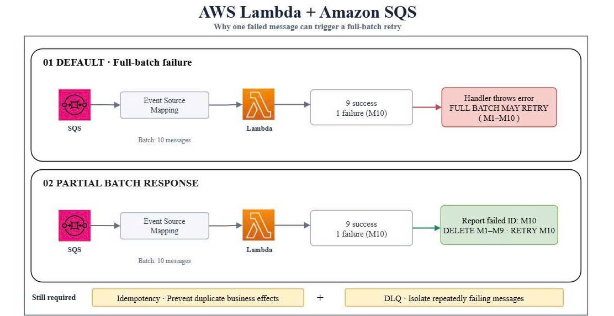

---
title: "AWS Lambda + SQS: Why Can One Failed Message Cause a Whole Batch Retry?"
date: 2026-10-31
weight: 1
chapter: false
pre: " <b> 3.1. </b> "
---

Suppose AWS Lambda receives a batch of **10 messages** from an Amazon SQS Standard queue to process orders:

- **9 messages** are processed successfully.
- **1 message** fails because its data is invalid.

You might expect Lambda to retry only the failed message. However, with the default behavior, **all 10 messages may be processed again**, including the 9 that already succeeded.

## 1. Why does this happen?

When Amazon SQS is connected to AWS Lambda, an **Event Source Mapping** polls messages from the queue and passes them to Lambda in batches.

By default, Lambda evaluates the outcome of the whole batch:

- If the function finishes successfully, the messages in the batch are deleted from SQS.
- If the function throws an unhandled error, the entire batch is treated as failed.
- After the **Visibility Timeout** expires, messages from the failed batch can become available for processing again.

A message that repeatedly causes failures is often called a **poison-pill message**.

The problem is that the failed message is not the only one retried. Successfully processed messages may also run again, causing unnecessary work and increasing the risk of duplicate data.

## 2. How can we reduce unnecessary retries?

AWS supports **Partial Batch Responses** through `ReportBatchItemFailures`, allowing a Lambda function to report exactly which messages failed.

Using the same example:

- **M1–M9:** Processed successfully → deleted from the queue.
- **M10:** Failed → remains available for retry.

Instead of retrying the entire batch, only the reported failed message needs another attempt.

However, **`ReportBatchItemFailures` must be enabled in the Event Source Mapping**, and the handler must return the correct list of failed messages. If the handler still throws an unhandled exception, the whole batch can be treated as failed.

## 3. Is a Partial Batch Response enough?

**Not completely.**

Amazon SQS Standard follows an **at-least-once delivery** model, so a message can still be delivered more than once.

Alongside Partial Batch Responses, an application should also consider:

- **Idempotency:** Processing the same request again should not cause unintended business effects.
- **Dead-Letter Queue (DLQ):** When configured, a separate queue can receive messages that repeatedly fail, so they can be investigated and handled.

## Key takeaway

**Partial Batch Responses** reduce unnecessary retries, while **Idempotency** protects data correctness when a message is processed more than once. These approaches complement each other rather than replace each other.

### Original Facebook post

[Read the original post on Facebook](https://www.facebook.com/share/p/1C8K1bvGzK/)

### References (AWS Official Documentation)

1. [Using Lambda with Amazon SQS](https://docs.aws.amazon.com/lambda/latest/dg/with-sqs.html)
2. [Handling errors for an SQS event source in Lambda](https://docs.aws.amazon.com/lambda/latest/dg/services-sqs-errorhandling.html)
3. [Benefits of using partial batch responses for Amazon SQS](https://docs.aws.amazon.com/prescriptive-guidance/latest/lambda-event-filtering-partial-batch-responses-for-sqs/benefits-partial-batch-responses.html)
