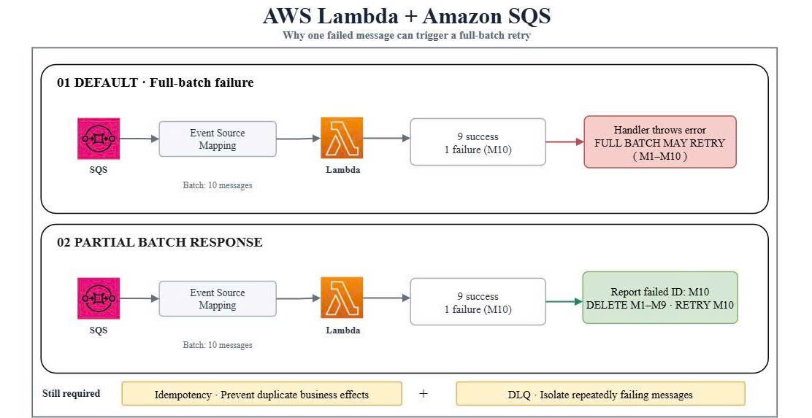

Giả sử AWS Lambda nhận một batch gồm **10 messages** từ Amazon SQS Standard để xử lý đơn hàng:

- **9 messages** được xử lý thành công.
- **1 message** bị lỗi do dữ liệu không hợp lệ.

Có thể bạn nghĩ Lambda chỉ cần xử lý lại message bị lỗi. Tuy nhiên, theo cơ chế mặc định, **cả 10 messages đều có thể được xử lý lại**, kể cả 9 messages đã thành công.

## 1. Tại sao lại như vậy?

Khi kết nối Amazon SQS với AWS Lambda, AWS sử dụng **Event Source Mapping** để lấy messages từ queue và chuyển đến Lambda theo từng batch.

Mặc định, kết quả được đánh giá cho cả batch:

- Nếu Lambda xử lý thành công và hoàn thành bình thường, các messages trong batch được xóa khỏi SQS.
- Nếu function gặp lỗi chưa được xử lý, toàn bộ batch bị xem là thất bại.
- Sau khi **Visibility Timeout** kết thúc, các messages trong batch thất bại có thể xuất hiện trở lại để được xử lý.

Message liên tục gây lỗi thường được gọi là **poison-pill message**.

Vấn đề là không chỉ message lỗi bị retry. Những messages đã xử lý thành công cũng có thể chạy lại, làm tăng số lần xử lý không cần thiết và nguy cơ tạo dữ liệu trùng.

## 2. Làm sao để hạn chế tình trạng này?

AWS cung cấp **Partial Batch Response** thông qua cấu hình `ReportBatchItemFailures`, cho phép Lambda báo cáo cụ thể những messages xử lý thất bại.

Quay lại ví dụ ban đầu:

- **M1–M9:** Xử lý thành công → được xóa khỏi queue.
- **M10:** Xử lý thất bại → được giữ lại để retry.

Như vậy, thay vì retry cả batch, chỉ message được báo lỗi tiếp tục được giữ lại để xử lý lại.

Tuy nhiên, cần **bật `ReportBatchItemFailures` trong Event Source Mapping** và để handler trả về đúng danh sách message thất bại. Nếu handler vẫn ném exception chưa được xử lý, cả batch có thể tiếp tục bị xem là thất bại.

## 3. Partial Batch Response đã đủ chưa?

**Chưa hoàn toàn.**

Amazon SQS Standard sử dụng cơ chế **at-least-once delivery**, nghĩa là một message vẫn có thể được gửi đến bên xử lý nhiều lần.

Vì vậy, ngoài Partial Batch Response, ứng dụng nên có thêm:

- **Idempotency:** Xử lý lại cùng một yêu cầu không tạo thêm tác động nghiệp vụ ngoài ý muốn.
- **Dead-Letter Queue (DLQ):** Khi được cấu hình, giúp chuyển những messages liên tục thất bại sang queue riêng để kiểm tra và xử lý.

## Điều cần nhớ

**Partial Batch Response** giúp giảm những lần retry không cần thiết, còn **Idempotency** giúp bảo vệ tính đúng đắn của dữ liệu khi message bị xử lý lại. Hai cơ chế bổ sung cho nhau, không thay thế nhau.

### Bài đăng gốc

[Đọc bài viết trên Facebook](https://www.facebook.com/share/p/1C8K1bvGzK/)

### Tài liệu tham khảo (AWS Official Documentation)

1. [Using Lambda with Amazon SQS](https://docs.aws.amazon.com/lambda/latest/dg/with-sqs.html)
2. [Handling errors for an SQS event source in Lambda](https://docs.aws.amazon.com/lambda/latest/dg/services-sqs-errorhandling.html)
3. [Benefits of using partial batch responses for Amazon SQS](https://docs.aws.amazon.com/prescriptive-guidance/latest/lambda-event-filtering-partial-batch-responses-for-sqs/benefits-partial-batch-responses.html)
