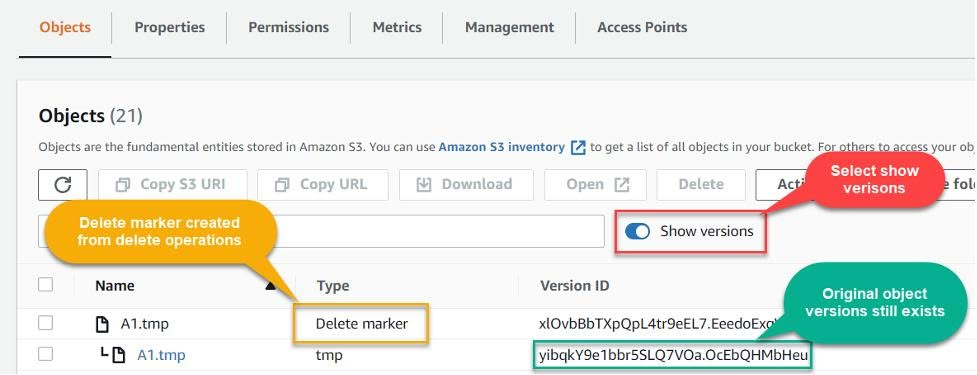

Suppose an **Amazon S3 bucket** has **Versioning enabled**, contains 100 objects (each with only one version), and uses a Lifecycle Rule to expire current versions after 7 days.

The developer expects old data to be deleted and storage costs to decrease.

However, after Lifecycle processes all 100 objects, the **Object Count can increase from 100 to 200**.

The original objects are no longer accessible through their keys in a normal request, but their data still exists and may continue to incur storage charges.

**Why does this happen?**

## 1. The reason is S3 Versioning

In a versioning-enabled bucket, when Lifecycle Expiration processes a current object version, Amazon S3 does not permanently delete the data.

Instead, S3 creates a **Delete Marker** as the new current version.

The previous data version becomes a **Noncurrent Version**.

For the original 100 objects:

- 100 Current Versions become 100 Noncurrent Versions.
- S3 creates 100 additional Delete Markers.
- The total Object Count increases from 100 to 200.

The Delete Markers prevent the objects from being returned through normal requests using their keys.

However, the **Noncurrent Versions are still stored** and may continue to incur storage charges.

**Note:** Doubling the Object Count does not mean storage costs will also double.

## 2. An important detail: The Lifecycle timeline

`Expiration` and `NoncurrentVersionExpiration` do not start counting time from the same point.

Suppose the configuration is:

- `Expiration = 7 days`
- `NoncurrentDays = 30`

Example timeline:

- **Day 0:** Upload the object.
- **Around Day 7:** The object becomes eligible for expiration. When Lifecycle processes it, S3 creates a Delete Marker and the previous version becomes noncurrent.
- **Around Day 37:** If the version became noncurrent on Day 7, it becomes eligible for permanent deletion after another 30 days, assuming no other retention conditions apply.

This means **the 30-day period starts when the version becomes noncurrent**, not when the object was originally uploaded.

These dates are illustrative because AWS uses Lifecycle time-rounding rules and processes actions asynchronously.

## 3. What should you check if storage usage does not decrease?

Instead of looking only at the **Total Object Count**, check the following:

- **Increasing Delete Markers:** Review Object Versions and S3 Storage Lens metrics such as `DeleteMarkerObjectCount` and `NonCurrentVersionStorageBytes` to identify old data that is still retained.
- **Noncurrent Storage not decreasing:** Check `NoncurrentVersionExpiration`, `NoncurrentDays`, and Lifecycle Rule filters. If `NewerNoncurrentVersions` is configured, both the age and version-count conditions must be satisfied.
- **Incomplete Multipart Uploads:** Check `IncompleteMultipartUploadStorageBytes` and consider using `AbortIncompleteMultipartUpload` to clean up unfinished uploads.
- **Storage costs not decreasing as expected:** Review Storage Classes, minimum storage duration charges, and AWS Billing information.

Also, if Noncurrent Versions have been permanently deleted but Delete Markers remain, review the **Expired Object Delete Marker** cleanup mechanism.

Another important detail is that Lifecycle actions are asynchronous. However, AWS applies the relevant billing changes when objects become eligible for expiration, even if physical deletion happens later. Noncurrent Versions that have not yet become eligible for expiration may still incur storage charges.

## 4. A practical example

Suppose a restaurant recommendation website uses Amazon S3 to store user-uploaded images.

When a user clicks **"Delete Image"**, the application may remove the image metadata or create a Delete Marker, while older image versions remain in S3.

Therefore, designing a data deletion feature requires considering:

- Data recovery requirements.
- Storage costs.
- Permanent deletion requirements.

## Key takeaway

**Lifecycle Expiration does not necessarily mean Permanent Deletion in a versioning-enabled S3 bucket.**

Do not check only whether an object has disappeared. Also review the stored object versions and make sure the Lifecycle configuration matches your data retention requirements.

### Original Facebook post

[Read the original post on Facebook](https://www.facebook.com/share/p/18Z3mD7KML/)

### References (AWS Official Documentation)

1. [Troubleshooting Amazon S3 Lifecycle issues](https://docs.aws.amazon.com/AmazonS3/latest/userguide/troubleshoot-lifecycle.html)
2. [Lifecycle configuration elements](https://docs.aws.amazon.com/AmazonS3/latest/userguide/intro-lifecycle-rules.html)
3. [Amazon S3 Storage Lens metrics glossary](https://docs.aws.amazon.com/AmazonS3/latest/userguide/storage_lens_metrics_glossary.html)
4. [Managing the lifecycle of objects](https://docs.aws.amazon.com/AmazonS3/latest/userguide/object-lifecycle-mgmt.html)
