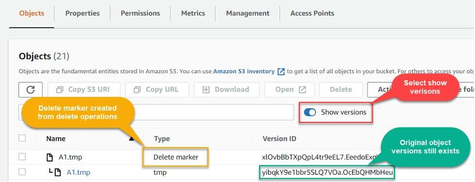

# AWS S3: Đã cấu hình Lifecycle để xóa dữ liệu, vì sao vẫn có thể bị tính phí lưu trữ?

Giả sử một **Amazon S3 bucket** đã bật **Versioning**, đang lưu 100 objects (mỗi object chỉ có một version) và có Lifecycle Rule tự động expire current versions sau 7 ngày.

Developer kỳ vọng dữ liệu cũ sẽ được xóa và chi phí lưu trữ giảm.

Tuy nhiên, sau khi Lifecycle xử lý đủ 100 objects, **Object Count có thể tăng từ 100 lên 200**.

Các objects cũ không còn truy cập được bằng key thông thường, nhưng dữ liệu vẫn tồn tại và có thể tiếp tục phát sinh phí.

**Tại sao lại như vậy?**

## 1. Nguyên nhân nằm ở S3 Versioning

Trong bucket đã bật Versioning, khi Lifecycle Expiration xử lý một current version, S3 không xóa vĩnh viễn dữ liệu mà tạo một **Delete Marker** làm current version mới.

Phiên bản dữ liệu trước đó trở thành **Noncurrent Version**.

Với 100 objects ban đầu:

- 100 Current Versions trở thành 100 Noncurrent Versions.
- S3 tạo thêm 100 Delete Markers.
- Tổng Object Count tăng từ 100 lên 200.

Delete Marker khiến object không còn được trả về khi truy cập bằng key thông thường.

Tuy nhiên, các **Noncurrent Versions vẫn được lưu trữ** và có thể tiếp tục phát sinh chi phí.

**Lưu ý:** Object Count tăng gấp đôi không có nghĩa chi phí lưu trữ cũng tăng gấp đôi.

## 2. Một điểm cần lưu ý: Timeline của Lifecycle

`Expiration` và `NoncurrentVersionExpiration` không bắt đầu tính thời gian từ cùng một thời điểm.

Giả sử cấu hình:

- `Expiration = 7 days`
- `NoncurrentDays = 30`

Timeline minh họa:

- **Ngày 0:** Upload object.
- **Khoảng ngày 7:** Object đủ điều kiện Expiration. Khi Lifecycle xử lý, S3 tạo Delete Marker và version cũ trở thành noncurrent.
- **Khoảng ngày 37:** Nếu version trở thành noncurrent vào ngày 7, nó mới đủ điều kiện xóa vĩnh viễn sau 30 ngày, giả sử không có điều kiện giữ lại khác.

Như vậy, **30 ngày được tính từ khi version trở thành noncurrent**, không phải từ ngày upload.

Các mốc trên chỉ mang tính minh họa vì AWS có quy tắc làm tròn thời gian Lifecycle và thực hiện xử lý bất đồng bộ.

## 3. Nếu dữ liệu chưa giảm, nên kiểm tra gì?

Thay vì chỉ nhìn **Total Object Count**, cần xem thêm:

- **Delete Markers tăng:** Kiểm tra Object Versions và các chỉ số như `DeleteMarkerObjectCount`, `NonCurrentVersionStorageBytes` trong S3 Storage Lens để xác định dữ liệu cũ còn được lưu giữ.
- **Noncurrent Storage không giảm:** Kiểm tra `NoncurrentVersionExpiration`, `NoncurrentDays` và các bộ lọc của Lifecycle Rule. Nếu có cấu hình `NewerNoncurrentVersions`, cả điều kiện thời gian và số phiên bản đều phải được đáp ứng.
- **Incomplete Multipart Uploads:** Kiểm tra `IncompleteMultipartUploadStorageBytes` và cân nhắc cấu hình `AbortIncompleteMultipartUpload` để dọn các upload chưa hoàn tất.
- **Chi phí chưa giảm tương ứng:** Xem lại Storage Class, minimum storage duration charges và thông tin trong AWS Billing.

Ngoài ra, khi các Noncurrent Versions đã được xóa nhưng Delete Markers vẫn còn, có thể kiểm tra cơ chế dọn **Expired Object Delete Markers**.

Một điểm quan trọng khác: Lifecycle xử lý bất đồng bộ, nhưng AWS áp dụng thay đổi về phí lưu trữ khi object đủ điều kiện expiration, ngay cả khi thao tác xóa thực tế diễn ra chậm hơn. Những Noncurrent Versions chưa đủ điều kiện xóa vẫn có thể tiếp tục bị tính phí.

## 4. Liên hệ với ứng dụng thực tế

Giả sử một website gợi ý quán ăn sử dụng Amazon S3 để lưu ảnh người dùng.

Khi người dùng nhấn **"Xóa ảnh"**, ứng dụng có thể đã xóa metadata hoặc tạo Delete Marker, nhưng các phiên bản ảnh cũ vẫn còn trên S3.

Vì vậy, khi thiết kế chức năng xóa dữ liệu, cần cân nhắc giữa:

- Khả năng khôi phục dữ liệu.
- Chi phí lưu trữ.
- Yêu cầu xóa vĩnh viễn.

## Điều cần nhớ

**Lifecycle Expiration không đồng nghĩa với Permanent Deletion trong bucket đã bật Versioning.**

Đừng chỉ kiểm tra object đã biến mất hay chưa. Hãy kiểm tra cả những phiên bản còn được lưu trữ và cấu hình Lifecycle phù hợp.

### Bài đăng gốc

[Đọc bài viết trên Facebook](https://www.facebook.com/share/p/18Z3mD7KML/)

### Tài liệu tham khảo (AWS Official Documentation)

1. [Troubleshooting Amazon S3 Lifecycle issues](https://docs.aws.amazon.com/AmazonS3/latest/userguide/troubleshoot-lifecycle.html)
2. [Lifecycle configuration elements](https://docs.aws.amazon.com/AmazonS3/latest/userguide/intro-lifecycle-rules.html)
3. [Amazon S3 Storage Lens metrics glossary](https://docs.aws.amazon.com/AmazonS3/latest/userguide/storage_lens_metrics_glossary.html)
4. [Managing the lifecycle of objects](https://docs.aws.amazon.com/AmazonS3/latest/userguide/object-lifecycle-mgmt.html)
