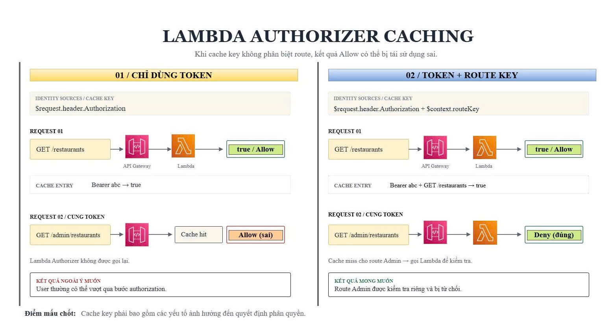

When an **Amazon API Gateway HTTP API** uses a **Lambda Authorizer** with Simple Responses and Authorizer Caching, a cache key based only on the Authorization token may allow an authorization result from one route to be reused for another.

This can result in unintended access to protected API routes.

Suppose an application uses Amazon API Gateway HTTP API with a Lambda Authorizer to control access.

The system has two routes:

- `GET /restaurants`: Accessible to regular users.
- `GET /admin/restaurants`: Accessible only to administrators.

Both routes share the same Lambda Authorizer, with **Simple Responses** and **Authorizer Caching** enabled.

The developer expects regular users to access `/restaurants` but be denied access to `/admin/restaurants`.

However, if caching is configured incorrectly, an Allow result from the first route may be reused for the second route without checking permissions again.



## 1. Why does this happen?

When Authorizer Caching is enabled, API Gateway uses **Identity Sources** to generate a cache key.

This key determines when a previously stored authorization result can be reused.

For example, suppose the only Identity Source is:

```text
$request.header.Authorization
```

Two requests using the same Authorization header will have the same cache key, even if they access different routes that share the authorizer.

### Step 1: A regular user accesses a public API route

A regular user sends:

```http
GET /restaurants
```

The Lambda Authorizer checks the token and route permissions.

Since the user is allowed to access this route, it returns:

```json
{
  "isAuthorized": true
}
```

API Gateway caches this result using the Authorization token.

### Step 2: The user accesses an Admin API route

While the cache TTL is still valid, the same user sends:

```http
GET /admin/restaurants
```

If the Lambda Authorizer were invoked again, it should return:

```json
{
  "isAuthorized": false
}
```

The user does not have administrator permissions.

However, because the second request uses the same Authorization token, API Gateway may find the previously cached `true` result.

Instead of invoking the Lambda Authorizer again, API Gateway reuses the cached Allow decision.

As a result, the request may pass API Gateway authorization even though the user does not have permission to access the Admin route.

**Root cause:** The cache key does not distinguish between routes, while a Simple Response returns a Boolean Allow/Deny decision without defining permissions for individual API resources.

This is an authorization configuration risk, not a default security vulnerability in AWS.

## 2. How can this be prevented?

### Solution 1 — Include the Route Key in the Cache Key

Instead of using only the Authorization token, configure the Identity Sources as:

```text
$request.header.Authorization
$context.routeKey
```

API Gateway will then generate a cache key based on both the token and the route key.

For example:

- `Token A + GET /restaurants` → Allow
- `Token A + GET /admin/restaurants` → Deny

This allows authorization results to be cached separately for each route, preventing an Allow result from one route from being incorrectly reused for another.

**Important:** `$context.routeKey` distinguishes API routes, but it does not distinguish individual resources within the same route.

For example:

```http
GET /orders/100
GET /orders/200
```

Both requests may match the same route:

```http
GET /orders/{id}
```

If authorization depends on the ownership of each order, adding `$context.routeKey` alone is not enough.

### Solution 2 — Use an IAM Policy Response

Instead of returning only a Boolean Allow/Deny result, a Lambda Authorizer can return an **IAM Policy**.

This allows the authorizer to define permissions for specific API resources and HTTP methods.

An IAM Policy provides more granular access control than a Simple Response.

However, using an IAM Policy does not automatically solve every caching problem.

The policy's resource scope and cache configuration must still match the application's authorization requirements.

### Solution 3 — Enforce Authorization in the Backend

API Gateway authorization should not always be the only security layer protecting application data.

For example, even if a user is allowed to call:

```http
GET /orders/{id}
```

That does not mean they should be able to access every order.

The backend must still verify whether the requested order belongs to the user or is otherwise accessible to them.

This is especially important for applications that require authorization at the individual resource level.

## 3. Practical lessons

When enabling Lambda Authorizer Caching, three factors deserve particular attention:

- **Cache Key:** Do the Identity Sources include the information that affects authorization decisions?
- **Authorization Response:** Is a Boolean Allow/Deny response suitable when different routes require different permissions?
- **Cache TTL:** If a user's permissions change, how long can a cached authorization result remain valid?

During testing, Authorizer Caching can be temporarily disabled by setting:

```text
authorizerResultTtlInSeconds = 0
```

This allows authorization behavior to be observed when the authorizer is invoked again for each request.

**Note:** This example focuses specifically on Lambda Authorizers for HTTP APIs with caching enabled, especially when using Simple Responses. It should not be confused with JWT Authorizer behavior.

## Conclusion

Authorizer Caching reduces Lambda Authorizer invocations, which can improve performance and reduce request latency.

However, when the cache key does not reflect the required authorization scope, an Allow result may be reused beyond its intended context.

**The key lesson is not simply to add `$context.routeKey`, but to design cache keys around the information that determines access permissions.**

A configuration that improves application performance can also introduce security risks if it is not designed and tested carefully.

### Original Facebook post

[Read the original post on Facebook](https://www.facebook.com/share/p/1BPEBPipns/)

### References (AWS Official Documentation)

1. [HTTP API Lambda Authorizers](https://docs.aws.amazon.com/apigateway/latest/developerguide/http-api-lambda-authorizer.html)
2. [Introducing IAM and Lambda Authorizers for Amazon API Gateway HTTP APIs](https://aws.amazon.com/blogs/compute/introducing-iam-and-lambda-authorizers-for-amazon-api-gateway-http-apis/)
