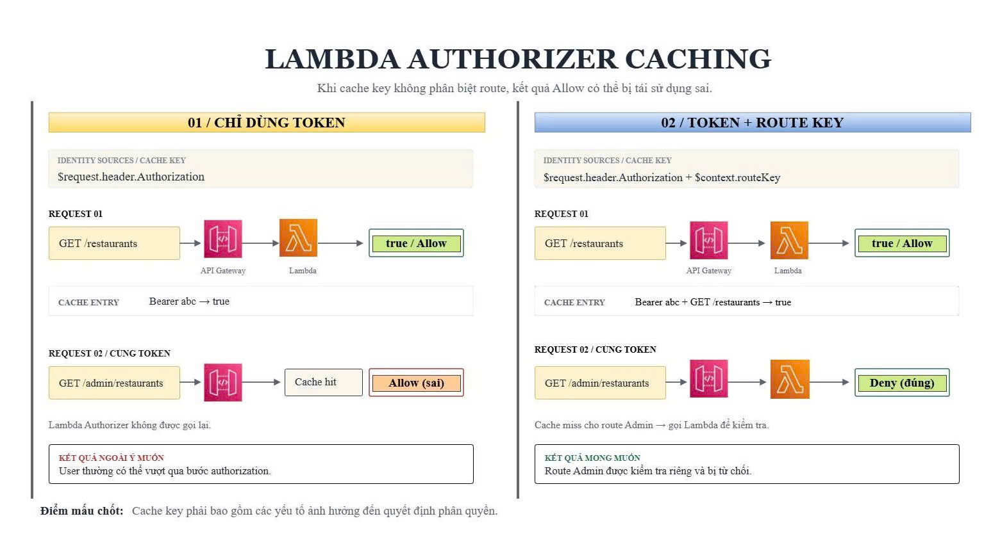

Khi **Amazon API Gateway HTTP API** sử dụng **Lambda Authorizer** với Simple Responses và Authorizer Caching, nếu cache key chỉ dựa trên Authorization token mà không phân biệt route, kết quả Allow của một API có thể được tái sử dụng cho API khác, dẫn đến truy cập ngoài quyền hạn.

Giả sử một ứng dụng sử dụng Amazon API Gateway HTTP API với Lambda Authorizer để kiểm tra quyền truy cập.

Hệ thống có hai routes:

- `GET /restaurants`: Người dùng thông thường được truy cập.
- `GET /admin/restaurants`: Chỉ quản trị viên được truy cập.

Cả hai routes sử dụng chung Lambda Authorizer, bật **Simple Responses** và **Authorizer Caching**.

Developer kỳ vọng user thông thường có thể truy cập `/restaurants` nhưng sẽ bị từ chối khi truy cập `/admin/restaurants`.

Tuy nhiên, nếu cấu hình cache không phù hợp, kết quả Allow của route đầu tiên có thể được tái sử dụng cho route thứ hai mà không thực hiện lại bước kiểm tra quyền.



## 1. Tại sao lại xảy ra?

Khi bật Authorizer Caching, API Gateway sử dụng các **Identity Sources** để tạo cache key, xác định khi nào một kết quả authorization đã lưu có thể được tái sử dụng.

Ví dụ, nếu chỉ cấu hình Identity Source:

```text
$request.header.Authorization
```

Hai requests có cùng Authorization header sẽ có cùng cache key, dù truy cập hai routes khác nhau dùng chung authorizer.

### Bước 1: User truy cập API thông thường

Một user thông thường gọi:

```http
GET /restaurants
```

Lambda Authorizer kiểm tra token và quyền truy cập theo route, xác định user được phép truy cập nên trả về Simple Response:

```json
{
  "isAuthorized": true
}
```

API Gateway lưu kết quả này vào cache theo Authorization token.

### Bước 2: User truy cập API dành cho Admin

Trong thời gian cache TTL còn hiệu lực, user tiếp tục gọi:

```http
GET /admin/restaurants
```

Nếu Lambda Authorizer được gọi để kiểm tra request này, kết quả phải là:

```json
{
  "isAuthorized": false
}
```

Vì user không có quyền Admin.

Tuy nhiên, do request thứ hai sử dụng cùng Authorization token, API Gateway có thể tìm thấy kết quả `true` đã được cache trước đó.

Thay vì gọi Lambda Authorizer để kiểm tra lại quyền đối với route Admin, API Gateway tái sử dụng kết quả Allow trong cache.

Kết quả là request có thể vượt qua bước authorization của API Gateway, dù user không có quyền truy cập route đó.

**Nguyên nhân cốt lõi:** Cache key không phân biệt routes, kết hợp với Simple Response chỉ trả về Boolean Allow/Deny mà không giới hạn quyền theo từng API resource.

Đây là rủi ro phát sinh từ cách cấu hình authorization, không phải lỗ hổng mặc định của AWS.

## 2. Làm sao để tránh?

### Cách 1 — Thêm Route Key vào Cache Key

Thay vì chỉ sử dụng Authorization token, có thể cấu hình Identity Sources gồm:

```text
$request.header.Authorization
$context.routeKey
```

Khi đó, API Gateway tạo cache key dựa trên cả token và route key.

Ví dụ:

- `Token A + GET /restaurants` → Allow
- `Token A + GET /admin/restaurants` → Deny

Nhờ vậy, kết quả authorization được cache riêng theo từng route, tránh việc sử dụng nhầm kết quả Allow giữa các routes khác nhau.

**Lưu ý:** `$context.routeKey` chỉ giúp phân biệt các routes, không phân biệt từng tài nguyên cụ thể.

Ví dụ:

```http
GET /orders/100
GET /orders/200
```

Cả hai có thể cùng thuộc route:

```http
GET /orders/{id}
```

Vì vậy, nếu quyền truy cập phụ thuộc vào từng đơn hàng, chỉ thêm `$context.routeKey` vẫn chưa đủ để đảm bảo phân quyền chính xác.

### Cách 2 — Sử dụng IAM Policy Response

Thay vì chỉ trả về Boolean Allow/Deny, Lambda Authorizer có thể trả về **IAM Policy** để xác định quyền truy cập theo API resources và HTTP methods.

Cách này cho phép kiểm soát phạm vi truy cập chi tiết hơn so với Simple Response.

Tuy nhiên, IAM Policy không tự động giải quyết mọi vấn đề liên quan đến caching. Phạm vi resources được phép truy cập và cách thiết kế cache vẫn phải phù hợp với yêu cầu phân quyền của hệ thống.

### Cách 3 — Kiểm tra quyền tại Backend

Authorization tại API Gateway không nên được xem là lớp bảo vệ duy nhất cho mọi loại dữ liệu.

Ví dụ, ngay cả khi user được phép gọi:

```http
GET /orders/{id}
```

Điều đó không có nghĩa họ được quyền xem tất cả đơn hàng.

Backend vẫn cần xác minh đơn hàng được yêu cầu có thuộc quyền truy cập của user hay không.

Đặc biệt với những hệ thống có phân quyền theo từng đối tượng dữ liệu, việc kiểm tra quyền ở cấp tài nguyên là rất quan trọng.

## 3. Bài học thực tế

Khi bật Lambda Authorizer Caching, có ba yếu tố cần đặc biệt chú ý:

- **Cache Key:** Identity Sources có phản ánh đúng các yếu tố ảnh hưởng đến quyết định phân quyền hay không?
- **Authorization Response:** Boolean Allow/Deny có phù hợp khi nhiều routes yêu cầu các quyền truy cập khác nhau không?
- **Cache TTL:** Nếu quyền của user thay đổi, kết quả authorization cũ có thể tiếp tục được sử dụng trong bao lâu?

Trong quá trình kiểm thử, có thể tạm thời tắt Authorizer Caching bằng cách đặt:

```text
authorizerResultTtlInSeconds = 0
```

Cách này giúp quan sát hành vi authorization khi mỗi request được kiểm tra lại.

**Lưu ý:** Tình huống trong bài tập trung vào Lambda Authorizer của HTTP API khi bật caching, đặc biệt với Simple Responses. Không nên đánh đồng cơ chế này với JWT Authorizer.

## Kết luận

Authorizer Caching giúp giảm số lần gọi Lambda Authorizer, từ đó cải thiện hiệu năng và giảm độ trễ khi xử lý request.

Tuy nhiên, nếu cache key không phản ánh đúng phạm vi phân quyền, kết quả Allow của một request có thể được tái sử dụng ngoài phạm vi dự kiến.

**Bài học quan trọng không chỉ là thêm `$context.routeKey`, mà là phải thiết kế cache key phù hợp với các yếu tố quyết định quyền truy cập.**

Một cấu hình giúp hệ thống hoạt động nhanh hơn cũng có thể trở thành rủi ro bảo mật nếu không được thiết kế và kiểm thử cẩn thận.

### Bài đăng gốc

[Đọc bài viết trên Facebook](https://www.facebook.com/share/p/1BPEBPipns/)

### Tài liệu tham khảo (AWS Official Documentation)

1. [HTTP API Lambda Authorizers](https://docs.aws.amazon.com/apigateway/latest/developerguide/http-api-lambda-authorizer.html)
2. [Introducing IAM and Lambda Authorizers for Amazon API Gateway HTTP APIs](https://aws.amazon.com/blogs/compute/introducing-iam-and-lambda-authorizers-for-amazon-api-gateway-http-apis/)
