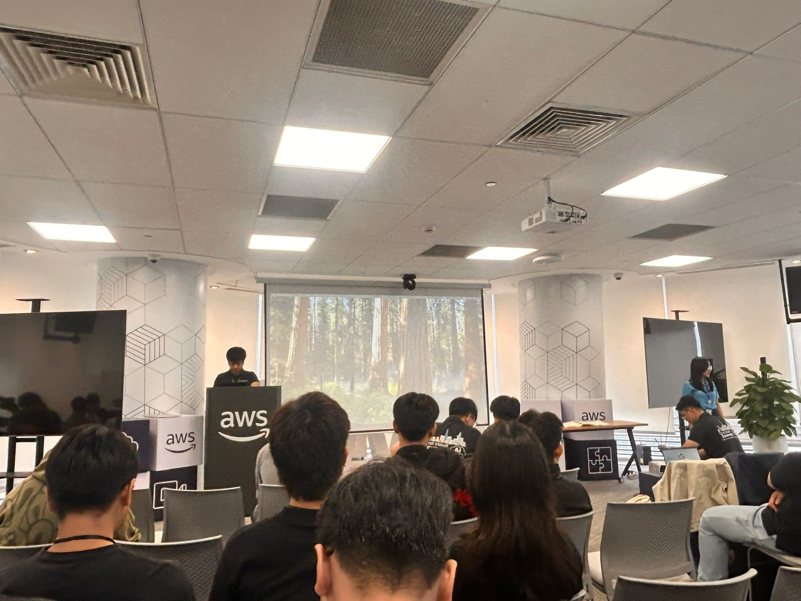
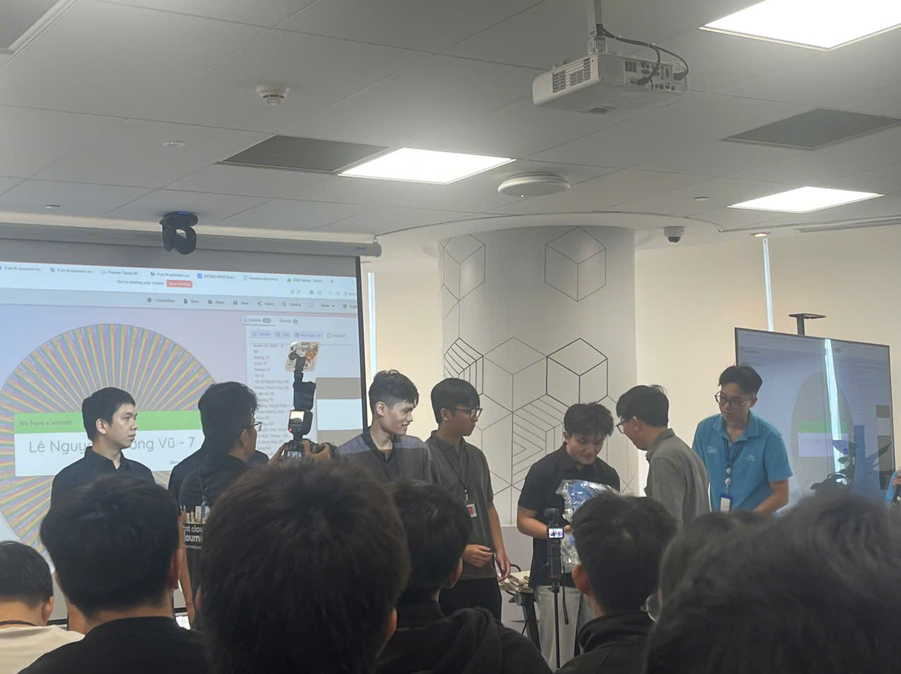
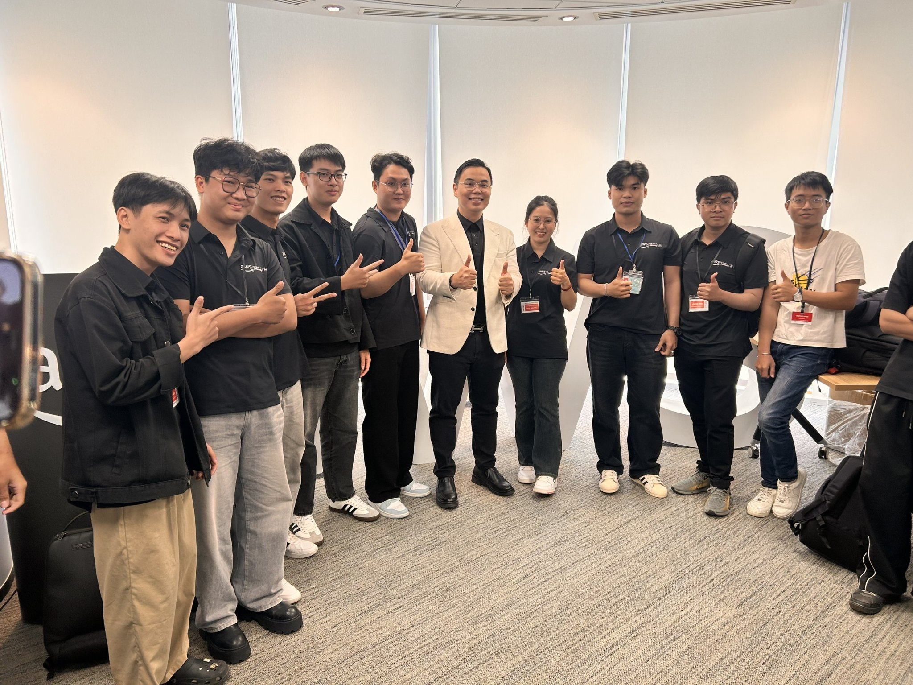

### Event Introduction

On **September 26, 2026**, I followed the **FCAJ Buildrathon Kickoff**, an event organized as part of the First Cloud AI Journey program at the AWS office in Ho Chi Minh City.

The event covered several main topics:

- Introduction to the First Cloud AI Journey (FCAJ) program.
- Official kickoff of the Buildrathon.
- Introduction and networking activities with CMC Global.
- A presentation by Mr. Truong about a chatbot project designed to support workplace communication.
- An overview of the Market Slack Bot architecture.

Through the presentations, I had the opportunity to learn more about the FCAJ program and understand how an AI application can be developed to solve real-world workplace problems.

### 1. Introduction to First Cloud AI Journey

The event began with an overview of the **First Cloud AI Journey (FCAJ)** program.

The presentation introduced the program's objectives, participation process, and upcoming activities.

This session helped me better understand the learning journey and the project development activities planned for the Buildrathon.

### 2. Buildrathon Kickoff

The next session marked the official launch of the **Buildrathon**.

The organizers introduced the Buildrathon program and explained how participating teams would work on their projects.

This session gave me a clearer understanding of the Buildrathon's direction, particularly how participants could apply their technical knowledge to develop solutions for practical problems.

### 3. Introduction and Networking with CMC Global

Another part of the kickoff featured an introduction from **CMC Global**.

Representatives from the company shared information about their organization and participated in networking activities with members of the program.

The event also included a gift-giving activity, which contributed to a friendly and engaging atmosphere.

Through this session, I learned more about CMC Global and how technology companies can connect with students and technology communities.

### 4. Mr. Truong's Presentation on a Chatbot Project

One of the sessions I found most interesting was Mr. Truong's presentation about a chatbot project developed to support communication between different teams.

According to the situation presented, the project involved two teams working in different locations:

- **Business Analysts (BA):** Working overseas.
- **Engineers:** Working in Vietnam.

Because the teams were geographically separated, exchanging requirements, updating information, and resolving issues could sometimes become challenging.

To address these difficulties, the development team created a **Triage Bot** to help receive, classify, and process information exchanged between the teams.

What interested me most was that the chatbot was developed to solve a specific workplace problem rather than simply demonstrate AI technology.

### 5. Triage Bot and Defining AI Responsibilities

The **Triage Bot** was introduced as a tool designed to support information processing and communication between teams.

During the demonstration, I learned how the development team defined the bot's behavior and operational boundaries through a file called `SOUL.md`.

Some of the components described in the file included:

- **Identity:** Defines the bot's identity and role.
- **Expertise:** Describes the areas of knowledge the bot should have.
- **Tone & Style:** Specifies how the bot communicates and responds.
- **Skills Used:** Identifies the skills or tools available to the bot.
- **Domain-specific Protocols:** Defines rules for handling tasks within a particular domain.
- **Anti-patterns:** Describes behaviors or approaches the bot should avoid.
- **Out of Scope:** Specifies tasks that fall outside the bot's responsibilities.

An interesting point was that the bot was not designed to answer every possible request.

Instead, the development team clearly defined its responsibilities, the tasks it could perform, and situations in which it should not respond.

From this session, I learned that building a chatbot involves more than selecting an AI model. Defining its **role, scope, operating rules, and response behavior** is equally important for ensuring that the system meets user needs.

### 6. Market Slack Bot Architecture

During the presentation, I was introduced to the overall architecture of the **Market Slack Bot**.

The main processing flow was illustrated as follows:

**Slack → Socket Mode → Response Gate → Claude Code**

In addition to this main flow, the system included several supporting components:

- `SOUL.md`
- Memory
- `bot-schedule`
- Internal API
- Cron and Database

#### Socket Mode

Socket Mode uses a WebSocket connection to allow an application to receive events and interact with Slack.

#### Response Gate

The Response Gate is positioned before the bot's main processing component.

Based on my understanding of the presentation, this component helps determine when the bot should respond instead of processing and replying to every message in the system.

#### SOUL.md

The `SOUL.md` file defines the bot's role, communication style, operational rules, and boundaries.

#### Memory

Memory helps retain the context of previous conversations.

This allows the bot to refer to earlier messages within a conversation thread rather than treating every request as completely independent.

#### Bot Schedule

The `bot-schedule` component supports activities and tasks scheduled to run at specific times.

#### Internal API

The Internal API supports communication and the execution of certain internal application tasks.

#### Cron and Database

Cron and Database support data storage, information management, and scheduled operations.

Through this architecture, I realized that a chatbot used in a real working environment requires multiple components working together. It is not simply a system that sends requests to an AI model and returns the generated responses.

### 7. Choosing Components When Designing a System

One statement from the presentation caught my attention:

> "Each piece answered a question I actually faced."

From my perspective, this means that each component of a system should be introduced to solve a specific problem encountered during development.

In the Market Slack Bot architecture, different components serve different purposes:

- **Slack:** Provides the communication platform where users submit requests.
- **Socket Mode:** Establishes the connection with Slack.
- **Response Gate:** Controls when the bot should respond.
- **SOUL.md:** Defines the bot's role and operational boundaries.
- **Memory:** Maintains conversation context.
- **Internal API:** Supports internal task processing.
- **Cron and Database:** Handle data storage and scheduled tasks.

The main lesson I learned is that developers should not add technologies to a system simply because they are popular.

Instead, they should first understand the problem and then select the components that can solve it effectively.

### 8. Understanding a Real-World AI Application

The Triage Bot demonstration gave me a broader perspective on how an AI application is structured.

Previously, when thinking about chatbots, I mainly focused on the AI model and the API used to send requests.

However, the presentation helped me realize that a practical AI system also requires several supporting elements:

- Clearly defined responsibilities and scope.
- Conversation context management.
- Memory for retaining information.
- APIs for connecting different components.
- Databases for storing data.
- Scheduling mechanisms for automated tasks.
- Rules for controlling system responses.

These components help an AI application operate more effectively within the actual workflow of its users.

### 9. Networking and Knowledge Sharing

Besides the technical presentations, the kickoff included introduction and networking activities within the First Cloud AI Journey community.

The session featuring CMC Global and the real-world chatbot project provided additional insights into software development environments and how teams with different responsibilities collaborate.

In particular, the example of Business Analysts working overseas and Engineers working in Vietnam highlighted the importance of clear communication during software development.

### 10. Key Takeaways

After following the event, I summarized several important lessons:

- Gained a better understanding of the FCAJ program and Buildrathon activities.
- Learned more about CMC Global and the networking opportunities offered by the program.
- Gained insights into how different teams collaborate during project development.
- Understood some of the communication challenges between Business Analysts and Engineers working in different locations.
- Learned how a Triage Bot can support information processing and classification.
- Understood the role of `SOUL.md` in defining chatbot behavior.
- Recognized the importance of Memory and Context in conversations.
- Became familiar with the basic architecture of a Slack-integrated bot.
- Realized that an AI application requires multiple supporting components beyond the AI model itself.

### 11. Lessons Learned

The most memorable part of the kickoff for me was the presentation about the **Triage Bot and Market Slack Bot architecture**.

Starting from a communication challenge between Business Analysts and Engineers, the development team created a chatbot to support information exchange and task processing.

This example helped me understand that developing an AI application should begin with identifying a real problem, followed by selecting an appropriate model and system architecture.

I also learned that practical AI systems often involve multiple components, including AI Models, Memory, APIs, Databases, Context Management, and mechanisms for controlling responses.

These concepts will be useful as I continue exploring system design and AI application development in the future.

### 12. Event Photos

Below are some photos related to the FCAJ Buildrathon Kickoff.

#### Kickoff Event Overview

*An overview of the event and its activities.*

#### Project Introduction and Demonstration

*A photo related to the project presentation and demonstration.*

#### FCAJ Buildrathon Kickoff

*A presentation introducing the Buildrathon activities.*

#### Closing Session

*A photo from the final part of the kickoff event.*

### Conclusion

The **FCAJ Buildrathon Kickoff on September 26, 2026**, helped me gain a clearer understanding of the First Cloud AI Journey program and the objectives of the Buildrathon.

Among the topics presented, the session about the **Triage Bot and Market Slack Bot architecture** left the strongest impression on me.

Through this example, I learned that an AI application requires more than an artificial intelligence model. It also needs supporting components and processing mechanisms designed around real-world requirements.

The knowledge gained from this event provides a useful foundation for further learning about system design and AI application development.