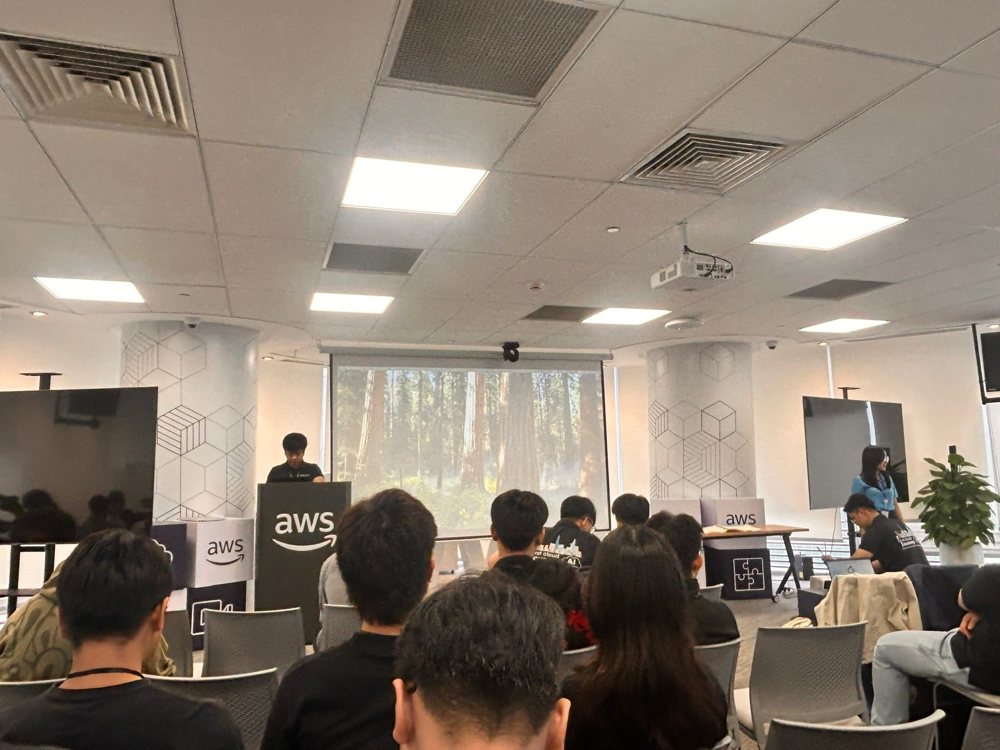
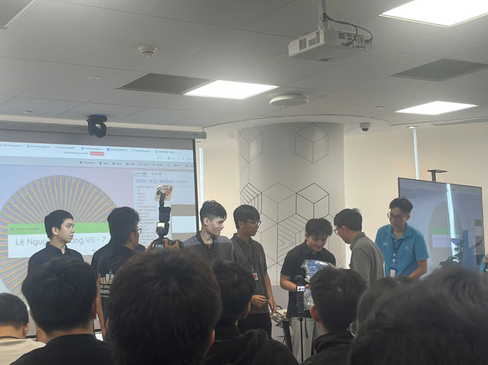
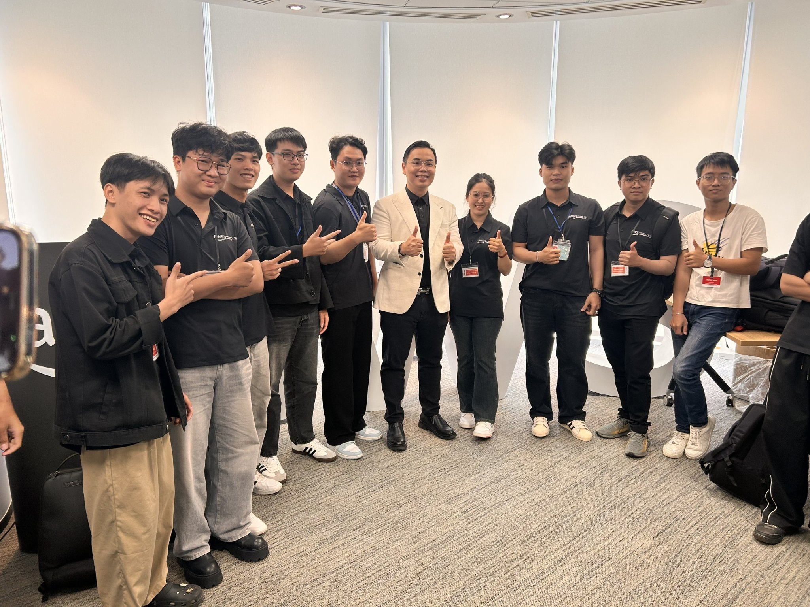

### Giới thiệu sự kiện

Ngày **26/09/2026**, tôi theo dõi buổi **FCAJ Buildrathon Kickoff** thuộc chương trình First Cloud AI Journey, được tổ chức tại văn phòng AWS ở TP.HCM.

Buổi sự kiện gồm những nội dung chính:

- Giới thiệu chương trình First Cloud AI Journey (FCAJ).
- Khởi động hoạt động Buildrathon.
- Giới thiệu và giao lưu cùng CMC Global.
- Chia sẻ của anh Trường về dự án chatbot hỗ trợ công việc.
- Giới thiệu kiến trúc của Market Slack Bot.

Thông qua các phần trình bày, tôi có cơ hội tìm hiểu thêm về chương trình FCAJ và cách một ứng dụng AI được xây dựng để giải quyết những vấn đề trong công việc thực tế.

### 1. Giới thiệu về First Cloud AI Journey

Phần đầu tiên của sự kiện tập trung giới thiệu tổng quan về chương trình **First Cloud AI Journey (FCAJ)**.

Nội dung trình bày giúp các thành viên hiểu rõ hơn về mục tiêu chương trình, cách thức tham gia cũng như những hoạt động dự kiến trong thời gian tới.

Qua phần này, tôi có cái nhìn rõ ràng hơn về lộ trình học tập và hoạt động phát triển dự án trong Buildrathon.

### 2. Kickoff Buildrathon

Tiếp theo là phần khởi động chính thức của **Buildrathon**.

Ban tổ chức giới thiệu về hoạt động Buildrathon và cách các nhóm sẽ tham gia phát triển dự án trong khuôn khổ chương trình.

Phần này giúp tôi hiểu thêm về định hướng của Buildrathon, đặc biệt là việc vận dụng kiến thức đã học để xây dựng những sản phẩm giải quyết bài toán thực tế.

### 3. Giới thiệu và giao lưu cùng CMC Global

Một nội dung khác trong buổi kickoff là phần giới thiệu từ **CMC Global**.

Đại diện công ty chia sẻ một số thông tin về đơn vị và tham gia các hoạt động giao lưu với thành viên của chương trình.

Buổi sự kiện cũng có phần tặng quà dành cho người tham gia, góp phần tạo không khí gần gũi và sôi nổi.

Thông qua phần này, tôi biết thêm về CMC Global và những hoạt động kết nối giữa doanh nghiệp với cộng đồng học tập công nghệ.

### 4. Chia sẻ của anh Trường về dự án chatbot

Một trong những nội dung tôi quan tâm nhất là phần anh Trường giới thiệu về một dự án chatbot được xây dựng để hỗ trợ quá trình làm việc giữa các nhóm.

Theo tình huống được chia sẻ, dự án có hai nhóm làm việc tại những địa điểm khác nhau:

- **Business Analyst (BA):** Làm việc ở nước ngoài.
- **Engineer:** Làm việc tại Việt Nam.

Do khoảng cách địa lý và sự khác biệt trong cách phối hợp, quá trình trao đổi yêu cầu, cập nhật thông tin và xử lý vấn đề có thể gặp những khó khăn nhất định.

Từ nhu cầu thực tế đó, nhóm phát triển đã xây dựng một **Triage Bot** nhằm hỗ trợ tiếp nhận, phân loại và xử lý thông tin trao đổi giữa các bên.

Điều khiến tôi chú ý là chatbot được xây dựng từ một vấn đề cụ thể trong quy trình làm việc, thay vì chỉ nhằm mục đích thử nghiệm công nghệ AI.

### 5. Triage Bot và cách định nghĩa vai trò của AI

**Triage Bot** được giới thiệu như một công cụ hỗ trợ xử lý thông tin trong quá trình trao đổi giữa các nhóm.

Trong phần demo, tôi được xem cách nhóm phát triển định nghĩa hành vi và phạm vi hoạt động của bot thông qua file `SOUL.md`.

Một số thành phần được đề cập trong file gồm:

- **Identity:** Xác định danh tính và vai trò của bot.
- **Expertise:** Mô tả chuyên môn mà bot cần có.
- **Tone & Style:** Quy định cách thức giao tiếp và phản hồi.
- **Skills Used:** Xác định các kỹ năng hoặc công cụ được sử dụng.
- **Domain-specific Protocols:** Quy tắc xử lý trong lĩnh vực cụ thể.
- **Anti-patterns:** Những hành vi hoặc cách xử lý cần tránh.
- **Out of Scope:** Các nhiệm vụ nằm ngoài phạm vi hoạt động.

Điểm tôi thấy thú vị là bot không được thiết kế để trả lời tất cả mọi yêu cầu.

Thay vào đó, nhóm phát triển xác định rõ bot có nhiệm vụ gì, được phép thực hiện những công việc nào và khi nào không nên đưa ra phản hồi.

Qua phần này, tôi hiểu rằng việc xây dựng một chatbot không chỉ phụ thuộc vào AI model. Việc định nghĩa **vai trò, phạm vi, quy tắc hoạt động và cách phản hồi** cũng rất quan trọng để hệ thống đáp ứng đúng nhu cầu sử dụng.

### 6. Kiến trúc của Market Slack Bot

Trong phần trình bày, tôi được giới thiệu kiến trúc tổng quan của **Market Slack Bot**.

Luồng xử lý chính được minh họa như sau:

**Slack → Socket Mode → Response Gate → Claude Code**

Bên cạnh luồng chính, hệ thống còn có những thành phần hỗ trợ như:

- `SOUL.md`
- Memory
- `bot-schedule`
- Internal API
- Cron và Database

#### Socket Mode

Socket Mode sử dụng kết nối WebSocket để ứng dụng có thể nhận các sự kiện và tương tác với Slack.

#### Response Gate

Response Gate nằm trước phần xử lý của bot.

Theo cách tôi hiểu từ phần trình bày, thành phần này giúp kiểm soát những trường hợp bot cần phản hồi, thay vì xử lý và trả lời mọi tin nhắn xuất hiện trong hệ thống.

#### SOUL.md

File `SOUL.md` được sử dụng để xác định vai trò, cách giao tiếp, các quy tắc và phạm vi hoạt động của bot.

#### Memory

Memory hỗ trợ lưu giữ ngữ cảnh của những cuộc trao đổi.

Nhờ đó, bot có thể tham khảo thông tin từ các tin nhắn trước trong cùng một luồng hội thoại, thay vì xem mỗi yêu cầu là một nội dung hoàn toàn độc lập.

#### Bot Schedule

Thành phần `bot-schedule` hỗ trợ các hoạt động hoặc công việc được lên lịch trước.

#### Internal API

Internal API phục vụ quá trình trao đổi và xử lý một số tác vụ bên trong ứng dụng.

#### Cron và Database

Cron và Database hỗ trợ lưu trữ thông tin, quản lý dữ liệu cần thiết và thực hiện các công việc theo lịch.

Qua phần kiến trúc, tôi thấy rằng một chatbot hoạt động trong môi trường thực tế cần có nhiều thành phần phối hợp, không chỉ đơn giản là gửi yêu cầu đến AI model rồi nhận kết quả.

### 7. Cách lựa chọn thành phần khi thiết kế hệ thống

Trong phần trình bày có một câu khiến tôi chú ý:

> "Each piece answered a question I actually faced."

Theo cách tôi hiểu, mỗi thành phần của hệ thống nên xuất hiện để giải quyết một vấn đề cụ thể mà nhóm phát triển gặp phải.

Đối với kiến trúc Market Slack Bot, các thành phần có những vai trò khác nhau:

- **Slack:** Nơi người dùng trao đổi và gửi yêu cầu.
- **Socket Mode:** Hỗ trợ kết nối với Slack.
- **Response Gate:** Kiểm soát thời điểm bot cần phản hồi.
- **SOUL.md:** Xác định vai trò và giới hạn hoạt động.
- **Memory:** Lưu giữ ngữ cảnh hội thoại.
- **Internal API:** Hỗ trợ xử lý những tác vụ nội bộ.
- **Cron và Database:** Phục vụ lưu trữ và thực hiện công việc theo lịch.

Bài học tôi rút ra là không nên bổ sung công nghệ vào hệ thống chỉ vì công nghệ đó phổ biến. Trước tiên cần hiểu vấn đề, sau đó mới lựa chọn thành phần phù hợp để giải quyết.

### 8. Góc nhìn về một ứng dụng AI thực tế

Phần giới thiệu Triage Bot giúp tôi có thêm góc nhìn về cách một ứng dụng AI được tổ chức.

Trước đây, khi nghĩ đến chatbot, tôi thường tập trung vào AI model và API dùng để gửi yêu cầu.

Tuy nhiên, thông qua phần chia sẻ, tôi nhận thấy hệ thống thực tế còn cần nhiều yếu tố khác như:

- Phạm vi và nhiệm vụ của bot.
- Quản lý ngữ cảnh hội thoại.
- Memory để lưu giữ thông tin.
- API kết nối các thành phần.
- Database phục vụ lưu trữ.
- Cơ chế thực hiện tác vụ theo lịch.
- Quy tắc kiểm soát phản hồi.

Những thành phần này giúp ứng dụng AI hoạt động phù hợp hơn với quy trình làm việc của người sử dụng.

### 9. Hoạt động kết nối và chia sẻ tại sự kiện

Bên cạnh những nội dung kỹ thuật, buổi kickoff còn có các hoạt động giới thiệu và kết nối trong cộng đồng First Cloud AI Journey.

Phần chia sẻ từ CMC Global và ví dụ thực tế về dự án chatbot giúp tôi có thêm góc nhìn về môi trường phát triển phần mềm và cách những nhóm có trách nhiệm khác nhau phối hợp để giải quyết công việc.

Đặc biệt, tình huống BA làm việc ở nước ngoài và Engineer làm việc tại Việt Nam cho thấy tầm quan trọng của việc trao đổi thông tin rõ ràng trong quá trình phát triển sản phẩm.

### 10. Những kiến thức học được

Sau khi theo dõi sự kiện, tôi tổng hợp được một số nội dung đáng chú ý:

- Hiểu rõ hơn về mục tiêu của FCAJ và hoạt động Buildrathon.
- Biết thêm về CMC Global và các hoạt động giao lưu trong chương trình.
- Có thêm góc nhìn về cách các nhóm phối hợp khi phát triển dự án.
- Hiểu được một số khó khăn trong việc trao đổi giữa BA và Engineer làm việc ở những địa điểm khác nhau.
- Biết cách Triage Bot được sử dụng để hỗ trợ xử lý và phân loại thông tin.
- Hiểu thêm vai trò của `SOUL.md` trong việc định nghĩa hành vi của chatbot.
- Nhận biết tầm quan trọng của Memory và Context đối với những cuộc hội thoại.
- Tìm hiểu được kiến trúc cơ bản của một bot tích hợp với Slack.
- Nhận ra rằng một AI application cần nhiều thành phần hỗ trợ bên cạnh AI model.

### 11. Bài học rút ra

Nội dung tôi nhớ nhất sau buổi kickoff là phần chia sẻ về **Triage Bot và kiến trúc Market Slack Bot**.

Từ một khó khăn trong quá trình làm việc giữa BA và Engineer, nhóm phát triển đã xây dựng giải pháp chatbot để hỗ trợ trao đổi và xử lý thông tin.

Qua đó, tôi nhận thấy việc phát triển một ứng dụng AI nên bắt đầu bằng cách xác định vấn đề thực tế, sau đó lựa chọn mô hình và kiến trúc phù hợp.

Tôi cũng hiểu thêm rằng một hệ thống AI cần có sự kết hợp giữa nhiều thành phần như Model, Memory, API, Database, Context và cơ chế kiểm soát phản hồi.

Đây là những kiến thức hữu ích để tôi tham khảo khi tiếp tục tìm hiểu và xây dựng các ứng dụng AI trong tương lai.

### 12. Một số hình ảnh của sự kiện

Dưới đây là những hình ảnh tư liệu liên quan đến buổi FCAJ Buildrathon Kickoff.

#### Không gian buổi kickoff

*Hình ảnh ghi lại không gian và hoạt động trong buổi kickoff.*

#### Phần giới thiệu và demo dự án

*Hình ảnh tư liệu liên quan đến phần chia sẻ và minh họa dự án.*

#### FCAJ Buildrathon Kickoff

*Hình ảnh giới thiệu hoạt động Buildrathon trong chương trình.*

#### Kết thúc buổi sự kiện

*Hình ảnh tư liệu phần cuối buổi kickoff.*

### Tổng kết

Buổi **FCAJ Buildrathon Kickoff ngày 26/09/2026** giúp tôi hiểu rõ hơn về chương trình First Cloud AI Journey và định hướng hoạt động Buildrathon.

Trong các nội dung được trình bày, phần giới thiệu về **Triage Bot và kiến trúc Market Slack Bot** để lại cho tôi nhiều ấn tượng nhất.

Thông qua ví dụ này, tôi hiểu thêm rằng một ứng dụng AI không chỉ cần mô hình trí tuệ nhân tạo mà còn phải có các thành phần hỗ trợ và cơ chế xử lý phù hợp với nhu cầu thực tế.

Những kiến thức từ buổi chia sẻ là cơ sở để tôi tiếp tục tìm hiểu về thiết kế hệ thống và phát triển ứng dụng AI trong quá trình học tập.