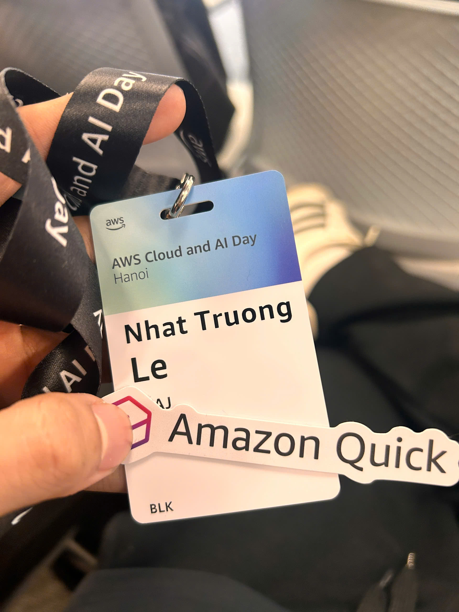
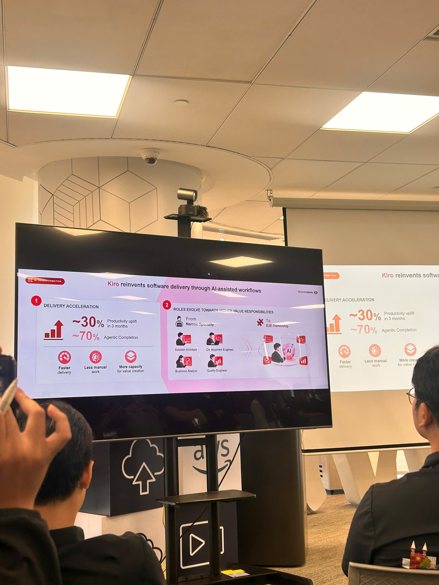
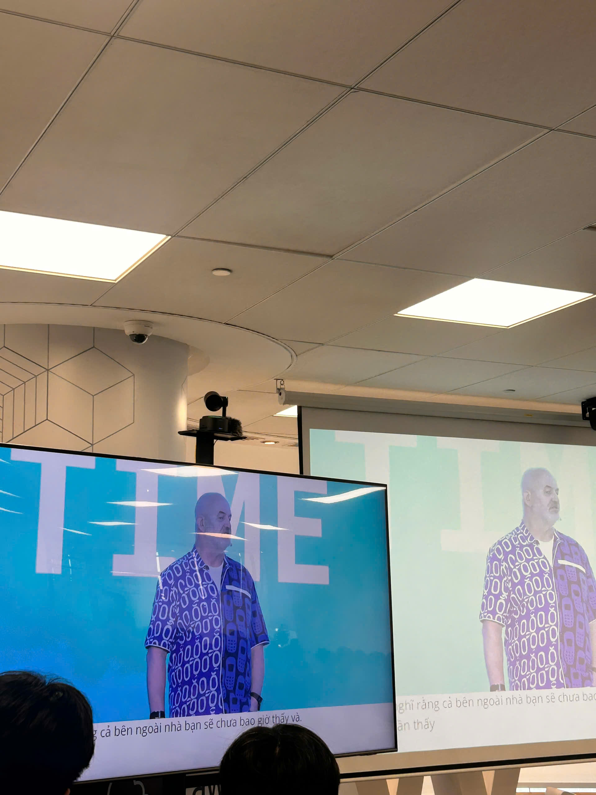
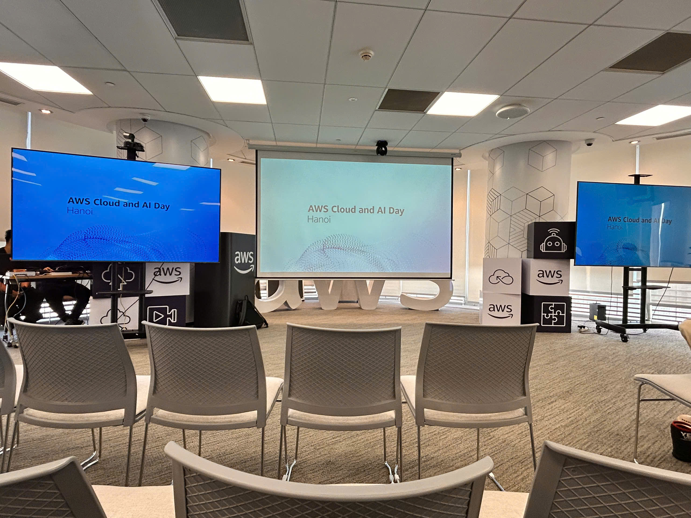
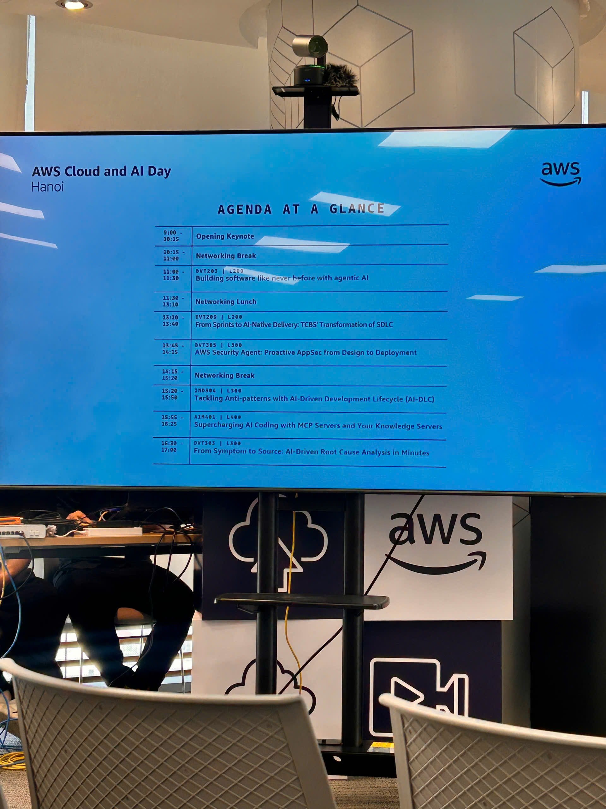

### Event Introduction

On **September 29, 2026**, I attended a **viewing party in Ho Chi Minh City** to follow **AWS Cloud and AI Day Hanoi**, which was held in Hanoi.

The event covered topics related to cloud computing, artificial intelligence, and the use of technology in software development.

At that time, I had just started learning AWS, so many concepts were still unfamiliar to me. Following the event gave me an opportunity to explore new topics and understand more about how Cloud and AI are used in real-world applications.

### Event Information

- **Event Name:** AWS Cloud and AI Day Hanoi.
- **Date:** September 29, 2026.
- **Main Location:** Hanoi, Vietnam.
- **My Location:** Ho Chi Minh City.
- **Format:** Attending a viewing party and watching the event presentations.

### Topics Explored

#### 1. Cloud Architecture and System Scalability

One topic I was interested in was how to build systems that can continue working well as the number of users increases.

When I first started learning AWS, I usually studied each service separately and tried to remember its purpose. However, building a complete application requires different services to work together.

Through the discussions about distributed systems and data processing, I learned that managing resources and maintaining performance become more challenging as traffic grows.

I also realized that scalability is not simply about adding more servers. It also depends on how the system is organized and how responsibilities are divided between components.

This is something I would like to understand better as I continue studying AWS.

#### 2. AI Agents and AI Application Development

AI Agents were another topic that caught my attention during the event.

Previously, I mainly used AI to ask questions, search for information, or understand difficult concepts. Because of that, I was curious about how AI could be included in applications to support more tasks.

From the topics I explored, I learned that AI can work with data and other tools to help process specific user requests.

However, I think one important point is that AI-generated results still need to be checked. AI may sometimes provide incorrect answers or results that do not match what users need.

Therefore, when developing an AI application, it is important to consider the input data, output results, and how the system handles unexpected situations.

#### 3. Software Development with AI Support

Besides AI applications for users, I was also interested in how AI can support programmers.

AI tools can help explain source code, suggest solutions to errors, and make unfamiliar programming concepts easier to understand.

I find these tools useful because, as a student, I sometimes spend a lot of time trying to understand why a program does not work as expected.

However, using AI does not mean that testing can be skipped. Suggested code still needs to be reviewed and tested before being used in a project.

My main takeaway was that AI should support the learning and development process, but developers still need to understand what they are building.

#### 4. Cloud Security and System Operations

Another area I paid attention to was security and application management in the Cloud.

When a website is deployed to the Internet, developers need to think about more than whether its features work. Protecting data and managing user access are also important.

Applications also need monitoring so that problems can be detected when errors occur or resource usage becomes too high.

Before joining the program, I often thought that getting a website to run meant most of the work was finished. After learning more about Cloud, I realized that operating and maintaining an application are also important.

Although I did not have much practical experience with AWS security at that time, I understood that these topics would be necessary when deploying applications for real users.

#### 5. AWS and AI Applications in Business

The event also gave me a broader view of how Cloud and AI can support business activities.

Cloud services provide infrastructure for storing data, running applications, and managing resources. AI can support information processing and reduce some repetitive tasks.

I was interested in how these technologies could work together in a real application.

I also realized that an application does not always need many AWS services. The technologies used should depend on the project's requirements, scale, and budget.

This is something I want to remember when developing my own projects.

### Key Takeaways

After the viewing party, I noted several useful points:

- Learned more about how Cloud services work together in a system.
- Understood why scalability and performance matter.
- Gained basic knowledge about AI Agents and AI applications.
- Realized that AI can support programming, but its results still need to be checked.
- Learned more about the importance of security and system monitoring.
- Understood that choosing AWS services also requires considering costs.

I could not fully understand every topic after just one event. However, the viewing party helped me identify what I should study in the following weeks.

### Connection to My Project

At the time of the event, I was beginning to explore the idea of **LoveSpot**, a restaurant recommendation and itinerary planning application for Ho Chi Minh City.

The topics about Cloud and AI made me think about several challenges that the project might face.

For example, the application would need reliable restaurant information to provide useful recommendations. It would also need to process user preferences, budgets, and selected locations.

I also started thinking about how recommendation results should be checked. A restaurant with good reviews might not be suitable if it is too far away or too expensive for the user.

The Cloud topics also helped me get a basic idea of how the application could eventually be deployed to AWS. However, these were still early ideas, not features that had already been implemented in LoveSpot.

### Personal Reflection

For me, attending the viewing party was an interesting experience because it introduced topics beyond the basic AWS lessons I had studied.

Among the topics, I was most interested in AI and how it can support software development.

Some concepts related to Cloud architecture and distributed systems were still difficult for me because I did not have much practical experience. I believe I need to continue reading and practicing to understand them better.

After the event, I realized that learning technology is not only about remembering how tools work. It is also about knowing when to use them and how to combine them to build something useful.

### Event Photos

Below are some photos from the viewing party in Ho Chi Minh City.

#### Photo 1 — AWS Cloud and AI Day Hanoi

#### Photo 2 — Event Activities

#### Photo 3 — Presentation Session

#### Photo 4 — Following the Event

#### Photo 5 — Event Photo

### Conclusion

The **AWS Cloud and AI Day Hanoi viewing party on September 29, 2026** helped me learn more about Cloud Computing and Artificial Intelligence.

I realized that building an application involves more than writing code. Developers also need to consider data, scalability, security, and system operations.

Although I still have a lot to learn, the event gave me a better direction for continuing my AWS studies and gradually applying what I learn to the LoveSpot project.