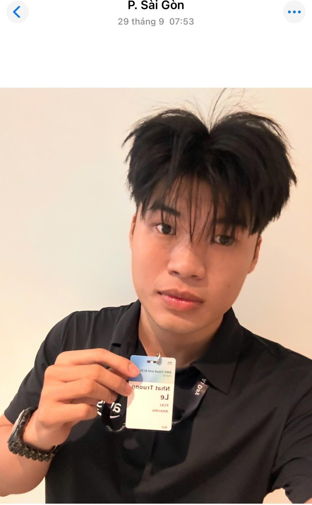

### Giới thiệu sự kiện

Ngày **29/09/2026**, tôi tham gia buổi **viewing party tại TP. Hồ Chí Minh** để theo dõi sự kiện **AWS Cloud and AI Day Hanoi** được tổ chức tại Hà Nội.

Sự kiện có nhiều nội dung xoay quanh điện toán đám mây, trí tuệ nhân tạo và việc ứng dụng công nghệ trong quá trình phát triển phần mềm.

Lúc đó, tôi mới bắt đầu tìm hiểu AWS nên vẫn còn khá nhiều kiến thức chưa nắm rõ. Việc theo dõi sự kiện giúp tôi tiếp cận thêm những chủ đề mới và hiểu hơn về cách Cloud và AI được sử dụng ngoài thực tế.

### Thông tin sự kiện

- **Tên sự kiện:** AWS Cloud and AI Day Hanoi.
- **Thời gian:** 29/09/2026.
- **Địa điểm tổ chức chính:** Hà Nội, Việt Nam.
- **Địa điểm tham gia:** TP. Hồ Chí Minh.
- **Hình thức:** Tham gia viewing party và theo dõi các phiên trình bày.

### Nội dung tìm hiểu

#### 1. Kiến trúc Cloud và khả năng mở rộng hệ thống

Một trong những chủ đề tôi quan tâm là cách xây dựng một hệ thống có thể hoạt động ổn định khi số lượng người dùng tăng lên.

Khi mới học AWS, tôi thường tìm hiểu từng dịch vụ riêng lẻ và ghi nhớ chức năng của chúng. Tuy nhiên, để xây dựng một ứng dụng hoàn chỉnh, các dịch vụ cần được kết hợp với nhau theo một kiến trúc phù hợp.

Thông qua những nội dung về hệ thống phân tán và xử lý dữ liệu, tôi hiểu thêm rằng khi lượng truy cập tăng, việc quản lý tài nguyên và đảm bảo hiệu năng cũng trở nên khó khăn hơn.

Tôi nhận thấy khả năng mở rộng không chỉ là tăng thêm máy chủ, mà còn liên quan đến cách tổ chức hệ thống và phân chia công việc giữa các thành phần.

Đây là phần kiến thức tôi muốn tìm hiểu kỹ hơn trong quá trình học AWS.

#### 2. AI Agent và xu hướng phát triển ứng dụng AI

AI Agent là một trong những chủ đề khiến tôi chú ý khi theo dõi sự kiện.

Trước đây, tôi thường sử dụng AI để đặt câu hỏi, tìm kiếm thông tin hoặc nhờ giải thích một vấn đề nào đó. Vì vậy, tôi khá tò mò về cách AI có thể được đưa vào các ứng dụng để hỗ trợ nhiều công việc hơn.

Qua những nội dung tìm hiểu, tôi biết thêm rằng AI có thể được kết hợp với dữ liệu và các công cụ khác để hỗ trợ xử lý những yêu cầu cụ thể.

Tuy nhiên, một điều tôi thấy quan trọng là kết quả do AI đưa ra vẫn cần được kiểm tra. AI có thể trả lời chưa chính xác hoặc chưa phù hợp với yêu cầu của người dùng.

Vì vậy, nếu xây dựng một ứng dụng có sử dụng AI, người phát triển cần quan tâm đến dữ liệu đầu vào, kết quả đầu ra và cách xử lý những trường hợp không như mong đợi.

#### 3. Phát triển phần mềm với sự hỗ trợ của AI

Bên cạnh các ứng dụng AI dành cho người dùng, tôi cũng quan tâm đến việc sử dụng AI trong quá trình lập trình.

Hiện nay, AI có thể hỗ trợ giải thích mã nguồn, gợi ý cách sửa lỗi và giúp lập trình viên tìm hiểu những kiến thức chưa quen thuộc.

Đối với tôi, đây là một công cụ khá hữu ích vì trong quá trình học lập trình, đôi khi tôi gặp những lỗi mất nhiều thời gian mới tìm ra nguyên nhân.

Tuy nhiên, tôi nghĩ việc dùng AI không có nghĩa là có thể bỏ qua các bước kiểm tra chương trình. Mã nguồn được gợi ý vẫn cần được đọc lại và chạy thử để đảm bảo hoạt động đúng.

Điều tôi rút ra là nên sử dụng AI để hỗ trợ quá trình học và làm việc, đồng thời vẫn phải tự hiểu những gì mình đang xây dựng.

#### 4. Bảo mật và vận hành hệ thống Cloud

Một nội dung khác tôi chú ý là các vấn đề về bảo mật và quản lý ứng dụng khi triển khai lên Cloud.

Khi một website được đưa lên Internet, ngoài việc đảm bảo các chức năng hoạt động, người phát triển còn cần quan tâm đến dữ liệu và quyền truy cập của người dùng.

Bên cạnh đó, hệ thống cũng cần có cách theo dõi hoạt động để biết khi nào xảy ra lỗi hoặc khi tài nguyên được sử dụng quá nhiều.

Trước khi tham gia chương trình, tôi thường nghĩ rằng chỉ cần website chạy được là đã gần hoàn thành. Nhưng khi tìm hiểu thêm về Cloud, tôi nhận thấy việc vận hành và bảo trì cũng là một phần quan trọng.

Dù chưa có nhiều kinh nghiệm về bảo mật AWS, tôi hiểu đây là kiến thức cần thiết nếu muốn triển khai ứng dụng để người khác sử dụng.

#### 5. AWS và ứng dụng AI trong doanh nghiệp

Qua các chủ đề được giới thiệu, tôi có thêm góc nhìn về cách Cloud và AI có thể hỗ trợ hoạt động của doanh nghiệp.

Cloud giúp cung cấp môi trường để lưu trữ dữ liệu, chạy ứng dụng và quản lý tài nguyên. Trong khi đó, AI có thể hỗ trợ xử lý thông tin hoặc thực hiện một số công việc mà trước đây cần nhiều thao tác thủ công.

Điều khiến tôi quan tâm là cách hai công nghệ này có thể kết hợp với nhau trong một hệ thống thực tế.

Tôi cũng nhận ra rằng không phải ứng dụng nào cũng cần sử dụng thật nhiều dịch vụ AWS. Việc lựa chọn công nghệ nên dựa trên nhu cầu, quy mô và chi phí của hệ thống.

Đây là điều tôi muốn ghi nhớ khi bắt đầu xây dựng các dự án của mình.

### Những kiến thức rút ra

Sau buổi viewing party, tôi ghi lại một số điều đáng chú ý:

- Hiểu thêm về cách các dịch vụ Cloud phối hợp trong một hệ thống.
- Biết vì sao khả năng mở rộng và hiệu năng lại quan trọng.
- Có thêm kiến thức cơ bản về AI Agent và các ứng dụng AI.
- Nhận thấy AI có thể hỗ trợ lập trình nhưng vẫn cần kiểm tra kết quả.
- Hiểu hơn về vai trò của bảo mật và giám sát hệ thống.
- Biết rằng việc lựa chọn dịch vụ AWS cần cân nhắc cả nhu cầu và chi phí.

Tôi chưa thể hiểu hết các chủ đề chỉ sau một buổi theo dõi. Tuy nhiên, sự kiện giúp tôi biết thêm những kiến thức mình nên học trong các tuần tiếp theo.

### Liên hệ với dự án cá nhân

Vào thời điểm tham gia sự kiện, tôi đang bắt đầu tìm hiểu ý tưởng xây dựng **LoveSpot**, một ứng dụng hỗ trợ gợi ý quán ăn và tạo lịch trình tại TP. Hồ Chí Minh.

Từ những nội dung về Cloud và AI, tôi nghĩ đến một số vấn đề có thể gặp phải khi phát triển dự án.

Chẳng hạn, để gợi ý được những địa điểm phù hợp, ứng dụng cần có dữ liệu quán ăn đủ chính xác. Hệ thống cũng cần biết cách tiếp nhận sở thích, ngân sách và khu vực mà người dùng lựa chọn.

Ngoài ra, tôi bắt đầu quan tâm đến việc kiểm tra kết quả gợi ý. Một quán ăn có đánh giá tốt chưa chắc đã phù hợp nếu quá xa hoặc vượt ngân sách của người dùng.

Những nội dung về Cloud cũng giúp tôi hình dung sơ bộ việc triển khai ứng dụng lên AWS sau này. Tuy nhiên, đây mới là những kiến thức tham khảo trong giai đoạn đầu, chưa phải các chức năng đã được triển khai trong LoveSpot.

### Cảm nhận cá nhân

Đối với tôi, việc tham gia viewing party là một trải nghiệm khá thú vị vì được tiếp cận nhiều chủ đề ngoài những bài học AWS cơ bản.

Trong các nội dung được tìm hiểu, tôi quan tâm nhất đến AI và cách sử dụng công nghệ này trong quá trình phát triển phần mềm.

Một số kiến thức về kiến trúc Cloud và hệ thống phân tán vẫn còn khó hiểu vì tôi chưa có nhiều kinh nghiệm thực tế. Tôi nghĩ mình cần tiếp tục đọc tài liệu và thực hành để hiểu rõ hơn.

Sau sự kiện, tôi nhận ra rằng việc học công nghệ không chỉ là ghi nhớ cách sử dụng từng công cụ. Quan trọng hơn là biết khi nào nên sử dụng và làm thế nào để kết hợp chúng thành một ứng dụng có ích.

### Một số hình ảnh khi tham gia sự kiện

Dưới đây là một số hình ảnh từ buổi viewing party tại TP. Hồ Chí Minh.

#### Hình ảnh 1 — AWS Cloud and AI Day Hanoi

#### Hình ảnh 2 — Hoạt động tại sự kiện

#### Hình ảnh 3 — Nội dung trình bày

#### Hình ảnh 4 — Theo dõi sự kiện

#### Hình ảnh 5 — Hình ảnh sự kiện

#### Hình ảnh 6 — Hình ảnh sự kiện

### Tổng kết

Buổi viewing party của **AWS Cloud and AI Day Hanoi ngày 29/09/2026** giúp tôi có thêm góc nhìn về lĩnh vực Cloud Computing và AI.

Tôi hiểu thêm rằng khi xây dựng một ứng dụng, ngoài việc lập trình các chức năng, còn cần quan tâm đến dữ liệu, khả năng mở rộng, bảo mật và cách vận hành hệ thống.

Dù vẫn còn nhiều kiến thức cần học, sự kiện đã giúp tôi có thêm định hướng để tiếp tục tìm hiểu AWS và từng bước áp dụng những điều đã học vào dự án LoveSpot.