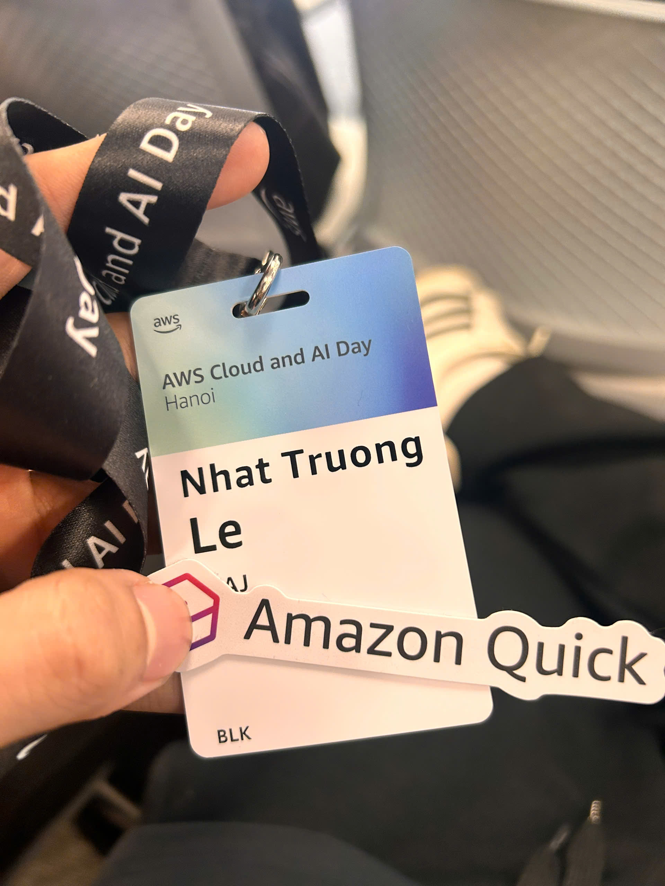
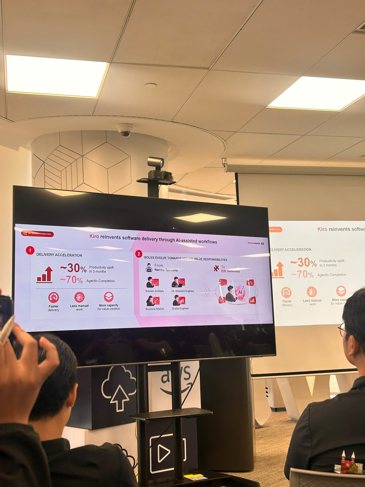
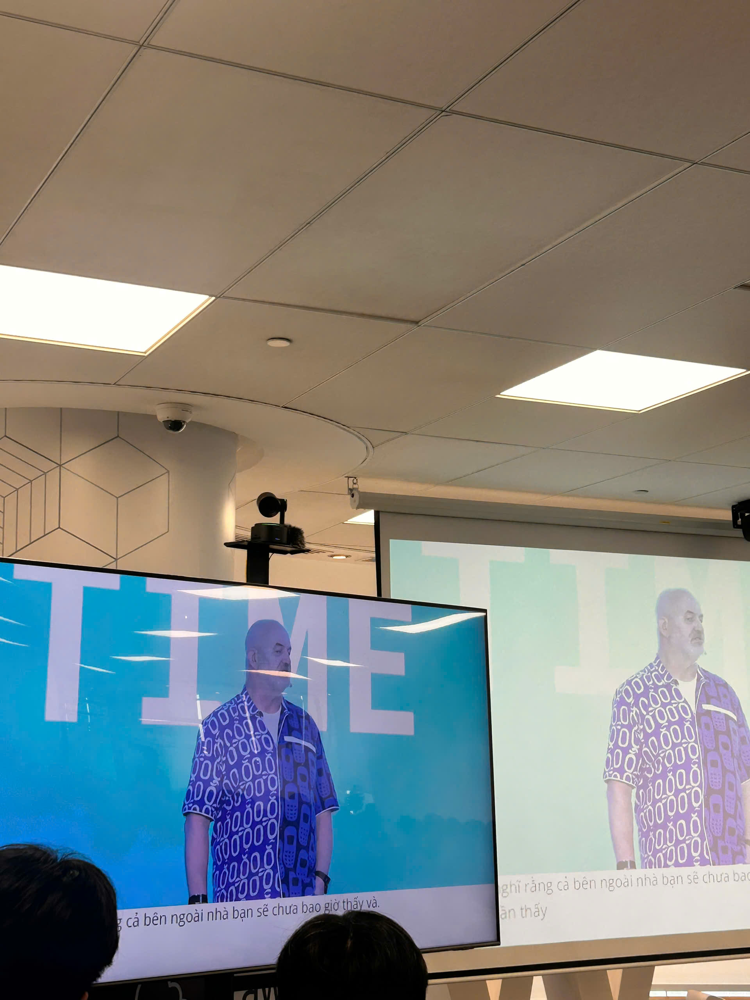
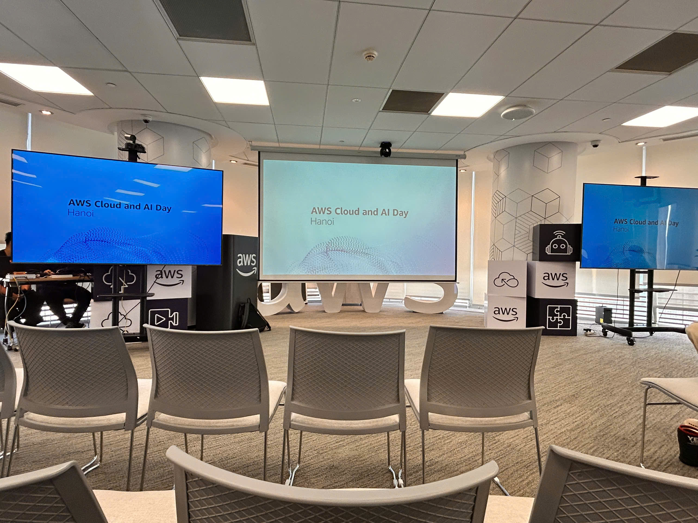
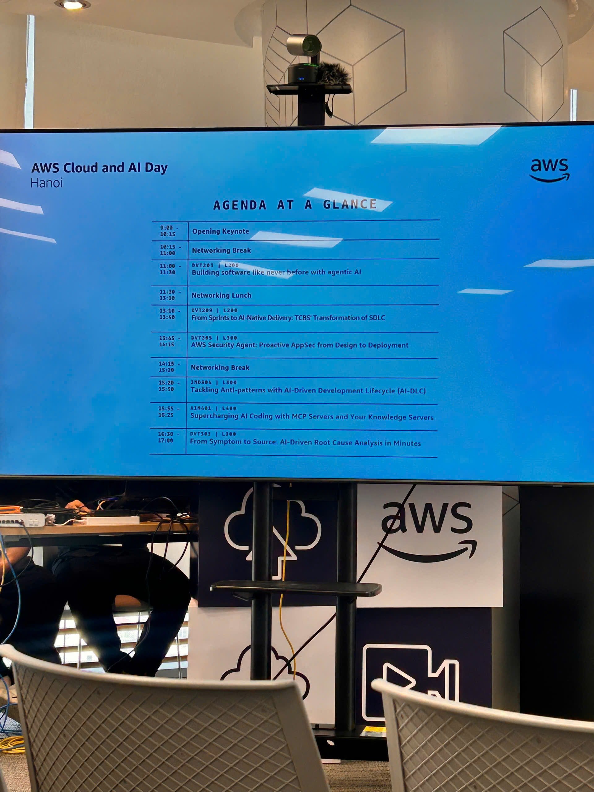

### Giới thiệu sự kiện

Ngày **29/09/2026**, tôi tham gia buổi **viewing party tại TP. Hồ Chí Minh** để theo dõi sự kiện **AWS Cloud and AI Day Hanoi** được tổ chức tại Hà Nội.

Sự kiện tập trung vào những chủ đề liên quan đến điện toán đám mây, trí tuệ nhân tạo, phát triển phần mềm và các giải pháp công nghệ được ứng dụng trong doanh nghiệp.

Thông qua các phiên trình bày, tôi có cơ hội tìm hiểu thêm về kiến trúc hệ thống Cloud, AI Agent, ứng dụng AI trong phát triển phần mềm, bảo mật và vận hành hệ thống.

### Thông tin sự kiện

- **Tên sự kiện:** AWS Cloud and AI Day Hanoi.
- **Thời gian:** 29/09/2026.
- **Địa điểm tổ chức chính:** Hà Nội, Việt Nam.
- **Địa điểm tham gia:** TP. Hồ Chí Minh.
- **Hình thức:** Tham gia viewing party, theo dõi các phiên trình bày của sự kiện.

### Nội dung tìm hiểu

#### 1. Kiến trúc Cloud và khả năng mở rộng hệ thống

Một trong những nội dung được đề cập tại sự kiện là cách xây dựng hệ thống có khả năng phục vụ số lượng lớn người dùng, đồng thời duy trì hiệu năng và tính sẵn sàng.

Các bài trình bày giới thiệu những thách thức trong hệ thống phân tán, đặc biệt khi lượng dữ liệu và số lượng yêu cầu ngày càng tăng.

Tôi cũng được tìm hiểu về **Amazon Dynamo**, một hệ thống lưu trữ key-value được thiết kế để đáp ứng yêu cầu về khả năng mở rộng và tính sẵn sàng trong các hệ thống phân tán.

Qua phần này, tôi hiểu thêm rằng khi xây dựng ứng dụng Cloud, lập trình viên không chỉ quan tâm đến chức năng mà còn phải xem xét khả năng mở rộng, độ tin cậy và hiệu quả vận hành.

#### 2. AI Agent và xu hướng phát triển ứng dụng AI

Một chủ đề khác mà tôi quan tâm là sự phát triển của **AI Agent** và các ứng dụng **AI-native**.

Các phần trình bày đề cập đến cách AI Agent có thể hỗ trợ tự động hóa quy trình, xử lý công việc và nâng cao hiệu quả hoạt động trong doanh nghiệp.

Tuy nhiên, việc triển khai AI trong thực tế cũng đặt ra nhiều vấn đề cần cân nhắc:

- Kiểm soát chất lượng kết quả đầu ra.
- Đảm bảo AI hoạt động đúng phạm vi và mục đích.
- Kiểm tra và đánh giá những kết quả do AI tạo ra.
- Có sự giám sát của con người đối với những tác vụ quan trọng.

Điều tôi rút ra là việc xây dựng một ứng dụng AI không chỉ đơn giản là kết nối với mô hình ngôn ngữ. Hệ thống còn cần quy trình xử lý rõ ràng, cơ chế kiểm thử và cách quản lý phù hợp.

#### 3. Phát triển phần mềm với sự hỗ trợ của AI

Sự kiện cũng giới thiệu những hướng tiếp cận mới trong phát triển phần mềm, đặc biệt là việc sử dụng **AI Coding Assistants** và AI Agent để hỗ trợ lập trình viên.

AI có thể giúp người phát triển tìm hiểu mã nguồn, gợi ý cách giải quyết vấn đề và hỗ trợ một số tác vụ trong quá trình xây dựng ứng dụng.

Tuy nhiên, việc sử dụng AI vẫn cần kết hợp với các bước phát triển phần mềm cơ bản như:

- Phân tích và xác định yêu cầu.
- Thiết kế kiến trúc hệ thống.
- Kiểm thử chức năng.
- Đánh giá các vấn đề bảo mật.
- Theo dõi và cải thiện ứng dụng sau khi triển khai.

Qua nội dung này, tôi nhận thấy các công cụ AI có thể giúp tăng năng suất làm việc, nhưng kiến thức lập trình và tư duy giải quyết vấn đề vẫn rất quan trọng.

#### 4. Bảo mật và vận hành hệ thống Cloud

Bảo mật là một trong những vấn đề cần quan tâm khi phát triển và triển khai ứng dụng trên Cloud.

Các nội dung được chia sẻ đề cập đến việc phát hiện lỗ hổng, sử dụng công cụ hỗ trợ kiểm tra bảo mật và xây dựng quy trình vận hành hệ thống an toàn.

Tôi hiểu thêm rằng bảo mật không nên chỉ được xem xét khi ứng dụng đã hoàn thành, mà cần được chú ý trong suốt quá trình phát triển.

Bên cạnh đó, việc giám sát hoạt động hệ thống cũng giúp phát hiện vấn đề và hỗ trợ quá trình xử lý sự cố.

#### 5. AWS và ứng dụng AI trong doanh nghiệp

Một nội dung đáng chú ý khác là cách các doanh nghiệp có thể kết hợp dịch vụ AWS với trí tuệ nhân tạo để phát triển các giải pháp công nghệ.

Các phiên trình bày đề cập đến vai trò của Cloud trong việc cung cấp hạ tầng, hỗ trợ xử lý dữ liệu, triển khai ứng dụng AI và giám sát hoạt động của hệ thống.

Qua đó, tôi có thêm góc nhìn về cách công nghệ Cloud và AI có thể được sử dụng cùng nhau để giải quyết những bài toán thực tế.

### Những kiến thức rút ra

Sau khi theo dõi sự kiện, tôi tổng hợp được một số nội dung đáng chú ý:

- Hiểu thêm về khả năng mở rộng và tính sẵn sàng của các hệ thống Cloud.
- Biết thêm về hệ thống phân tán và những thách thức khi phục vụ số lượng lớn người dùng.
- Tìm hiểu xu hướng phát triển của AI Agent và AI-native applications.
- Nhận thấy vai trò của AI trong việc hỗ trợ lập trình và tự động hóa công việc.
- Hiểu rằng kết quả do AI tạo ra vẫn cần được kiểm tra và đánh giá.
- Có thêm kiến thức về bảo mật, giám sát và quản lý vận hành ứng dụng Cloud.
- Nhận biết được vai trò của AWS trong việc hỗ trợ doanh nghiệp xây dựng và triển khai các giải pháp AI.

### Liên hệ với dự án cá nhân

Hiện tại, tôi đang phát triển dự án **ứng dụng gợi ý quán ăn và tạo lịch trình tại TP.HCM**.

Từ những nội dung được chia sẻ tại sự kiện, tôi nhận thấy một số kiến thức có thể tham khảo cho quá trình phát triển dự án.

Trước hết, việc xây dựng hệ thống gợi ý cần quan tâm đến chất lượng dữ liệu và khả năng xử lý yêu cầu của người dùng. Khi số lượng địa điểm và người dùng tăng lên, khả năng mở rộng của hệ thống cũng là một vấn đề cần xem xét.

Bên cạnh đó, những kiến thức về AI giúp tôi hiểu rõ hơn tầm quan trọng của việc kiểm tra kết quả gợi ý, thay vì chỉ dựa vào kết quả do hệ thống tạo ra.

Các nội dung về bảo mật và vận hành Cloud cũng là cơ sở để tôi tiếp tục tìm hiểu khi có kế hoạch triển khai ứng dụng lên AWS trong tương lai.

Đây là những kiến thức tham khảo và định hướng phát triển, không có nghĩa tất cả các giải pháp được giới thiệu tại sự kiện đã được triển khai trong dự án hiện tại.

### Cảm nhận cá nhân

Việc tham gia viewing party giúp tôi có thêm cơ hội tiếp cận những kiến thức về Cloud Computing và AI thông qua các tình huống ứng dụng thực tế.

Trong số các nội dung được trình bày, tôi quan tâm nhiều đến AI Agent và cách AI có thể hỗ trợ quá trình phát triển phần mềm.

Một số khái niệm về hệ thống phân tán và kiến trúc Cloud vẫn còn khá mới đối với tôi, vì vậy tôi cần tiếp tục tìm hiểu thêm qua tài liệu và quá trình thực hành.

Nhìn chung, sự kiện giúp tôi mở rộng góc nhìn về lĩnh vực AI và Cloud, đồng thời nhận ra tầm quan trọng của việc kết hợp kiến thức lập trình, thiết kế hệ thống và vận hành ứng dụng.

### Một số hình ảnh khi tham gia sự kiện

Dưới đây là một số hình ảnh tư liệu từ buổi viewing party tại TP. Hồ Chí Minh.

#### Hình ảnh 1 — AWS Cloud and AI Day Hanoi

#### Hình ảnh 2 — Hoạt động tại sự kiện

#### Hình ảnh 3 — Nội dung trình bày

#### Hình ảnh 4 — Theo dõi sự kiện

#### Hình ảnh 5 — Hình ảnh sự kiện

### Tổng kết

Buổi viewing party của **AWS Cloud and AI Day Hanoi ngày 29/09/2026** giúp tôi hiểu thêm về các xu hướng phát triển trong lĩnh vực điện toán đám mây và trí tuệ nhân tạo.

Qua những nội dung được trình bày, tôi nhận thấy việc xây dựng ứng dụng hiện đại không chỉ liên quan đến lập trình mà còn đòi hỏi kiến thức về kiến trúc hệ thống, khả năng mở rộng, bảo mật và vận hành.

Những kiến thức này sẽ là nền tảng hữu ích để tôi tiếp tục học tập và phát triển dự án AI trong thời gian tới.