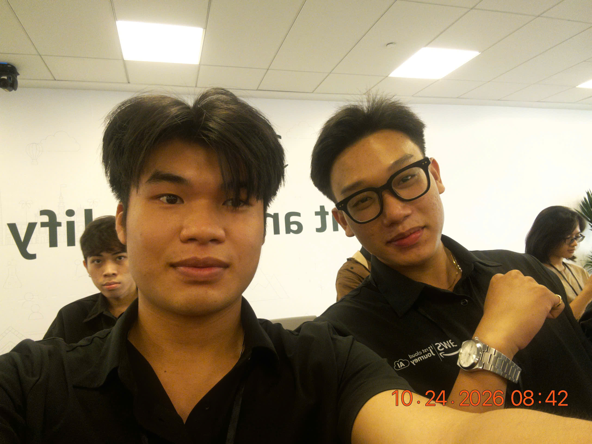
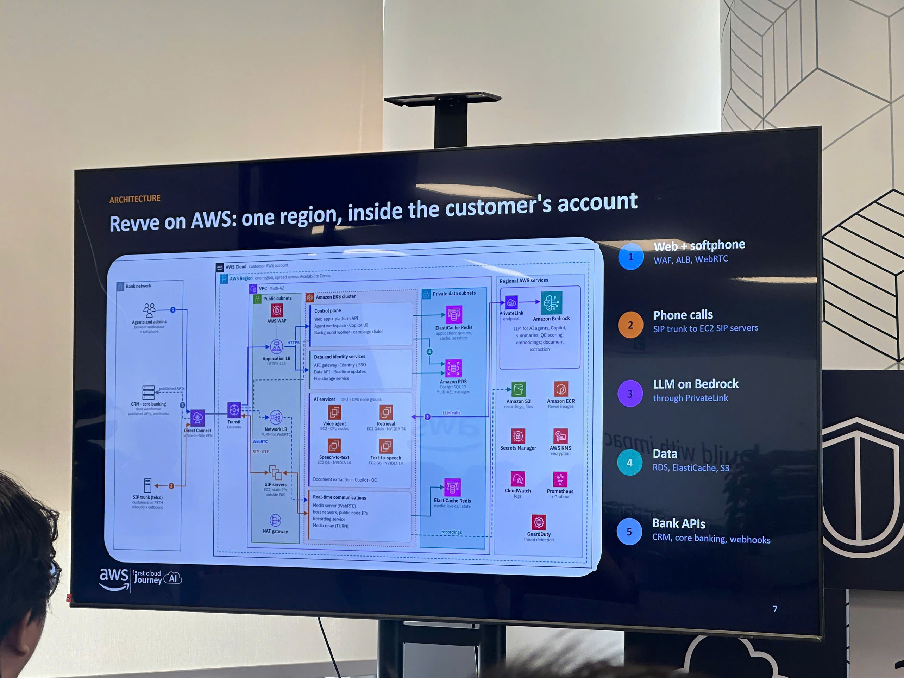
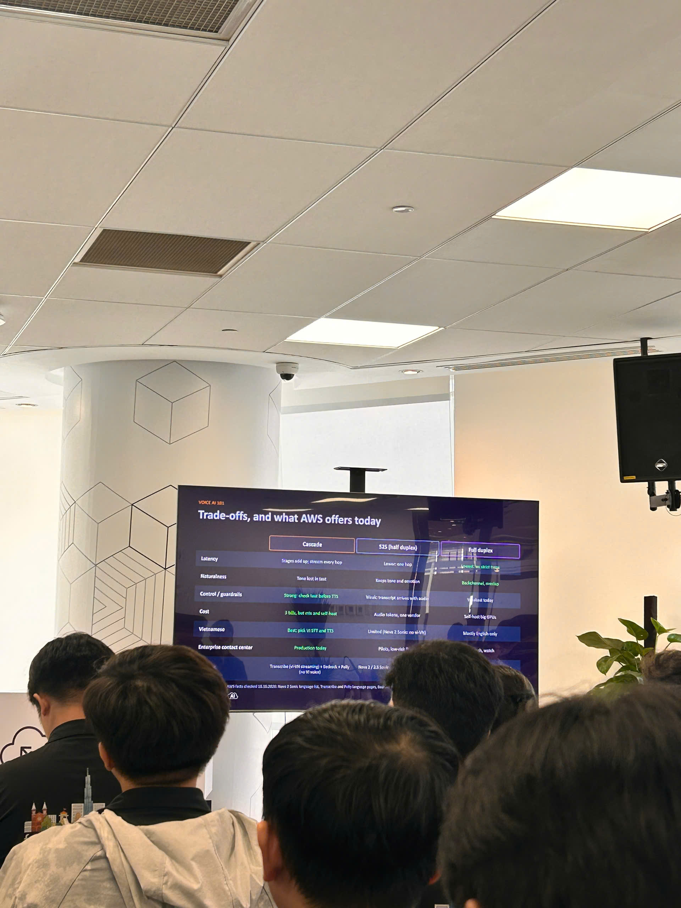
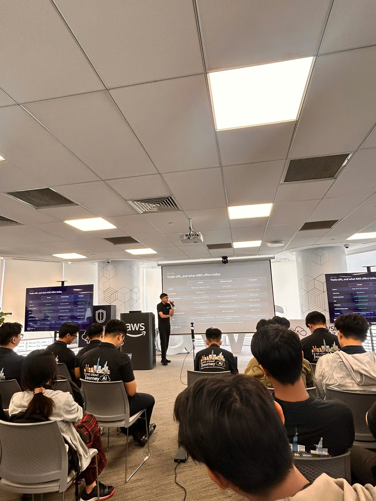
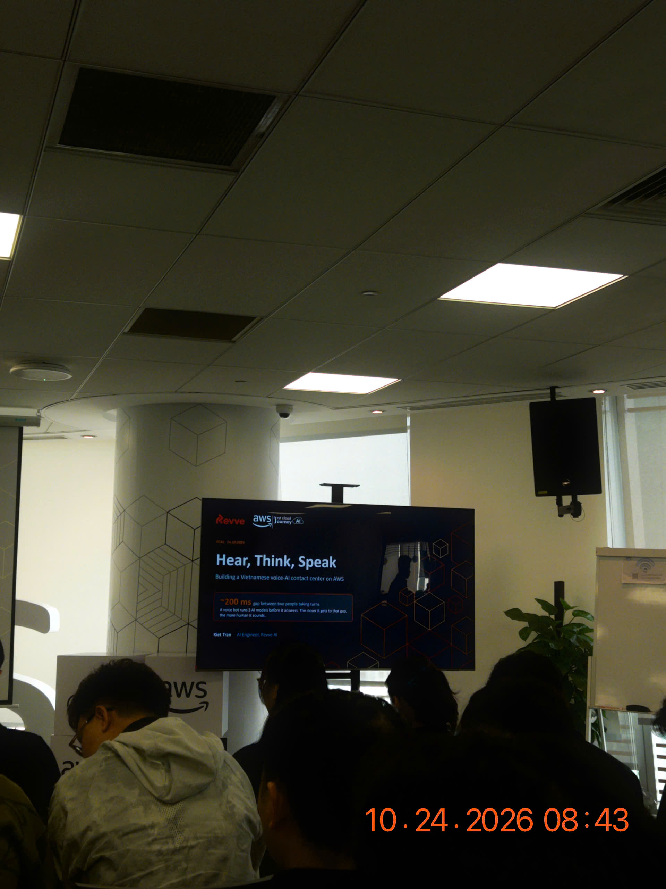

---
title: "Event 3 - FCAJ Mini Meeting"
date: 2026-10-24
weight: 3
chapter: false
pre: " <b> 4.3. </b> "
---

### Event Introduction

On **October 24, 2026**, I attended the **FCAJ Mini Meeting**, an event organized within the First Cloud AI Journey community.

The meeting included presentations about **Vietnamese Voice AI, AWS Resource Access Manager (RAM), AWS Security Agent, and Amazon Bedrock AgentCore**.

Most of these topics were quite new to me. Besides learning basic AWS services, I wanted to understand how these technologies could be used in developing and managing real applications.

### Event Information

- **Event Name:** FCAJ Mini Meeting.
- **Date:** October 24, 2026.
- **Role:** Participant.
- **Main Topics:** Voice AI, AWS RAM, AWS Security Agent, and Amazon Bedrock AgentCore.

### 1. Hear, Think, Speak — Building Vietnamese Voice AI

The first topic I was interested in was **Hear, Think, Speak: Building a Vietnamese Voice-AI Contact Center on AWS**.

This presentation introduced how AI systems can listen, understand, and respond through speech. One example is an automated contact center that can communicate with customers.

Before this, I usually interacted with AI by typing questions and receiving text responses. Voice AI is more complicated because the system also needs to recognize speech, understand the message, and generate spoken responses.

#### Different approaches to voice processing

I learned about several approaches:

- **Cascade:** Converts speech into text, processes it using AI, and turns the response back into audio.
- **Speech-to-Speech:** Uses models that can process audio input and generate audio output.
- **Full Duplex:** Aims to support more natural conversations by allowing flexible listening and speaking.

What I found interesting was that Voice AI needs more than accurate answers. Response speed also matters because long delays can make a conversation feel unnatural.

This session helped me understand that developing a voice-based AI application involves several processing steps rather than just one AI model.

### 2. AWS Resource Access Manager — Sharing AWS Resources

The next topic was **AWS Resource Access Manager (AWS RAM)**.

When I first started learning AWS, I mostly worked with a single account, so I had not thought much about managing resources across multiple AWS accounts.

Through this presentation, I learned that AWS RAM supports sharing certain AWS resources between accounts. This can be useful for organizations with different teams or departments.

One thing I remembered was that resource sharing should always involve proper access management. Not every account should be allowed to use every resource.

Although I had not practiced using AWS RAM, this topic gave me a better understanding of how companies can organize their cloud environments.

### 3. AWS Security Agent — Web Application Security

Another topic was **AWS Security Agent** and how AI can support application security reviews.

When working on a website, I usually focus on the interface and main features first. Security is sometimes something I think about only when the application is nearly finished.

This presentation made me realize that security should be considered earlier, even during the system design stage.

For example, developers need to think about access permissions, data protection, and how to avoid unsafe configurations.

I also understood that AI tools may help with security reviews, but their findings still need to be checked. Using an automated tool does not guarantee that an application is completely secure.

This is an area I would like to learn more about before deploying my own projects to AWS.

### 4. Amazon Bedrock AgentCore — Runtime and Memory

The presentation about **Amazon Bedrock AgentCore** introduced more concepts related to developing and operating AI Agents.

The two topics I paid attention to were **Runtime** and **Memory**.

#### AgentCore Runtime

From what I understood, Runtime is related to the environment where an AI Agent runs and how its execution is managed.

This helped me realize that an AI Agent needs more than a model for processing information. It also needs a suitable environment to perform tasks.

#### AgentCore Memory

I found Memory interesting because it relates to storing information and maintaining context during interactions.

For example, when an application handles several related requests, keeping track of previous interactions may help it process information more effectively.

I also became familiar with concepts such as Session IDs, Actor IDs, and interaction data.

Although I did not fully understand how to implement these features, the presentation gave me a basic idea of what developers should consider when building AI applications with multiple processing steps.

### 5. What I Learned

After the Mini Meeting, I noted several useful points:

- Understood the basic processing steps of a Voice AI system.
- Learned about different approaches to developing voice-based AI applications.
- Understood the purpose of AWS RAM for sharing resources between AWS accounts.
- Realized that application security should be considered from the design stage.
- Learned about Runtime and Memory in AI Agent systems.
- Gained a better understanding of how AI works with other application components.

Some topics were still difficult for me, especially AWS RAM and AgentCore. I would need to read more documentation to understand them better.

### 6. Connection to My Project

At that time, I was working on **LoveSpot**, a restaurant recommendation and itinerary planning application for Ho Chi Minh City.

The team was still exploring and developing the early parts of the application, including the interface, venue data, and basic features.

The Mini Meeting made me think more about how different components of an AI application communicate with one another.

For LoveSpot, managing venue information and correctly processing user requirements were important areas to consider. The security topics also reminded me to pay more attention to how data and APIs should be handled.

Technologies such as Voice AI, AWS RAM, and AgentCore were only topics I learned about during the event. They were not services that had been implemented in LoveSpot.

### 7. Personal Reflection

I found the Mini Meeting interesting because it introduced several topics beyond the basic AWS lessons I had studied.

Among the presentations, I was most interested in **Vietnamese Voice AI**. The idea of a system that could understand and respond through speech made me curious about how audio data is processed behind the scenes.

However, some technical parts were difficult to follow, especially when the presentations discussed more advanced architectures and components. I still needed more time to understand those concepts.

After the event, I had several new topics to explore. I also realized that building a good application requires knowledge of data, security, and system operations, not just programming.

### 8. Event Photos

Below are some photos from the FCAJ Mini Meeting.

#### Photo 1

#### Photo 2

#### Photo 3

#### Photo 4

#### Photo 5

### Conclusion

The **FCAJ Mini Meeting on October 24, 2026**, helped me learn more about Voice AI, AWS resource management, application security, and AI Agents.

The main lesson I took away was that real AI applications need several components working together. Besides the AI model, developers also need to consider data processing, system connections, and result validation.

Overall, it was a useful learning experience that gave me more topics to explore while continuing my AWS studies and working on the LoveSpot project.
