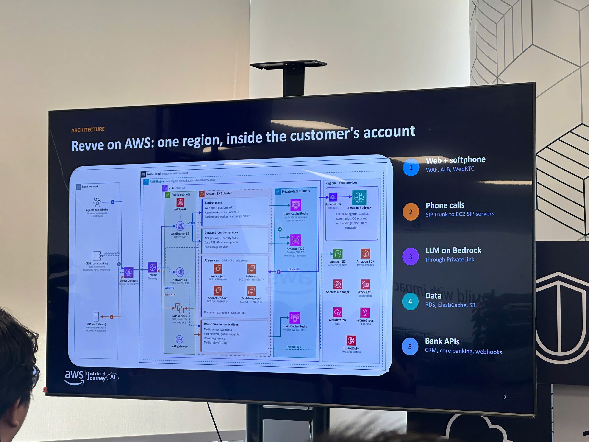
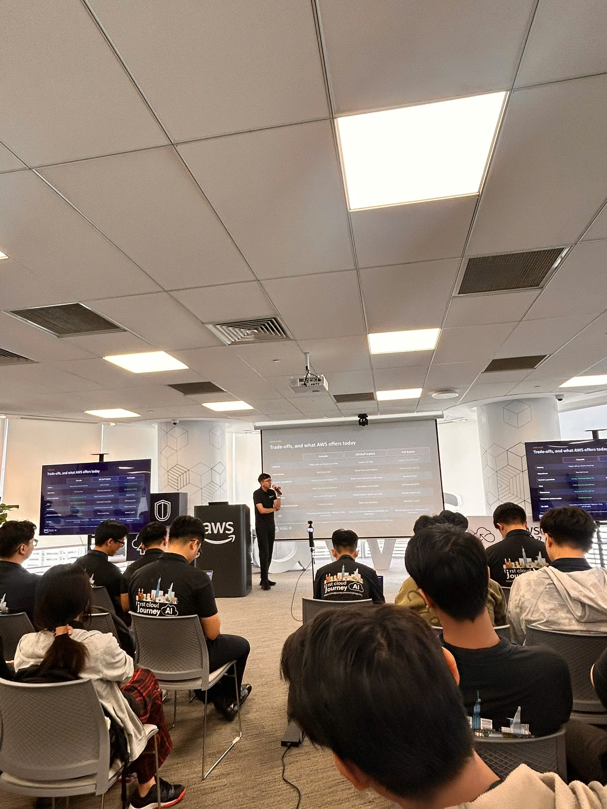
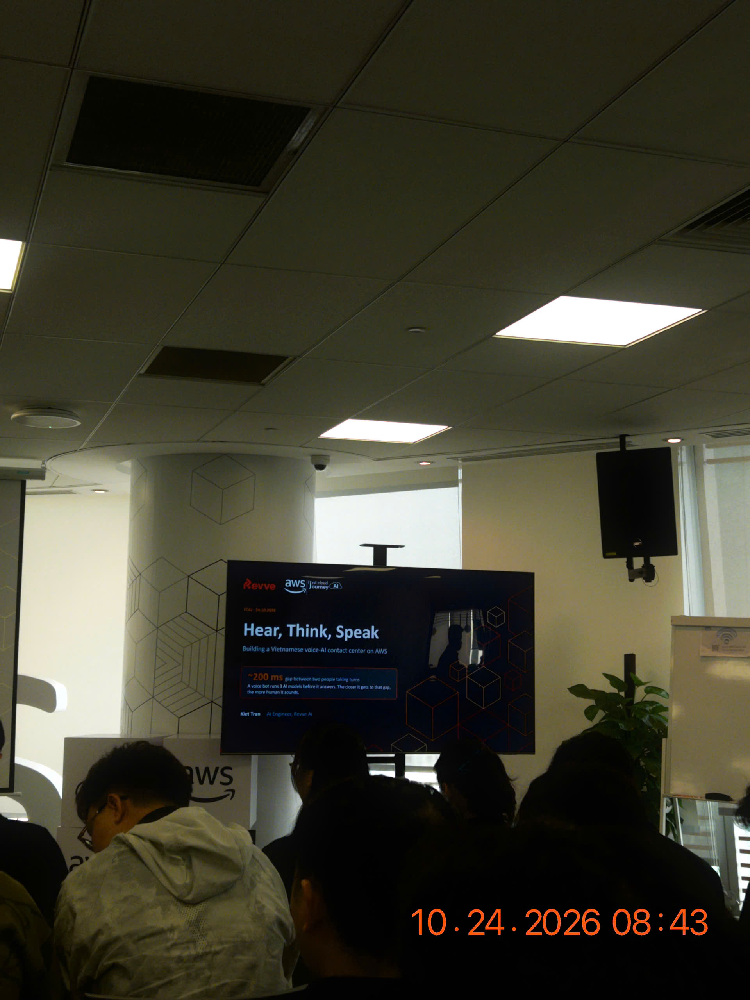

### Giới thiệu sự kiện

Ngày **24/10/2026**, tôi tham gia **FCAJ Mini Meeting**, một buổi chia sẻ kỹ thuật trong cộng đồng First Cloud AI Journey.

Sự kiện giới thiệu một số chủ đề liên quan đến trí tuệ nhân tạo và điện toán đám mây, bao gồm **Vietnamese Voice AI**, **AWS Resource Access Manager (RAM)**, **AWS Security Agent** và **Amazon Bedrock AgentCore**.

Thông qua các phần trình bày, tôi có cơ hội tìm hiểu thêm về cách những công nghệ này được sử dụng trong các hệ thống thực tế. Nội dung bài thu hoạch được tổng hợp từ những ghi chú và hình ảnh trình bày tại sự kiện.

### Thông tin sự kiện

- **Tên sự kiện:** FCAJ Mini Meeting.
- **Thời gian:** 24/10/2026.
- **Vai trò:** Người tham dự.
- **Nội dung chính:** Voice AI, AWS RAM, AWS Security Agent và Amazon Bedrock AgentCore.

### 1. Hear, Think, Speak — Xây dựng Voice AI tiếng Việt

Diễn giả **Kiet Tran**, AI Engineer tại Revve AI, chia sẻ chủ đề **Hear, Think, Speak: Building a Vietnamese Voice-AI Contact Center on AWS**.

Phần trình bày giới thiệu cách xây dựng hệ thống AI có khả năng giao tiếp bằng giọng nói, đặc biệt trong những tình huống như tổng đài chăm sóc khách hàng và phỏng vấn.

Một điểm tôi chú ý là hệ thống Voice AI không chỉ cần đưa ra câu trả lời chính xác mà còn phải xác định thời điểm người dùng kết thúc câu nói, xử lý nội dung và phản hồi đủ nhanh để cuộc hội thoại diễn ra tự nhiên.

#### Ba phương pháp xây dựng Voice Agent

Diễn giả giới thiệu ba hướng tiếp cận:

- **Cascade:** Chia quá trình xử lý thành các bước ASR → LLM → TTS. Hệ thống chuyển giọng nói thành văn bản, xử lý nội dung bằng mô hình ngôn ngữ rồi tạo phản hồi bằng giọng nói.
- **Speech-to-Speech (S2S):** Sử dụng mô hình xử lý đầu vào và đầu ra dưới dạng âm thanh.
- **Full Duplex S2S:** Hướng đến khả năng nghe và nói đồng thời, giúp tương tác gần hơn với hội thoại tự nhiên.

Theo phần chia sẻ, nhóm phát triển vẫn sử dụng **Cascade trong môi trường production** và tiếp tục thử nghiệm các phương pháp Speech-to-Speech.

Đối với bài toán tiếng Việt, Cascade cho phép nhóm lựa chọn từng thành phần phù hợp và kiểm soát nội dung thông qua bước xử lý văn bản trung gian.

Qua phần này, tôi hiểu thêm rằng lựa chọn kiến trúc Voice AI cần dựa trên yêu cầu thực tế về chất lượng giọng nói, độ trễ, khả năng ghi log và việc thay thế hoặc cải thiện từng thành phần.

#### Luồng xử lý cuộc gọi và kiến trúc AWS

Trong slide kiến trúc, hệ thống có nhiều thành phần phối hợp như:

- SIP Server và Media Server.
- Noise Cancellation.
- Turn Detection.
- Speech-to-Text.
- LLM kết hợp Flow Engine.
- Text-to-Speech.

Phần trình bày cũng giới thiệu kiến trúc triển khai của Revve trong một AWS Region và trong tài khoản AWS của khách hàng.

Ngoài ra, diễn giả chia sẻ một POC dành cho một ngân hàng tại Việt Nam, bao gồm các bước tiếp nhận yêu cầu, xác minh thông tin, xác định mục đích cuộc gọi và xử lý thông qua API hoặc chuyển tiếp đến nhân viên.

Ví dụ này giúp tôi hiểu rằng một ứng dụng Voice AI thực tế không chỉ có mô hình nhận diện và tạo giọng nói mà còn phải kết hợp với quy trình nghiệp vụ.

### 2. AWS Resource Access Manager — Chia sẻ tài nguyên giữa các tài khoản

Diễn giả **Long Huynh** giới thiệu về **AWS Resource Access Manager (AWS RAM)**.

Chủ đề bắt đầu từ những khó khăn khi một tổ chức sử dụng nhiều tài khoản AWS và cần chia sẻ một số tài nguyên giữa các tài khoản đó.

Những nội dung chính gồm:

- **Multi-account Challenge:** Những vấn đề khi quản lý hạ tầng trên nhiều tài khoản AWS.
- **AWS RAM:** Dịch vụ hỗ trợ chia sẻ các loại tài nguyên AWS được hỗ trợ.
- **Resource Share:** Cách xác định tài nguyên, đối tượng nhận chia sẻ và quyền truy cập.
- **Sharing Workflow:** Quy trình chia sẻ tài nguyên từ tài khoản sở hữu đến tài khoản sử dụng.
- **Regions và Availability Zone IDs:** Các yếu tố cần chú ý về phạm vi tài nguyên và vùng triển khai.
- **RAM trong Landing Zone:** Vai trò của việc chia sẻ tài nguyên trong môi trường doanh nghiệp.

Theo ghi chú của tôi, diễn giả cũng đề cập đến việc AWS RAM hỗ trợ chia sẻ tài nguyên thuộc hơn 40 dịch vụ AWS.

Điều tôi rút ra là khi quản lý nhiều tài khoản, cần xác định rõ **chia sẻ tài nguyên nào, cho tài khoản nào và với quyền truy cập gì**.

Phần trình bày giúp tôi có thêm góc nhìn về việc tổ chức hạ tầng AWS ở quy mô nhiều tài khoản, thay vì chỉ làm việc với các dịch vụ riêng lẻ trong một tài khoản.

### 3. AWS Security Agent — Bảo mật ứng dụng Web

Diễn giả **Thinh** chia sẻ chủ đề **Securing Your Web Apps With AWS Security Agent**.

Nội dung giới thiệu hướng tiếp cận sử dụng AI Agent để hỗ trợ một số hoạt động đánh giá bảo mật cho ứng dụng web.

Một phần tôi quan tâm là **Design Security Review**.

Theo slide trình bày, công cụ có thể sử dụng những tài liệu như:

- Tài liệu thiết kế ở định dạng Markdown.
- Mã cấu hình hạ tầng Terraform.
- Những bộ yêu cầu bảo mật được cấu hình trước.

Các thông tin này được sử dụng làm đầu vào để hỗ trợ quá trình đánh giá thiết kế theo những yêu cầu bảo mật tương ứng.

Qua phần này, tôi nhận thấy việc kiểm tra bảo mật không nhất thiết phải chờ đến khi ứng dụng hoàn thành. Những rủi ro có thể được xem xét ngay từ giai đoạn thiết kế hệ thống.

Diễn giả cũng đề cập đến vấn đề chi phí trong phần **The Pricing Reality**.

Tôi hiểu rằng khi sử dụng những công cụ hỗ trợ bằng AI Agent, cần xem xét phạm vi công việc và thời gian agent thực hiện tác vụ để đánh giá chi phí phù hợp.

### 4. Amazon Bedrock AgentCore — Runtime và Memory

Diễn giả **Xuan An** giới thiệu về **Amazon Bedrock AgentCore**, tập trung vào hai nội dung chính là **Runtime** và **Memory Architecture**.

Phần đầu trình bày các khái niệm liên quan đến AI Agent, Agentic AI và Agentic System trước khi đi sâu hơn vào các thành phần của AgentCore.

#### AgentCore Runtime

Nội dung về Runtime giúp tôi có cái nhìn tổng quan về môi trường thực thi dành cho các ứng dụng AI Agent.

Qua đó, tôi nhận thấy một hệ thống AI Agent cần có cơ chế vận hành và quản lý quá trình thực thi, không chỉ đơn thuần gọi AI model để nhận kết quả.

#### AgentCore Memory

Ở phần Memory, diễn giả giới thiệu cách tổ chức thông tin tương tác dưới dạng những sự kiện và các trường dữ liệu liên quan.

Một số khái niệm được trình bày gồm:

- **Memory ID:** Định danh của Memory.
- **Actor ID:** Định danh đối tượng tham gia tương tác.
- **Session ID:** Định danh phiên tương tác.
- **Payload:** Nội dung dữ liệu được ghi nhận.
- **Timestamp:** Thời điểm diễn ra sự kiện.
- **Branch:** Thông tin liên quan đến nhánh hoặc luồng tương tác.

Thông qua slide, tôi hình dung rõ hơn cách dữ liệu từ các phiên tương tác có thể được tổ chức và quản lý để hỗ trợ hoạt động của AI Agent.

Ngoài ra, buổi chia sẻ còn nhắc đến **Kiro Crew** và **App & Extensibility**. Đây là những chủ đề tôi muốn tìm hiểu thêm khi có thời gian.

### 5. Những kiến thức học được

Sau buổi FCAJ Mini Meeting, tôi tổng hợp được một số nội dung đáng chú ý:

- Hiểu sự khác biệt cơ bản giữa Cascade, Speech-to-Speech và Full Duplex Speech-to-Speech.
- Biết thêm cách một hệ thống Voice AI kết hợp xử lý âm thanh, mô hình AI, API và quy trình nghiệp vụ.
- Hiểu vai trò của AWS RAM trong việc chia sẻ tài nguyên giữa nhiều tài khoản AWS.
- Nhận thấy tầm quan trọng của việc đánh giá bảo mật từ giai đoạn thiết kế ứng dụng.
- Có thêm nhận thức về chi phí khi sử dụng các công cụ AI hỗ trợ kiểm tra bảo mật.
- Làm quen với Amazon Bedrock AgentCore Runtime và Memory.
- Hiểu thêm cách tổ chức thông tin và ngữ cảnh trong một hệ thống AI Agent.

### 6. Liên hệ với dự án cá nhân

Dự án tôi đang phát triển là **ứng dụng gợi ý quán ăn và tạo lịch trình tại TP.HCM**.

Ở thời điểm tham gia sự kiện, dự án đang trong giai đoạn xây dựng các thành phần ban đầu như giao diện và phần khung Backend.

Những nội dung được giới thiệu giúp tôi có thêm kiến thức tham khảo cho quá trình phát triển dự án.

Đặc biệt, tôi nhận thấy việc phân chia rõ trách nhiệm của từng thành phần, quản lý dữ liệu và kiểm soát quá trình xử lý yêu cầu là cần thiết khi xây dựng ứng dụng AI.

Các kiến thức về bảo mật cũng giúp tôi chú ý hơn đến việc đánh giá thiết kế hệ thống trước khi triển khai.

Tuy nhiên, những công nghệ được giới thiệu trong sự kiện chủ yếu là nội dung tôi tìm hiểu thêm, **không có nghĩa chúng đã được áp dụng hoặc triển khai trong dự án**.

### 7. Cảm nhận cá nhân

Điểm tôi quan tâm nhất trong buổi Mini Meeting là cách các diễn giả trình bày những vấn đề thực tế phía sau một ứng dụng AI.

Trước đây, khi tìm hiểu về AI, tôi thường tập trung nhiều vào mô hình. Tuy nhiên, qua các ví dụ về Voice AI và AI Agent, tôi thấy rằng một hệ thống còn cần nhiều thành phần khác để có thể hoạt động hiệu quả.

Một số nội dung như AWS RAM hay AgentCore Memory vẫn còn mới đối với tôi. Vì vậy, tôi cần tiếp tục đọc tài liệu và tìm hiểu thêm để nắm rõ cách sử dụng.

Nhìn chung, sự kiện giúp tôi mở rộng kiến thức về AI và AWS, đồng thời có thêm định hướng cho việc học tập và phát triển dự án.

### 8. Một số hình ảnh của sự kiện

Dưới đây là năm hình ảnh tư liệu được lưu lại từ sự kiện FCAJ Mini Meeting.

#### Hình ảnh 1

#### Hình ảnh 2

#### Hình ảnh 3

#### Hình ảnh 4

#### Hình ảnh 5

### Tổng kết

Buổi **FCAJ Mini Meeting ngày 24/10/2026** giúp tôi tiếp cận thêm những nội dung về Voice AI, quản lý tài nguyên AWS, bảo mật ứng dụng và kiến trúc AI Agent.

Trong đó, tôi đặc biệt quan tâm đến cách các hệ thống AI được kết hợp từ nhiều thành phần như xử lý dữ liệu, mô hình, API, Memory và các quy trình nghiệp vụ.

Những kiến thức được chia sẻ giúp tôi hiểu rõ hơn rằng việc phát triển ứng dụng AI không chỉ tập trung vào AI model mà còn cần quan tâm đến thiết kế hệ thống, quản lý dữ liệu và khả năng vận hành trong thực tế.