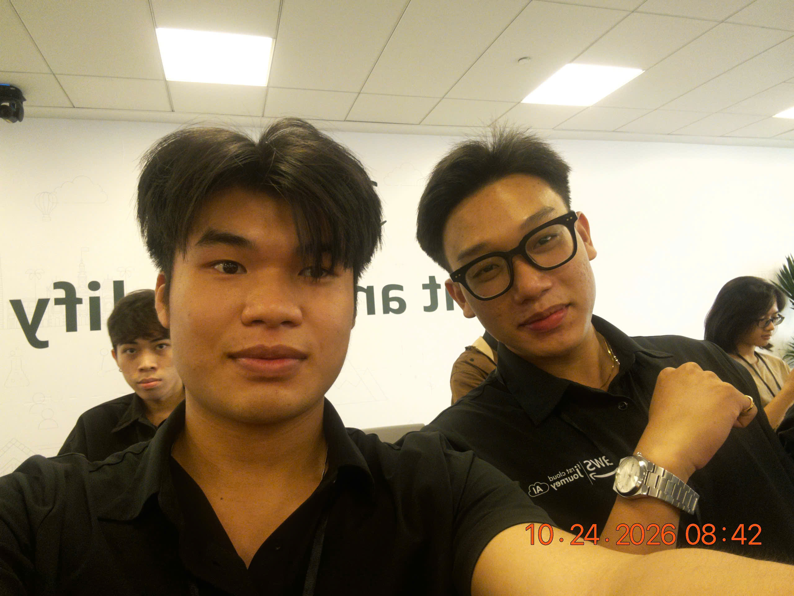
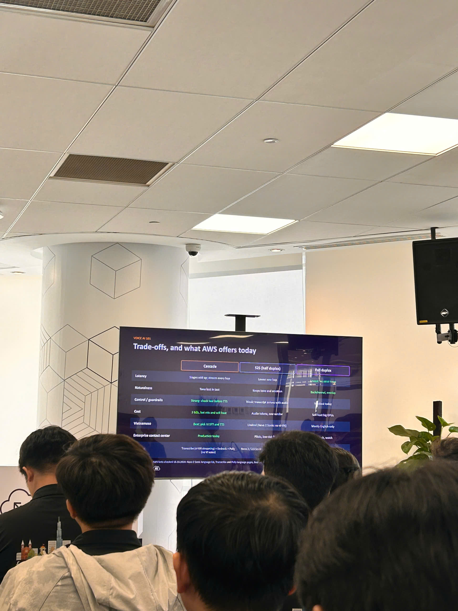

Giới thiệu sự kiện

Ngày 24/10/2026, tôi tham gia buổi FCAJ Mini Meeting thuộc cộng đồng First Cloud AI Journey.

Buổi gặp gỡ có các phần chia sẻ về Vietnamese Voice AI, AWS Resource Access Manager (RAM), AWS Security Agent và Amazon Bedrock AgentCore.

Đây đều là những chủ đề khá mới đối với tôi. Ngoài việc tìm hiểu các dịch vụ AWS cơ bản, tôi muốn biết thêm cách những công nghệ này được sử dụng khi xây dựng và quản lý một ứng dụng thực tế.

Thông tin sự kiện

Tên sự kiện: FCAJ Mini Meeting.

Thời gian: 24/10/2026.

Vai trò: Người tham dự.

Nội dung chính: Voice AI, AWS RAM, AWS Security Agent và Amazon Bedrock AgentCore.

1. Hear, Think, Speak — Xây dựng Voice AI tiếng Việt

Phần đầu tiên tôi quan tâm là chủ đề Hear, Think, Speak: Building a Vietnamese Voice-AI Contact Center on AWS.

Nội dung này giúp tôi tìm hiểu thêm về cách xây dựng một hệ thống AI có thể nghe, hiểu và phản hồi bằng giọng nói. Một ví dụ dễ hình dung là tổng đài tự động có khả năng trao đổi với khách hàng.

Trước đây, tôi thường sử dụng AI bằng cách nhập văn bản và nhận câu trả lời. Với Voice AI, quá trình xử lý phức tạp hơn vì hệ thống còn phải nhận diện lời nói, hiểu nội dung và tạo giọng nói phản hồi.

Các cách xử lý giọng nói

Tôi được biết thêm về một số hướng tiếp cận:

Cascade: Chuyển giọng nói thành văn bản, dùng AI xử lý nội dung rồi chuyển câu trả lời thành âm thanh.

Speech-to-Speech: Sử dụng mô hình có khả năng xử lý đầu vào và đầu ra bằng âm thanh.

Full Duplex: Hướng đến việc hệ thống có thể nghe và nói linh hoạt hơn trong cuộc hội thoại.

Điều tôi thấy thú vị là một hệ thống Voice AI không chỉ cần trả lời đúng. Tốc độ phản hồi cũng quan trọng, vì nếu phải chờ quá lâu thì cuộc trò chuyện sẽ không còn tự nhiên.

Qua phần này, tôi hiểu thêm rằng việc xây dựng ứng dụng AI có giọng nói cần kết hợp nhiều bước xử lý, thay vì chỉ sử dụng một mô hình AI.

2. AWS Resource Access Manager — Chia sẻ tài nguyên AWS

Chủ đề tiếp theo là AWS Resource Access Manager (AWS RAM).

Khi mới học AWS, tôi chủ yếu thực hành trong một tài khoản nên chưa nghĩ nhiều đến việc quản lý tài nguyên giữa nhiều tài khoản khác nhau.

Qua phần giới thiệu, tôi biết AWS RAM hỗ trợ chia sẻ một số loại tài nguyên AWS được hỗ trợ giữa các tài khoản. Điều này có thể hữu ích khi một tổ chức có nhiều nhóm làm việc hoặc cần quản lý hạ tầng theo từng bộ phận.

Một điểm tôi ghi nhớ là việc chia sẻ tài nguyên cần đi kèm với quản lý quyền truy cập. Không phải tài khoản nào cũng nên có quyền sử dụng mọi tài nguyên.

Dù chưa có cơ hội thực hành AWS RAM, tôi thấy đây là kiến thức hữu ích để hiểu thêm cách các doanh nghiệp tổ chức môi trường Cloud.

3. AWS Security Agent — Bảo mật ứng dụng Web

Một nội dung khác trong buổi Mini Meeting là AWS Security Agent và việc sử dụng AI để hỗ trợ kiểm tra bảo mật ứng dụng.

Trước đây, khi làm một website, tôi thường tập trung nhiều vào giao diện và chức năng. Những vấn đề về bảo mật đôi khi chỉ được chú ý khi ứng dụng gần hoàn thành.

Qua chủ đề này, tôi nhận thấy việc xem xét bảo mật nên bắt đầu sớm hơn, ngay từ lúc thiết kế hệ thống.

Chẳng hạn, khi xây dựng một ứng dụng, người phát triển cần quan tâm đến cách quản lý quyền truy cập, bảo vệ dữ liệu và hạn chế các cấu hình không an toàn.

Tôi cũng hiểu rằng các công cụ AI có thể hỗ trợ quá trình kiểm tra, nhưng kết quả vẫn cần được xem xét lại. Không nên cho rằng sử dụng công cụ tự động là ứng dụng đã hoàn toàn an toàn.

Đây là phần kiến thức tôi muốn tìm hiểu thêm trước khi triển khai những dự án của mình lên AWS.

4. Amazon Bedrock AgentCore — Runtime và Memory

Phần chia sẻ về Amazon Bedrock AgentCore giới thiệu thêm cho tôi các khái niệm liên quan đến việc xây dựng và vận hành AI Agent.

Hai nội dung tôi chú ý là Runtime và Memory.

AgentCore Runtime

Theo cách tôi hiểu, Runtime liên quan đến môi trường thực thi và cách quản lý hoạt động của AI Agent.

Điều này giúp tôi nhận ra rằng một AI Agent không chỉ cần có mô hình xử lý thông tin mà còn cần một môi trường phù hợp để chạy các tác vụ.

AgentCore Memory

Phần Memory khiến tôi quan tâm hơn vì liên quan đến việc lưu giữ thông tin và ngữ cảnh trong quá trình tương tác.

Ví dụ, nếu một ứng dụng cần xử lý nhiều yêu cầu liên tiếp, việc quản lý thông tin từ những lần tương tác trước có thể giúp quá trình xử lý thuận tiện hơn.

Tôi cũng được làm quen với một số khái niệm như Session ID, Actor ID và dữ liệu tương tác.

Dù chưa hiểu sâu về cách triển khai, phần trình bày giúp tôi biết thêm những vấn đề cần xem xét khi xây dựng ứng dụng AI có nhiều bước xử lý.

5. Những kiến thức học được

Sau buổi Mini Meeting, tôi ghi lại một số điều đáng chú ý:

Hiểu sơ bộ các bước xử lý trong một hệ thống Voice AI.

Biết thêm một số cách xây dựng ứng dụng AI có khả năng giao tiếp bằng giọng nói.

Hiểu mục đích của AWS RAM khi chia sẻ tài nguyên giữa các tài khoản.

Nhận thấy bảo mật cần được quan tâm ngay từ khi thiết kế ứng dụng.

Biết thêm về Runtime và Memory trong các hệ thống AI Agent.

Có thêm góc nhìn về việc kết hợp AI với những thành phần khác của ứng dụng.

Một số kiến thức vẫn còn khó đối với tôi, đặc biệt là các nội dung về AWS RAM và AgentCore. Tôi cần tiếp tục đọc thêm tài liệu để hiểu rõ hơn.

6. Liên hệ với dự án cá nhân

Trong thời gian này, tôi đang tham gia phát triển LoveSpot, ứng dụng gợi ý quán ăn và tạo lịch trình tại TP. Hồ Chí Minh.

Ở giai đoạn đó, nhóm đang tìm hiểu và xây dựng những thành phần ban đầu của ứng dụng, bao gồm giao diện, dữ liệu địa điểm và hướng xử lý các chức năng chính.

Từ những nội dung trong buổi Mini Meeting, tôi nhận thấy việc xây dựng một ứng dụng AI cần quan tâm đến cách các thành phần trao đổi dữ liệu với nhau.

Đối với LoveSpot, việc quản lý thông tin địa điểm và xử lý đúng yêu cầu người dùng là những vấn đề cần được chú ý. Ngoài ra, các kiến thức về bảo mật cũng nhắc tôi phải cẩn thận hơn khi làm việc với dữ liệu và API.

Những công nghệ như Voice AI, AWS RAM hay AgentCore hiện chỉ là kiến thức tôi tìm hiểu thêm, không phải những dịch vụ đã được sử dụng trong LoveSpot.

7. Cảm nhận cá nhân

Tôi thấy buổi Mini Meeting khá thú vị vì có nhiều chủ đề khác với những bài học AWS cơ bản trước đó.

Trong các phần chia sẻ, tôi thích nội dung về Voice AI tiếng Việt nhất. Việc một hệ thống có thể nghe và phản hồi bằng giọng nói khiến tôi tò mò về cách dữ liệu âm thanh được xử lý phía sau.

Tuy nhiên, cũng có những phần tôi chưa theo kịp hoàn toàn, nhất là khi nhắc đến các thành phần và kiến trúc chuyên sâu. Tôi nghĩ điều này khá bình thường vì mình vẫn đang trong quá trình học.

Sau sự kiện, tôi có thêm một số chủ đề muốn tìm hiểu và cũng nhận ra rằng để xây dựng một ứng dụng tốt, ngoài lập trình còn cần kiến thức về dữ liệu, bảo mật và vận hành hệ thống.

### 8. Một số hình ảnh của sự kiện

Dưới đây là một số hình ảnh được lưu lại từ buổi FCAJ Mini Meeting.

#### Hình ảnh 1

#### Hình ảnh 2

#### Hình ảnh 3

#### Hình ảnh 4

#### Hình ảnh 5

Tổng kết

Buổi FCAJ Mini Meeting ngày 24/10/2026 giúp tôi biết thêm về Voice AI, quản lý tài nguyên AWS, bảo mật ứng dụng và AI Agent.

Điều tôi nhớ nhất là một ứng dụng AI thực tế cần nhiều thành phần phối hợp để hoạt động hiệu quả. Ngoài mô hình AI, người phát triển còn phải quan tâm đến cách xử lý dữ liệu, kết nối hệ thống và kiểm tra kết quả.

Tôi xem đây là một buổi học bổ ích, giúp mình mở rộng kiến thức và có thêm hướng tìm hiểu trong quá trình học AWS cũng như phát triển dự án LoveSpot.