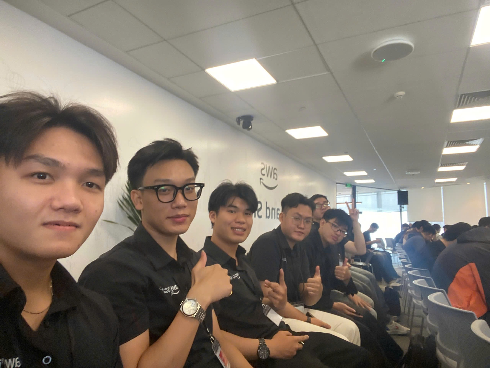
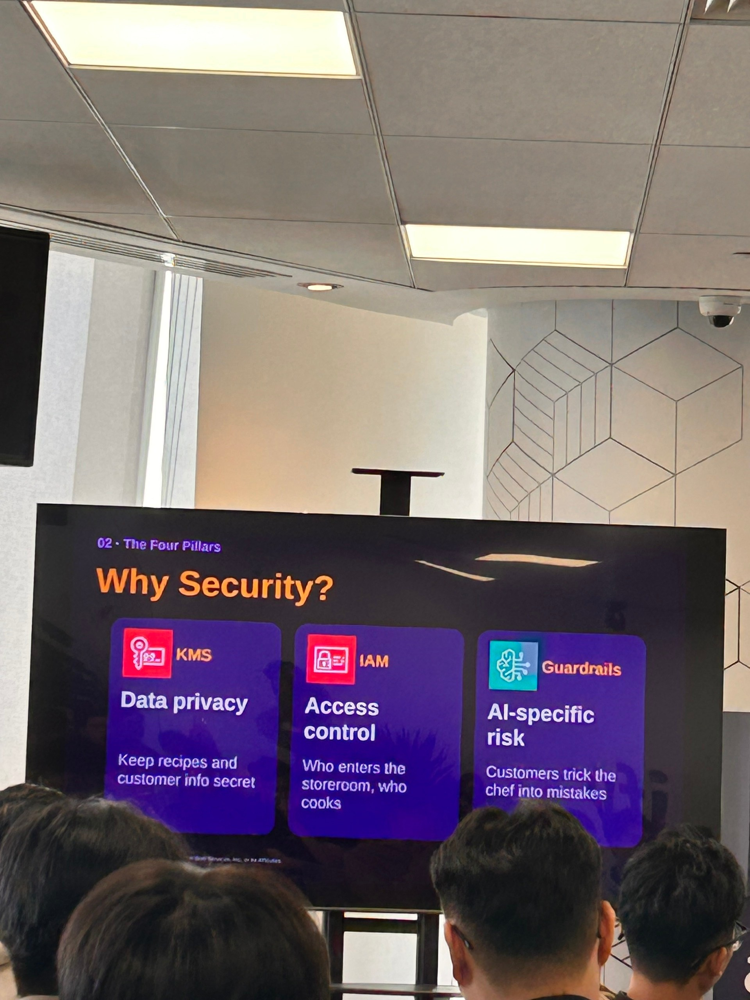
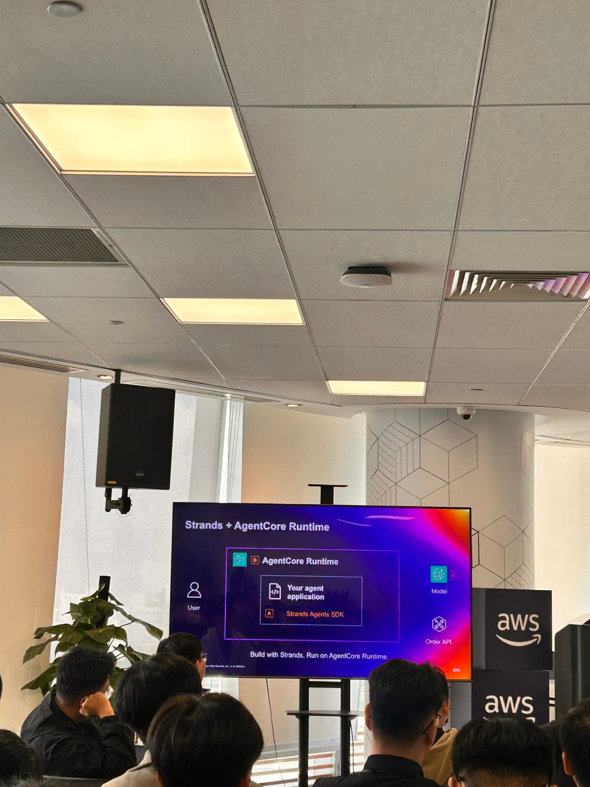

### Event Introduction

On **November 14, 2026**, I attended a session titled **From Prototype to Production**, which focused on developing and operating AI applications in real-world environments.

Before attending this session, I usually focused on whether an AI model could produce accurate responses and how to make a particular feature work. However, I learned that an application performing well in a test environment is not necessarily ready for real users.

Beyond the AI model, developers must also consider security, scalability, reliability, and operating costs. These topics were especially relevant to what I was learning through AWS and my software development project.

### Event Information

- **Event Name:** From Prototype to Production.
- **Date:** November 14, 2026.
- **Role:** Participant.
- **Main Topics:** AI architecture on AWS, Amazon Bedrock AgentCore, RAG, security, monitoring, and application operations.

### 1. From a Prototype to a Production System

One of the most interesting topics for me was the difference between building an AI prototype and deploying an application for real users.

During the prototype stage, developers often concentrate on the main functionality. However, when more people start using the application, the system needs to handle additional challenges.

The session introduced several important considerations:

- **Security:** Managing access permissions and protecting application data with services such as IAM and AWS KMS.
- **Scalability:** Using load balancing and Auto Scaling to handle changes in traffic.
- **Reliability:** Combining health checks, error handling, and recovery mechanisms to reduce service interruptions.
- **Cost:** Selecting appropriate infrastructure and AI models instead of always using the largest available option.

My main takeaway was that **a good AI application needs more than accurate responses. It must also remain stable and operate at a reasonable cost**.

### 2. Exploring Amazon Bedrock AgentCore

Another topic was **Amazon Bedrock AgentCore**, which introduced several components involved in building AI Agents.

I paid particular attention to three components:

- **Runtime:** Provides an environment for executing and managing agents.
- **Gateway:** Helps agents connect to the tools and APIs they need.
- **Memory:** Helps maintain information and context across interactions.

Previously, I thought of an AI Agent mainly as a model that could use tools to complete tasks. This session helped me understand that a complete system also needs to manage execution, context, and access permissions.

The presentations also included an example of connecting internal systems with AI components hosted on AWS. I found this interesting because organizations do not always need to move every part of their existing systems to the cloud.

### 3. RAG and Document Retrieval

The section on **Retrieval-Augmented Generation (RAG)** helped me better understand how AI applications can use information from external documents instead of relying only on the model's existing knowledge.

The process was explained through two main stages.

#### Preparing and Indexing Documents

Documents are processed into smaller sections. An embedding model then converts their content into vectors, making it possible to search for relevant information.

#### Retrieving Information and Generating Answers

When a user submits a question, the system searches for relevant document sections and provides them as context for the model to generate an answer.

One important lesson was that providing reference documents does not automatically guarantee an accurate answer. The retrieval system might select irrelevant information, or the model might misunderstand the content it receives.

Therefore, evaluating a RAG application requires examining both **retrieval quality** and **the accuracy of the final response**.

### 4. Controlling AI Agent Actions

The session also explored how multiple AI Agents can be organized to handle different types of requests.

Through examples involving **Strands and FastAPI**, I learned how a routing component can direct requests to specialized agents, such as agents responsible for information retrieval, document research, or drafting content.

One point that stood out to me was that not every AI action should happen automatically.

In the ticket-processing example, an agent could prepare a draft, but a person needed to review and approve it before submission.

I believe this approach is useful when AI features can modify data or perform actions on behalf of users.

Access control is equally important. An agent should only have permission to use the tools and resources required for its assigned task.

### 5. Monitoring and Operating AI Applications on AWS

The session also introduced several AWS services that can work together to deploy an application.

One example architecture used **Amazon ECR** to store container images, **Amazon ECS with AWS Fargate** to run applications, and an **Application Load Balancer** to distribute incoming traffic.

The discussion of IAM, Secrets Manager, and AWS Budgets also helped me understand how configuration secrets and operating costs can be managed.

This was an example architecture presented during the event, not an infrastructure setup I had already deployed for my own project.

Another interesting topic was **Langfuse**, which was introduced as a way to observe AI Agent execution.

Instead of simply knowing that a request was slow or failed, tracing individual steps can help identify whether a problem happened during document retrieval, model execution, or tool usage.

This showed me that monitoring is not only useful for finding errors but also for improving the performance and quality of AI applications.

### 6. What I Learned

After the session, I noted several important lessons:

- AI applications should be designed for ongoing operation, not only for the prototype stage.
- Security, scalability, and cost should be considered early in the architecture design process.
- RAG can help AI systems use external documents, but the retrieved information still needs to be evaluated.
- AI Agents should have limited access permissions, with human approval for important actions.
- Monitoring tools help developers understand execution flows and investigate problems more effectively.

Although I had not practiced all the technologies introduced during the session, the presentations helped me understand the challenges involved in operating real-world AI applications.

### 7. Connection to My LoveSpot Project

At that time, I was working on **LoveSpot**, an application designed to recommend dining locations and create itineraries in Ho Chi Minh City.

The project included venue data, recommendation algorithms, an AI service, backend components, and a frontend. The session encouraged me to think more carefully about how these components should work together when the application is deployed.

For LoveSpot, I identified several important considerations:

- **Data Accuracy:** Recommendations should be based on relevant and verifiable venue information.
- **AI Error Handling:** If an external AI service becomes unavailable, the application should handle the problem without unnecessarily interrupting the entire system.
- **Performance:** Processing times should be monitored to improve the user experience.
- **Security and Cost:** Deploying on AWS requires careful management of sensitive information and infrastructure costs.

Technologies such as AgentCore, ECS Fargate, and Langfuse were topics I learned about during the event. This does not mean they had already been integrated into LoveSpot.

### 8. Personal Reflection

I found the session valuable because it helped me look at AI from the perspective of building and operating a complete product rather than focusing only on the model.

The topics I found most interesting were error handling and monitoring AI Agent execution. Previously, I often concentrated on whether a feature worked. After the session, I realized that being able to identify the cause of a failure is just as important.

Some topics related to AgentCore and multi-component architectures were still new to me. However, they gave me more direction for continuing my AWS studies and learning how to design reliable applications.

### 9. Event Photos

### Conclusion

The **From Prototype to Production** session helped me better understand what is required to move an AI application from a prototype to a real operating environment.

My biggest takeaway was that **making a feature work is only the beginning. Maintaining reliability, security, and control over the system is equally important**.

These are areas I would like to continue exploring and applying where appropriate as I study AWS and develop the LoveSpot project.