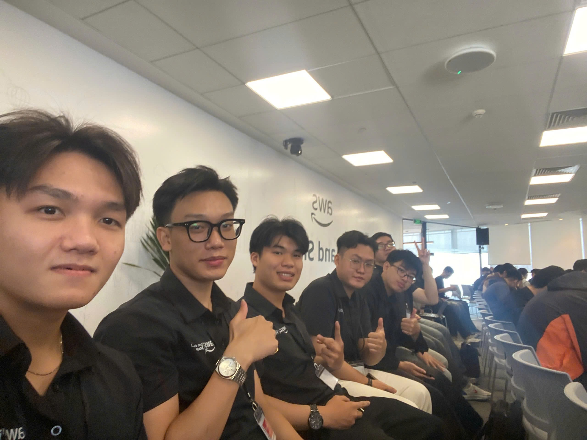
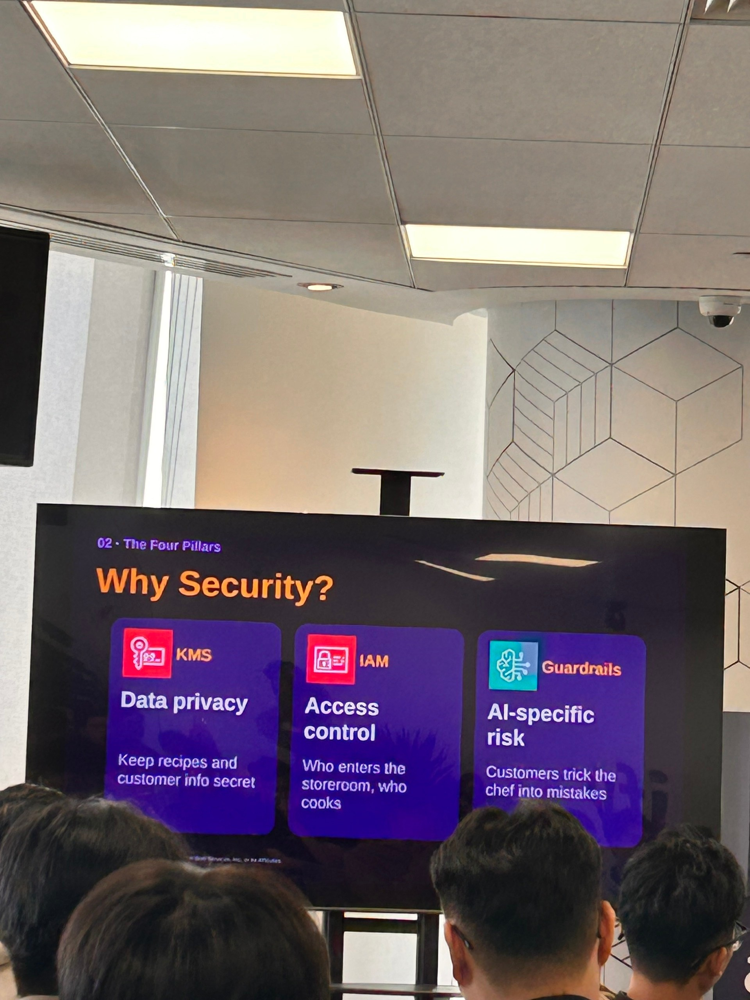
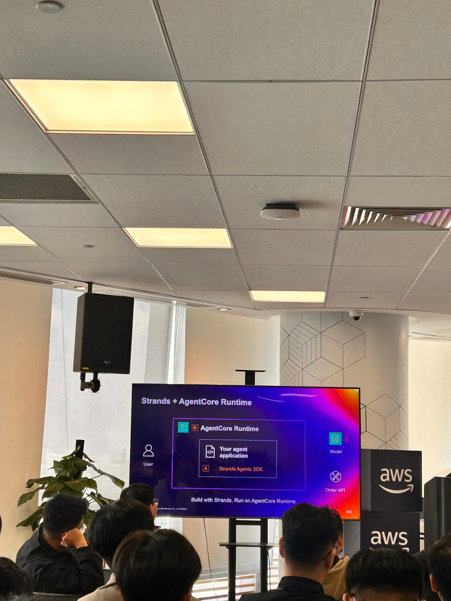

### Giới thiệu sự kiện

Ngày **14/11/2026**, tôi có cơ hội tham gia buổi chia sẻ với chủ đề **From Prototype to Production**, tập trung vào việc xây dựng và vận hành các ứng dụng AI trong môi trường thực tế.

Trước đây, khi tìm hiểu AI, tôi thường chú ý đến việc mô hình có trả lời đúng hay không và làm thế nào để xây dựng một tính năng hoạt động được. Tuy nhiên, qua buổi chia sẻ, tôi nhận ra rằng một ứng dụng chạy tốt ở môi trường thử nghiệm chưa chắc đã sẵn sàng phục vụ người dùng thực tế.

Bên cạnh mô hình AI, hệ thống còn cần quan tâm đến bảo mật, khả năng mở rộng, độ ổn định và chi phí vận hành. Đây cũng là những vấn đề tôi đang tìm hiểu trong quá trình phát triển dự án cá nhân và học AWS.

### Thông tin sự kiện

- **Tên sự kiện:** From Prototype to Production.
- **Thời gian:** 14/11/2026.
- **Vai trò:** Người tham dự.
- **Nội dung chính:** Kiến trúc AI trên AWS, Amazon Bedrock AgentCore, RAG, bảo mật, giám sát và vận hành ứng dụng.

### 1. Từ ứng dụng thử nghiệm đến hệ thống thực tế

Một trong những nội dung tôi quan tâm nhất là sự khác biệt giữa việc xây dựng một bản thử nghiệm AI và đưa ứng dụng vào sử dụng thực tế.

Trong giai đoạn thử nghiệm, người phát triển thường tập trung vào chức năng chính. Nhưng khi có nhiều người sử dụng, hệ thống cần được thiết kế để xử lý các tình huống phức tạp hơn.

Buổi chia sẻ đề cập đến một số yếu tố quan trọng:

- **Bảo mật:** Kiểm soát quyền truy cập và bảo vệ thông tin của ứng dụng bằng những dịch vụ như IAM và AWS KMS.
- **Khả năng mở rộng:** Sử dụng cân bằng tải và Auto Scaling để hệ thống thích ứng khi lượng truy cập thay đổi.
- **Độ tin cậy:** Kết hợp health check, xử lý lỗi và các phương án dự phòng để hạn chế gián đoạn.
- **Chi phí:** Lựa chọn tài nguyên và mô hình AI phù hợp thay vì luôn sử dụng giải pháp có cấu hình lớn nhất.

Điều tôi ghi nhớ là **một ứng dụng AI tốt không chỉ cần có câu trả lời chính xác, mà còn phải hoạt động ổn định và có chi phí hợp lý**.

### 2. Tìm hiểu Amazon Bedrock AgentCore

Một chủ đề khác là **Amazon Bedrock AgentCore**, giúp tôi hiểu thêm về những thành phần cần thiết khi xây dựng AI Agent.

Trong phần giới thiệu, tôi chú ý đến ba thành phần:

- **Runtime:** Cung cấp môi trường để thực thi và quản lý hoạt động của agent.
- **Gateway:** Hỗ trợ kết nối agent với các công cụ và API cần thiết.
- **Memory:** Hỗ trợ lưu giữ thông tin và ngữ cảnh để phục vụ các lần tương tác.

Trước đây, tôi thường hình dung AI Agent đơn giản là một mô hình có thể gọi công cụ để hoàn thành yêu cầu. Qua phần này, tôi nhận thấy hệ thống còn cần quản lý việc thực thi, thông tin được sử dụng và quyền truy cập của từng thành phần.

Buổi chia sẻ cũng giới thiệu ví dụ kết hợp hệ thống nội bộ với các thành phần AI trên AWS. Tôi thấy đây là một hướng tiếp cận thú vị vì không phải ứng dụng nào cũng có thể hoặc cần chuyển toàn bộ hệ thống lên Cloud.

### 3. RAG và cách AI sử dụng tài liệu

Phần **Retrieval-Augmented Generation (RAG)** giúp tôi hiểu rõ hơn cách ứng dụng AI có thể sử dụng dữ liệu từ những tài liệu bên ngoài thay vì chỉ dựa vào kiến thức có sẵn của mô hình.

Theo nội dung được giới thiệu, quá trình này có thể chia thành hai giai đoạn.

#### Chuẩn bị và lập chỉ mục dữ liệu

Tài liệu được xử lý thành những phần nhỏ hơn. Sau đó, mô hình embedding chuyển nội dung thành vector để hỗ trợ việc tìm kiếm thông tin liên quan.

#### Truy xuất và tạo câu trả lời

Khi người dùng đặt câu hỏi, hệ thống tìm những đoạn tài liệu phù hợp rồi đưa chúng vào ngữ cảnh để mô hình tạo câu trả lời.

Điều tôi thấy quan trọng là việc có tài liệu tham khảo không đồng nghĩa với việc câu trả lời luôn chính xác. Hệ thống vẫn có thể tìm nhầm thông tin hoặc mô hình hiểu chưa đúng nội dung được cung cấp.

Vì vậy, khi đánh giá một ứng dụng RAG, cần xem xét cả **chất lượng truy xuất tài liệu** và **chất lượng câu trả lời cuối cùng**.

### 4. Kiểm soát hành động của AI Agent

Buổi chia sẻ còn đề cập đến việc tổ chức nhiều agent để xử lý những loại yêu cầu khác nhau.

Thông qua các ví dụ sử dụng **Strands và FastAPI**, tôi được tìm hiểu cách một thành phần điều phối có thể chuyển yêu cầu đến agent phù hợp, chẳng hạn như tra cứu thông tin, nghiên cứu tài liệu hoặc chuẩn bị nội dung.

Một điểm đáng chú ý là không phải hành động nào của AI cũng nên được thực hiện tự động.

Trong ví dụ xử lý ticket, agent có thể chuẩn bị bản nháp, nhưng người dùng cần kiểm tra và phê duyệt trước khi gửi.

Tôi nhận thấy cách làm này hữu ích đối với những chức năng có khả năng thay đổi dữ liệu hoặc thực hiện hành động thay cho người dùng.

Ngoài ra, việc phân chia quyền truy cập cũng rất quan trọng. Agent chỉ nên được sử dụng những công cụ và tài nguyên thực sự cần thiết cho nhiệm vụ của mình.

### 5. Giám sát và vận hành ứng dụng AI trên AWS

Ở phần vận hành, buổi chia sẻ giới thiệu một số thành phần AWS có thể phối hợp để triển khai ứng dụng.

Ví dụ kiến trúc được trình bày sử dụng **Amazon ECR** để lưu trữ container image, **Amazon ECS với AWS Fargate** để chạy ứng dụng và **Application Load Balancer** để phân phối lưu lượng.

Các nội dung liên quan đến IAM, Secrets Manager và AWS Budgets cũng giúp tôi hiểu thêm về việc bảo vệ thông tin cấu hình và theo dõi chi phí.

Đây là kiến trúc minh họa trong buổi chia sẻ, không phải cấu trúc tôi đã triển khai cho dự án của mình.

Bên cạnh hạ tầng, tôi còn được giới thiệu **Langfuse** để quan sát quá trình xử lý của AI Agent.

Thay vì chỉ biết một yêu cầu mất nhiều thời gian hoặc gặp lỗi, việc theo dõi từng bước có thể giúp xác định vấn đề nằm ở khâu truy xuất dữ liệu, gọi mô hình hay sử dụng công cụ.

Từ đó, tôi hiểu rằng giám sát không chỉ phục vụ việc phát hiện lỗi mà còn giúp cải thiện hiệu năng và chất lượng của ứng dụng.

### 6. Những kiến thức rút ra

Sau buổi chia sẻ, tôi ghi nhớ một số kiến thức quan trọng:

- Một ứng dụng AI cần được thiết kế cho cả quá trình vận hành, không chỉ giai đoạn thử nghiệm.
- Bảo mật, khả năng mở rộng và chi phí cần được xem xét ngay từ khi xây dựng kiến trúc.
- RAG giúp AI khai thác thông tin từ tài liệu, nhưng cần kiểm tra độ chính xác của kết quả truy xuất.
- AI Agent cần được giới hạn quyền truy cập và có bước xác nhận của người dùng đối với những hành động quan trọng.
- Công cụ giám sát giúp hiểu rõ quá trình xử lý và tìm nguyên nhân khi hệ thống hoạt động không như mong đợi.

Tuy chưa có cơ hội thực hành toàn bộ những công nghệ được giới thiệu, tôi thấy buổi chia sẻ giúp mình hiểu thêm về các vấn đề mà một ứng dụng AI thực tế có thể gặp phải.

### 7. Liên hệ với dự án LoveSpot

Trong thời gian này, tôi đang tham gia phát triển **LoveSpot**, ứng dụng hỗ trợ gợi ý địa điểm ăn uống và xây dựng lịch trình tại TP. Hồ Chí Minh.

Dự án có các thành phần liên quan đến dữ liệu địa điểm, thuật toán gợi ý, AI service, backend và frontend. Vì vậy, nội dung buổi chia sẻ khiến tôi suy nghĩ nhiều hơn về cách những thành phần này hoạt động cùng nhau khi ứng dụng được triển khai.

Đối với LoveSpot, tôi nhận thấy có một số vấn đề cần chú ý:

- **Độ chính xác của dữ liệu:** Kết quả gợi ý cần dựa trên thông tin địa điểm phù hợp và có thể kiểm tra.
- **Xử lý lỗi AI:** Khi dịch vụ AI bên ngoài không phản hồi, ứng dụng cần có cách xử lý phù hợp thay vì khiến toàn bộ chức năng ngừng hoạt động.
- **Hiệu năng:** Cần theo dõi thời gian xử lý để cải thiện trải nghiệm của người dùng.
- **Bảo mật và chi phí:** Khi triển khai lên AWS, cần quản lý thông tin nhạy cảm và lựa chọn tài nguyên phù hợp với nhu cầu thực tế.

Các dịch vụ như AgentCore, ECS Fargate hay Langfuse là những công nghệ tôi được tìm hiểu qua sự kiện, không có nghĩa chúng đã được tích hợp vào LoveSpot.

### 8. Cảm nhận cá nhân

Tôi thấy buổi chia sẻ khá bổ ích vì giúp mình nhìn nhận AI từ góc độ xây dựng và vận hành một sản phẩm, thay vì chỉ quan tâm đến mô hình.

Phần tôi quan tâm nhất là cách hệ thống xử lý lỗi và giám sát hoạt động của AI Agent. Trước đây, khi phát triển một tính năng, tôi thường chú ý nhiều đến việc chức năng có chạy được hay không. Sau buổi này, tôi nhận ra rằng việc xác định nguyên nhân khi hệ thống gặp lỗi cũng quan trọng không kém.

Một số nội dung về AgentCore và các kiến trúc nhiều thành phần vẫn còn khá mới đối với tôi. Tuy nhiên, chúng giúp tôi có thêm định hướng để tiếp tục tìm hiểu AWS và cách thiết kế ứng dụng đáng tin cậy hơn.

### 9. Một số hình ảnh khi tham gia sự kiện

### Tổng kết

Buổi **From Prototype to Production** giúp tôi hiểu rõ hơn những yêu cầu cần thiết để chuyển một ứng dụng AI từ giai đoạn thử nghiệm sang môi trường vận hành thực tế.

Bài học lớn nhất tôi rút ra là **xây dựng được một tính năng chỉ là bước đầu; việc duy trì tính ổn định, bảo mật và khả năng kiểm soát hệ thống cũng quan trọng không kém**.

Đây là những kiến thức tôi muốn tiếp tục tìm hiểu và vận dụng phù hợp trong quá trình học AWS cũng như phát triển dự án LoveSpot.