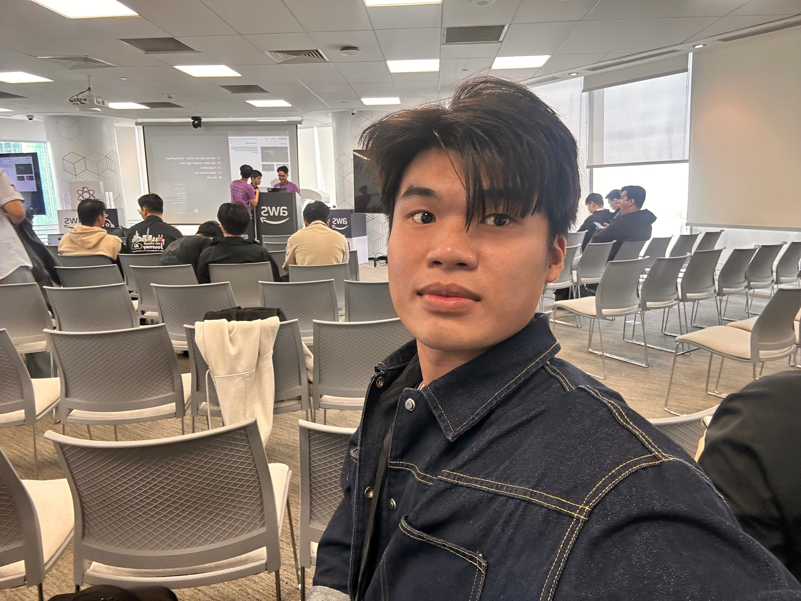
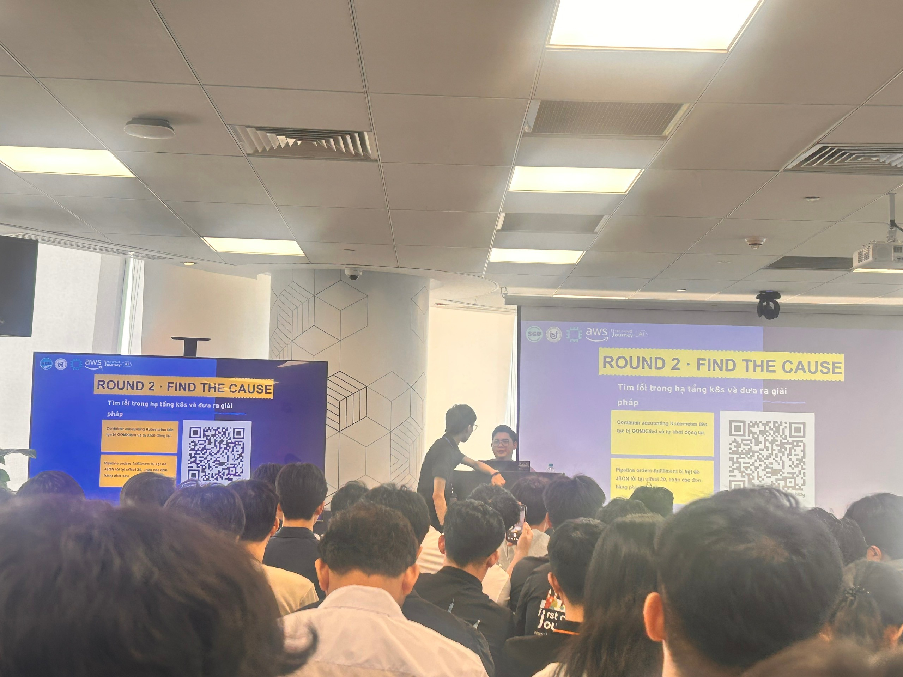
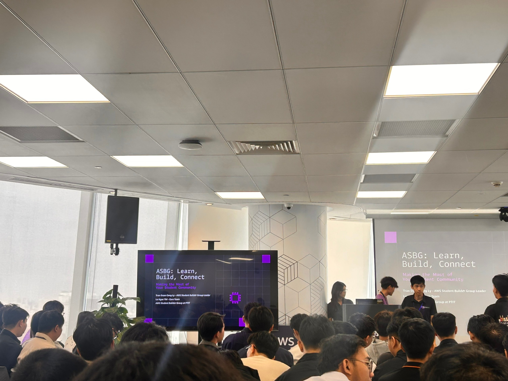
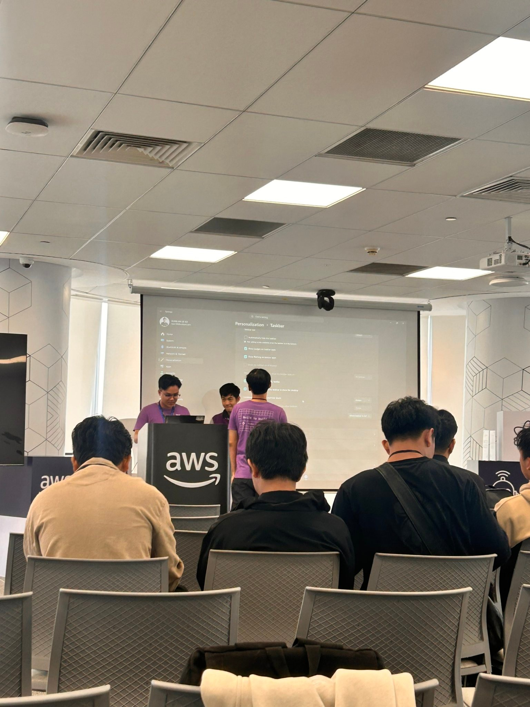

### Giới thiệu sự kiện

Ngày **21/11/2026**, tôi có cơ hội tham gia sự kiện **AWS Student Community Day Vietnam 2026** tại TP. Hồ Chí Minh.

Đây là dịp để các bạn sinh viên có cùng sự quan tâm đến Cloud Computing và AWS gặp gỡ, trao đổi kiến thức cũng như chia sẻ những kinh nghiệm trong quá trình học tập và thực hiện dự án.

Sự kiện có sự tham gia của các nhóm AWS Student Builder Group đến từ nhiều trường đại học, cùng những phần chia sẻ về bảo mật mạng trên AWS, kinh nghiệm tham gia cuộc thi công nghệ và các hoạt động giao lưu.

Đối với tôi, đây không chỉ là cơ hội tìm hiểu thêm kiến thức kỹ thuật mà còn giúp tôi biết được cách những bạn sinh viên khác học AWS và ứng dụng kiến thức vào các dự án thực tế.

### Thông tin sự kiện

- **Tên sự kiện:** AWS Student Community Day Vietnam 2026.
- **Thời gian:** Thứ Bảy, ngày 21/11/2026, từ 09:00 đến 11:30.
- **Địa điểm:** Tầng 26, Bitexco Tower, TP. Hồ Chí Minh.
- **Vai trò:** Người tham dự.
- **Nội dung chính:** Cộng đồng AWS Student Builder Group, bảo mật mạng trên AWS, chia sẻ kinh nghiệm dự án và các hoạt động giao lưu.

### 1. Tìm hiểu cộng đồng AWS Student Builder Group

Một trong những nội dung đầu tiên của sự kiện là phần giới thiệu và chia sẻ từ các nhóm **AWS Student Builder Group**.

Tôi được biết thêm về hoạt động của các nhóm sinh viên đến từ bốn trường đại học:

- HCMUTE – Đại học Sư phạm Kỹ thuật TP. Hồ Chí Minh.
- HUFLIT – Trường Đại học Ngoại ngữ – Tin học TP. Hồ Chí Minh.
- PTIT HCM – Học viện Công nghệ Bưu chính Viễn thông, cơ sở TP. Hồ Chí Minh.
- SGU – Trường Đại học Sài Gòn.

Các phần chia sẻ giúp tôi hiểu thêm về hành trình học tập và tham gia cộng đồng AWS của sinh viên ở những trường khác nhau.

Điều tôi thấy thú vị là mỗi nhóm có những trải nghiệm riêng, nhưng đều có chung sự quan tâm đến công nghệ Cloud và mong muốn phát triển kiến thức thông qua các hoạt động thực tế.

Qua đó, tôi nhận thấy việc tham gia một cộng đồng công nghệ có thể tạo thêm động lực học tập, giúp các thành viên trao đổi kinh nghiệm và cùng nhau giải quyết những khó khăn khi tiếp cận kiến thức mới.

### 2. Bảo mật mạng nhiều lớp trên AWS

Phần chia sẻ kỹ thuật mà tôi quan tâm nhất là chủ đề **bảo mật mạng nhiều lớp trên AWS**.

Trước đây, khi học về VPC, Subnet và Security Group, tôi thường tìm hiểu từng dịch vụ riêng lẻ. Qua nội dung này, tôi có thêm góc nhìn về cách kết hợp những thành phần đó để xây dựng một hệ thống có khả năng kiểm soát truy cập tốt hơn.

Theo những gì tôi tìm hiểu từ buổi chia sẻ, bảo mật không nên chỉ phụ thuộc vào một cơ chế duy nhất mà cần được xem xét ở nhiều lớp khác nhau.

#### Bảo vệ ở lớp biên

Đây là nơi hệ thống tiếp nhận lưu lượng từ Internet. Việc kiểm soát các yêu cầu truy cập từ bên ngoài giúp giảm nguy cơ các lưu lượng không mong muốn ảnh hưởng đến ứng dụng.

#### Phân chia và kiểm soát mạng

Các thành phần bên trong hệ thống có thể được đặt trong những vùng mạng khác nhau tùy theo chức năng.

Ví dụ, ứng dụng cần phục vụ người dùng từ Internet, nhưng cơ sở dữ liệu không nhất thiết phải cho phép truy cập trực tiếp từ bên ngoài.

Các cấu hình mạng và Security Group giúp xác định những kết nối nào được phép đi vào hoặc đi ra khỏi từng thành phần.

#### Quản lý quyền truy cập

Ngoài bảo mật mạng, việc quản lý danh tính và quyền truy cập cũng rất quan trọng.

Tôi hiểu thêm rằng mỗi dịch vụ hoặc người dùng chỉ nên được cấp những quyền thực sự cần thiết để thực hiện nhiệm vụ của mình.

#### Kiểm tra và theo dõi

Một điểm tôi ghi nhớ là sau khi cấu hình bảo mật, cần kiểm tra lại để xác nhận hệ thống hoạt động đúng như thiết kế.

Chẳng hạn, có thể thử một kết nối được phép và một kết nối cần bị chặn để kiểm tra các quy tắc truy cập có phù hợp hay không.

Qua phần này, tôi nhận ra rằng **bảo mật không chỉ là cấu hình các dịch vụ AWS mà còn là quá trình kiểm tra và duy trì những cấu hình đó**.

### 3. Kinh nghiệm từ các dự án và cuộc thi công nghệ

Một phần khác của sự kiện là **Unlocking Prove It**, nơi **Ngũ Hành Team** chia sẻ hành trình tham gia cuộc thi Prove It và đạt vị trí **2nd runner-up**.

Điều tôi quan tâm trong phần này không chỉ là kết quả cuộc thi mà còn là quá trình một nhóm sinh viên phát triển ý tưởng, thực hiện dự án và trình bày những gì đã làm được.

Từ phần chia sẻ, tôi nhận thấy việc xây dựng một sản phẩm công nghệ không chỉ yêu cầu kiến thức lập trình. Người thực hiện còn cần biết cách giải thích vấn đề, trình bày giải pháp và thể hiện những kết quả đã kiểm chứng.

Đặc biệt, khi giới thiệu một dự án, việc mô tả rõ lý do lựa chọn công nghệ và những khó khăn gặp phải có thể giúp người nghe hiểu hơn về quá trình phát triển sản phẩm.

Đây cũng là điều tôi muốn cải thiện khi chuẩn bị tài liệu và thuyết trình về dự án của mình.

### 4. Hoạt động giao lưu và thử thách kiến thức

Bên cạnh các phần chia sẻ, sự kiện còn có những hoạt động như **Quiz Quest** và **Word Quest**.

Các hoạt động này mang đến một cách ôn tập kiến thức Cloud khá thú vị thông qua những câu hỏi và thử thách ngắn.

Tôi thích hình thức này vì không khí trở nên thoải mái hơn, đồng thời người tham dự có cơ hội kiểm tra lại những kiến thức mình đã học.

Ngoài ra, sự kiện cũng tạo điều kiện để sinh viên từ nhiều trường gặp gỡ và trao đổi về những chủ đề cùng quan tâm.

Đối với tôi, đây là một trải nghiệm tích cực vì việc học công nghệ không nhất thiết chỉ diễn ra qua tài liệu hoặc những buổi học lý thuyết.

### 5. Những kiến thức rút ra

Sau khi tham gia sự kiện, tôi ghi nhớ một số điều đáng chú ý:

- Hiểu thêm về hoạt động và vai trò của cộng đồng AWS Student Builder Group.
- Có cái nhìn rõ hơn về cách xây dựng bảo mật theo nhiều lớp trong một hệ thống AWS.
- Nhận thấy cần kiểm tra cả những kết nối được phép và những kết nối phải bị từ chối.
- Hiểu thêm tầm quan trọng của việc giải thích quyết định kỹ thuật khi trình bày dự án.
- Nhận thấy việc trao đổi với cộng đồng giúp mở rộng kiến thức và tạo động lực học tập.

Trong đó, chủ đề bảo mật mạng là nội dung tôi muốn tiếp tục tìm hiểu sâu hơn vì có liên quan trực tiếp đến quá trình triển khai ứng dụng trên AWS.

### 6. Liên hệ với dự án LoveSpot

Trong thời gian này, tôi đang tham gia phát triển **LoveSpot**, ứng dụng hỗ trợ gợi ý địa điểm ăn uống và xây dựng lịch trình tại TP. Hồ Chí Minh.

Dự án có các thành phần như frontend, backend, AI service và cơ sở dữ liệu. Vì vậy, những kiến thức về bảo mật mạng trong sự kiện giúp tôi suy nghĩ rõ hơn về cách tổ chức các kết nối giữa những thành phần này.

Khi tìm hiểu kiến trúc AWS cho LoveSpot, tôi nhận thấy một số vấn đề cần chú ý:

- **Kiểm soát truy cập:** Chỉ cho phép các thành phần giao tiếp với nhau khi thực sự cần thiết.
- **Bảo vệ cơ sở dữ liệu:** Hạn chế truy cập trực tiếp từ Internet và quản lý quyền kết nối phù hợp.
- **Kiểm thử mạng:** Xác nhận các tuyến kết nối cần thiết hoạt động, đồng thời kiểm tra những kết nối phải bị chặn.
- **Tài liệu kiến trúc:** Trình bày rõ vai trò từng dịch vụ, lý do lựa chọn và kết quả kiểm thử.

Ngoài kiến thức bảo mật, phần chia sẻ kinh nghiệm dự án cũng nhắc tôi rằng tài liệu Workshop không nên chỉ liệt kê các bước triển khai. Việc giải thích lý do thiết kế và ghi lại kết quả kiểm thử cũng rất quan trọng.

Tôi muốn áp dụng những bài học này vào quá trình hoàn thiện dự án và tài liệu AWS Workshop của mình.

### 7. Cảm nhận cá nhân

Tôi cảm thấy **AWS Student Community Day Vietnam 2026** là một sự kiện thú vị và có ý nghĩa đối với sinh viên đang tìm hiểu về Cloud Computing.

Điều tôi thích nhất là được nghe những câu chuyện học tập và làm dự án từ các bạn sinh viên ở những trường khác nhau.

Phần bảo mật mạng cũng để lại cho tôi nhiều kiến thức hữu ích. Trước đây, tôi thường tập trung vào việc làm sao để các dịch vụ kết nối được với nhau. Sau buổi chia sẻ, tôi nhận thấy cần quan tâm nhiều hơn đến việc giới hạn những kết nối không cần thiết.

Mặc dù vẫn còn một số kiến thức kỹ thuật tôi cần tìm hiểu thêm, sự kiện đã giúp tôi có thêm động lực để tiếp tục học AWS và phát triển kỹ năng của bản thân.

### 8. Một số hình ảnh khi tham gia sự kiện

### Tổng kết

Buổi **AWS Student Community Day Vietnam 2026** giúp tôi mở rộng kiến thức về bảo mật mạng trên AWS và hiểu thêm về hoạt động của cộng đồng sinh viên yêu thích công nghệ Cloud.

Bên cạnh những kiến thức kỹ thuật, tôi còn học được rằng việc chia sẻ kinh nghiệm, làm việc nhóm và trình bày rõ quá trình phát triển dự án cũng là những kỹ năng quan trọng.

Tôi xem đây là một trải nghiệm đáng nhớ trong quá trình tham gia First Cloud AI Journey và là động lực để tiếp tục học hỏi, thực hành AWS cũng như hoàn thiện dự án LoveSpot.