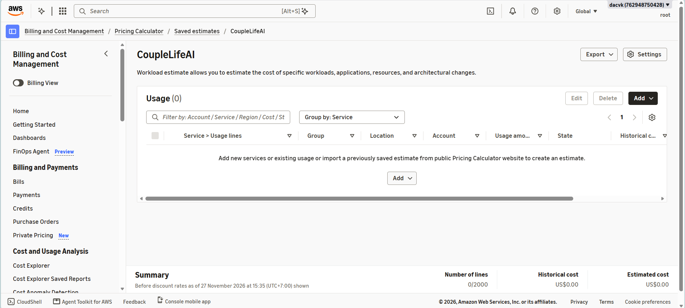
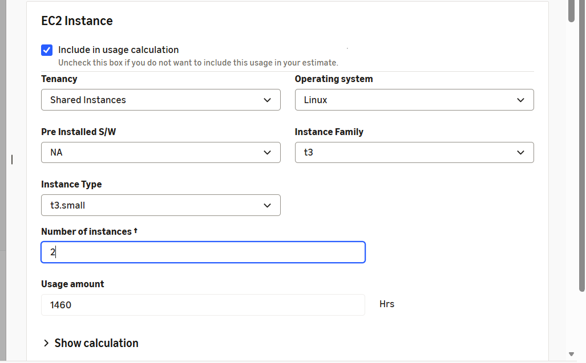
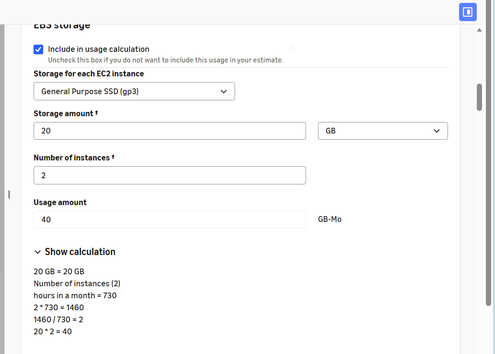
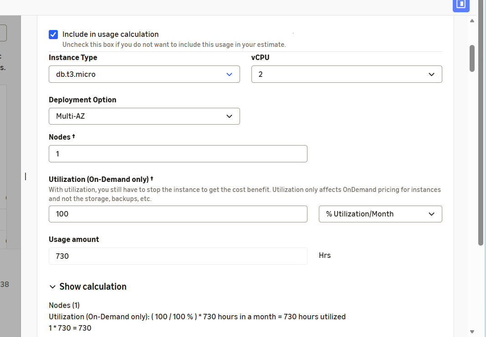
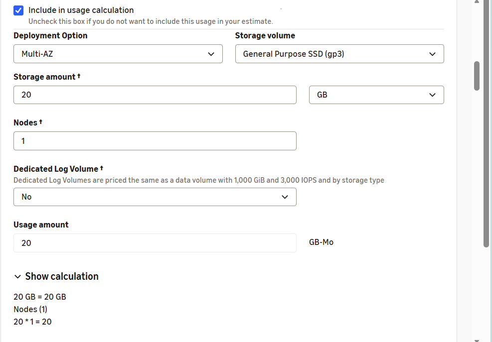
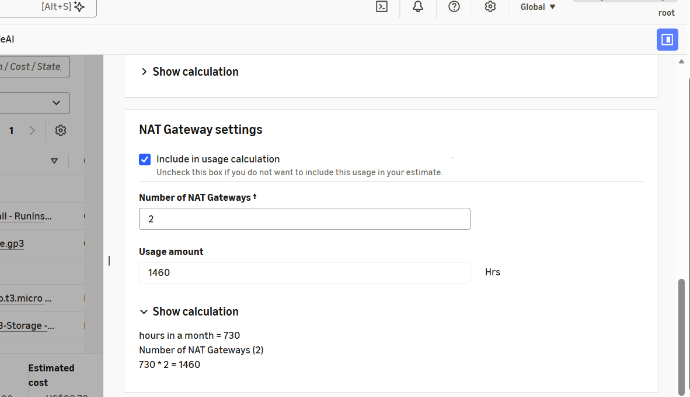

Before creating hourly billed resources, we prepare an initial estimate to see whether the HA configuration fits the lab budget. Select Singapore and use a standard 730-hour month; 14 days contain 336 hours. This is an estimate, not an immediate charge.

1. Open [AWS Pricing Calculator](https://calculator.aws/) → **Create estimate → Add service**. Choose Asia Pacific (Singapore) for regional services. The illustration shows the alternative calculator in the Billing Console.

2. Add Amazon EC2. Select Shared Instances, Linux, the `t3` family and `t3.small`, with two instances. Combined monthly usage is 1,460 instance-hours.

3. For EBS, select gp3 with 20 GiB per instance. The two instances require a total of 40 GiB-month.

4. Add Amazon RDS for PostgreSQL. Select `db.t3.micro`, a Multi-AZ DB instance deployment and 730 hours of use. Do not select a three-instance Multi-AZ DB cluster. Include 20 GiB of gp3 storage in Multi-AZ mode.

5. Add two NAT gateways for 1,460 combined gateway-hours per month, then include data processing and public IPv4. Add ALB, WAF, S3, ECR, Secrets Manager, CloudFront and monitoring.

Use the initial estimate to select resources. Enter the workload in [AWS Pricing Calculator](https://calculator.aws/), check the billable settings and save the estimate. See section 5.5.3 for the detailed breakdown.

The reference estimate is USD 223.77 per 730 hours (approximately USD 103 for 336 hours); see section 5.5.3.
