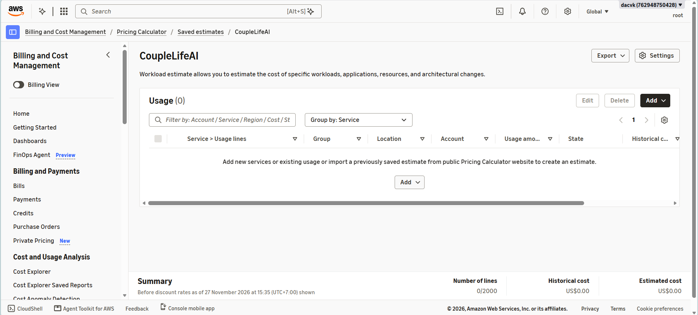
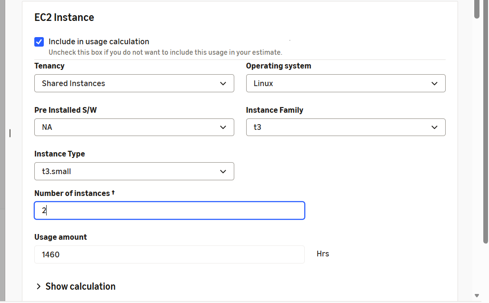
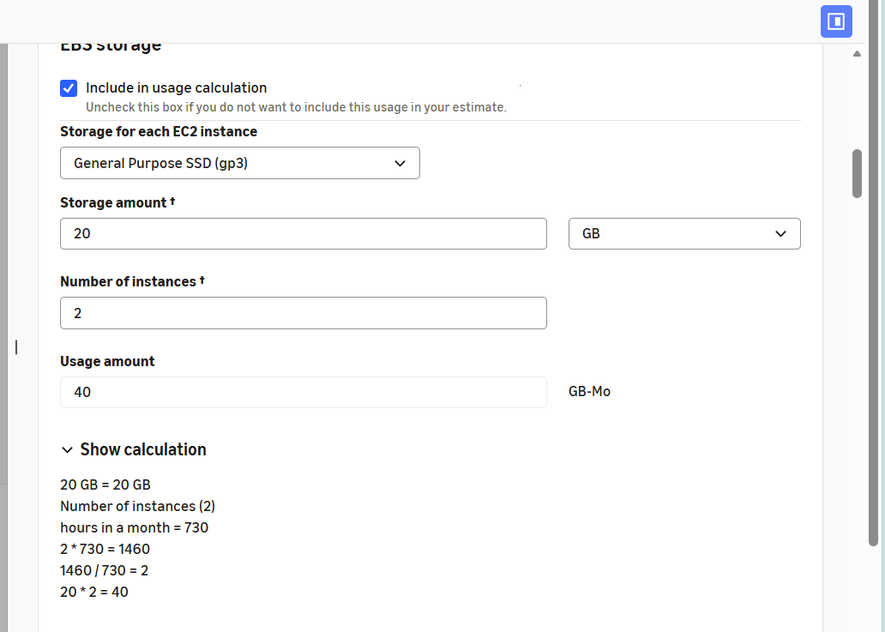
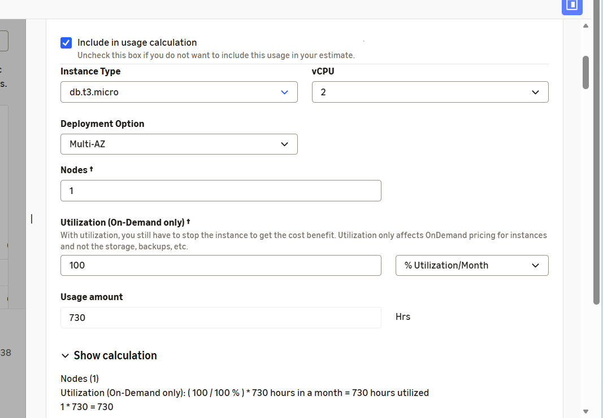
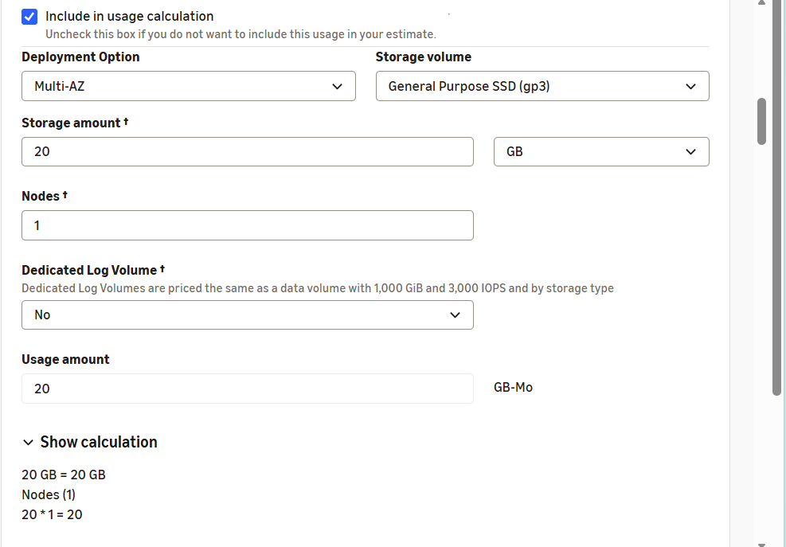
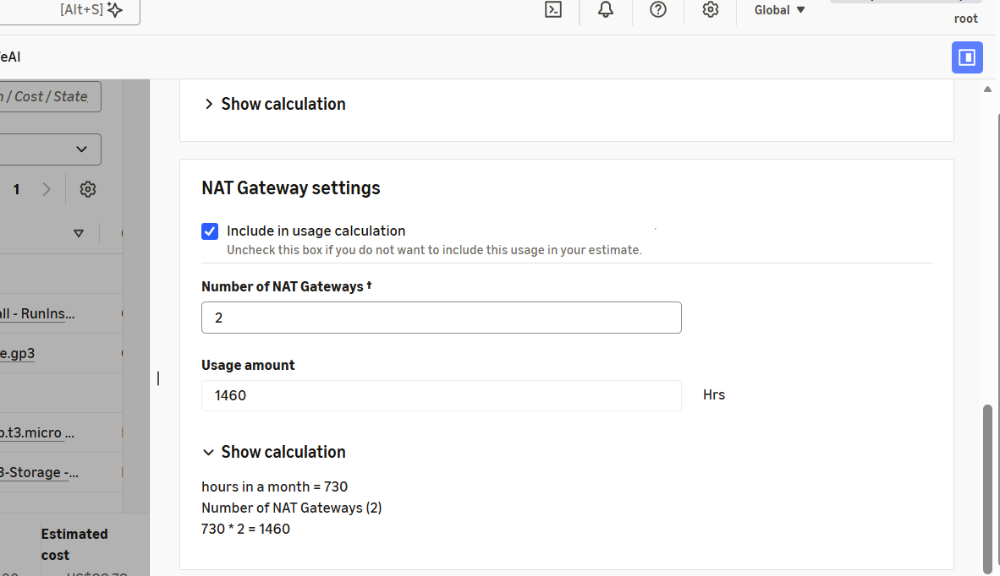

Trước khi tạo các tài nguyên tính phí theo giờ, chúng ta lập một dự toán sơ bộ để biết cấu hình HA có phù hợp với ngân sách thực hành hay không. Chọn Singapore và dùng 730 giờ cho một tháng quy ước; 14 ngày tương ứng 336 giờ. Đây là kịch bản dự toán, không phải số tiền bị trừ ngay khi tạo estimate.

1. Mở [AWS Pricing Calculator](https://calculator.aws/), chọn **Create estimate → Add service**. Chọn Region Asia Pacific (Singapore) cho các dịch vụ theo vùng.

2. Thêm Amazon EC2, chọn Shared Instances, Linux, dòng `t3`, loại `t3.small`, số lượng 2. Tổng usage cho hai máy là 1.460 instance-hours/tháng.

3. Ở phần EBS, chọn gp3, 20 GiB/máy. Với hai máy, dung lượng cần tính là 40 GiB-month.

4. Thêm Amazon RDS for PostgreSQL. Chọn `db.t3.micro`, Multi-AZ DB instance, một deployment với 730 giờ sử dụng. Không chọn Multi-AZ DB cluster gồm ba instance. Thêm 20 GiB gp3 với chế độ Multi-AZ.

5. Thêm NAT Gateway: số lượng 2, tổng 1.460 gateway-hours/tháng; bổ sung data processing và public IPv4. Sau đó bổ sung ALB, WAF, S3, ECR, Secrets Manager, CloudFront và giám sát.

Nếu sử dụng Calculator trong Billing Console như hình minh họa, nhập cùng số giờ và dung lượng. Kiểm tra các trường tính phí và lưu dự toán. Xem bảng tổng hợp tại mục 5.5.3.

Với cấu hình và giả định ở mục 5.5.3, dự toán tham chiếu là 223,77 USD/730 giờ (khoảng 103 USD/336 giờ).
