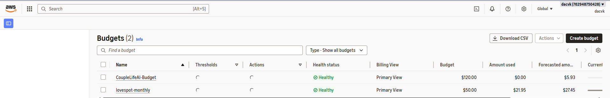

1. Open [AWS Budgets](https://console.aws.amazon.com/billing/home#/budgets), choose **Create budget**, and configure a monthly cost budget.
2. Set the name to `CoupleLifeAI-Budget` and the amount to `120 USD`. Select a recurring monthly budget to track costs.

3. Add Actual cost alerts at 50%, 80% and 100% (60, 96 and 120 USD). Use a monitored email address and complete any required notification confirmation. Review cost types, especially credits and refunds, to distinguish gross and net costs. For project-only reporting, activate appropriate cost allocation tags and wait for data.

4. Review and create the budget. Open the Alerts tab to check all three thresholds and notification recipients. Confirm email subscriptions if required.

{}
AWS Budgets is not a hard spending cap. Cost data may be delayed and a 14-day lab can cross monthly budget periods. Monitor Bills, Cost Explorer and Credits as well; do not rely on a budget to guarantee zero out-of-pocket cost.
{}

If the usage period spans two months, select the entire date range in Cost Explorer to track cumulative costs.
