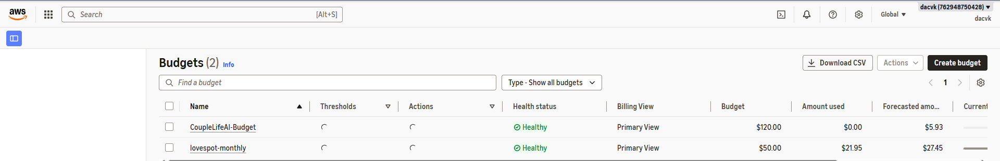

1. Mở [AWS Budgets](https://console.aws.amazon.com/billing/home#/budgets), chọn **Create budget**, thiết lập loại Cost budget với chu kỳ Monthly.
2. Đặt tên `CoupleLifeAI-Budget`, số tiền `120 USD`. Chọn recurring monthly budget để theo dõi chi phí.

3. Thêm cảnh báo Actual cost ở 50%, 80% và 100% (tương ứng 60, 96 và 120 USD). Nhập email nhận cảnh báo của bạn và hoàn tất xác nhận thông báo nếu được yêu cầu. Kiểm tra thiết lập cost types, đặc biệt credits/refunds, để phân biệt chi phí gộp và chi phí ròng. Nếu muốn theo dõi riêng dự án, dùng cost allocation tags sau khi đã kích hoạt và có dữ liệu.

4. Review và tạo budget. Mở tab Alerts để kiểm tra ba ngưỡng và địa chỉ nhận thông báo. Xác nhận email nếu hệ thống yêu cầu.

{}
AWS Budgets không phải cơ chế khóa chi tiêu. Chi phí có thể được ghi nhận trễ và ngân sách tháng sẽ sang chu kỳ mới trong thời gian thực hành 14 ngày. Theo dõi cả Bills, Cost Explorer và Credits; không dựa vào budget để bảo đảm không mất tiền túi.
{}

Nếu khoảng thời gian sử dụng đi qua hai tháng, chọn toàn bộ khoảng ngày trong Cost Explorer để theo dõi chi phí cộng dồn.
