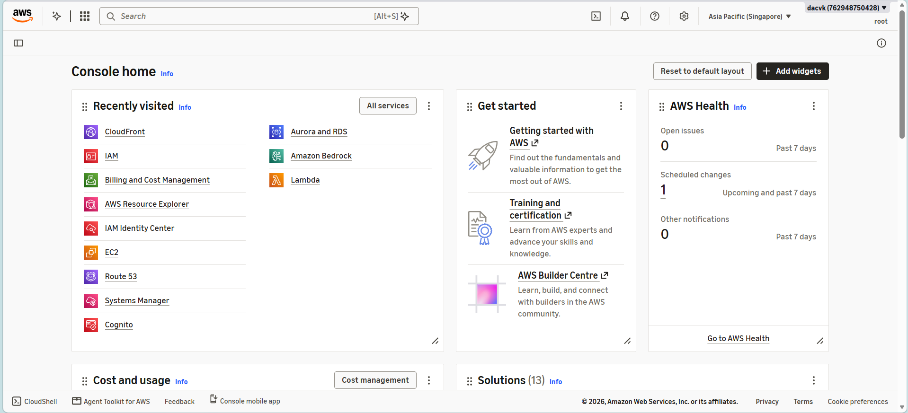

#### Prepare your tools

- Your own AWS account with permissions to create the VPC, EC2, RDS, IAM, S3 and other resources used in this lab. Enable MFA and use a suitably scoped IAM role or IAM user, not root access keys.
- Install [AWS CLI v2](https://docs.aws.amazon.com/cli/latest/userguide/getting-started-install.html), Git, Docker, Python 3.11 and the Node.js version required by `frontend/package.json`.
- Download the CoupleLife AI source and open a terminal in the repository root containing `backend/`, `ai-service/` and `frontend/`. Prepare the dataset and index files required by the source. Check dependencies and Dockerfiles before building.
- Create your Groq API key and Cloudflare Workers AI token in their respective dashboards. Keep them privately for Secrets Manager in section 5.3.2; do not commit them.

Obtain the CoupleLife AI source code and dataset before section 5.4. If supplied as a ZIP, extract it into a separate folder; if you have repository access, clone the repository and open that folder in your terminal.

#### Step 1: Select the Region

1. Sign in to the [AWS Management Console](https://ap-southeast-1.console.aws.amazon.com/console/home?region=ap-southeast-1).
2. Select **Asia Pacific (Singapore)** (`ap-southeast-1`) from the upper-right Region selector.



#### Step 2: Connect the AWS CLI

Open Bash or Git Bash on your computer. Check your tools:

```bash
aws --version
docker --version
git --version
node --version
python --version
```

If you use IAM Identity Center, run `aws configure sso --profile couplelife-lab`, enter your SSO settings and sign in with `aws sso login --profile couplelife-lab`. If you use an IAM user with access keys, run `aws configure --profile couplelife-lab`, enter the credentials in your terminal, select `ap-southeast-1` as the Region and `json` as the output format. Prefer temporary credentials; never create root access keys.

```bash
aws sts get-caller-identity --profile couplelife-lab
aws configure get region --profile couplelife-lab
```

Check that the returned Account ID matches the account in your console. Local CLI commands in this lab use `--profile couplelife-lab`. Define the shell variables again when opening a new terminal. On EC2, use the IAM instance role instead of access keys. CloudFront and IAM are global; CloudFront WAF uses CLOUDFRONT scope in `us-east-1`.

#### Step 3: Name and record resources

Use the names in this guide and the `Project=CoupleLifeAI` tag on resources that support tags. After each step, record your VPC ID, subnet IDs, security group IDs, RDS endpoint, master secret ARN, image tag, bucket name and CloudFront domain. IDs in illustrations are examples only. Do not store credentials in these notes.

#### Contents

1. [Estimate costs before deployment](5.2.1-Cost-estimation/)
2. [Set up AWS Budgets](5.2.2-AWS-Budgets/)
