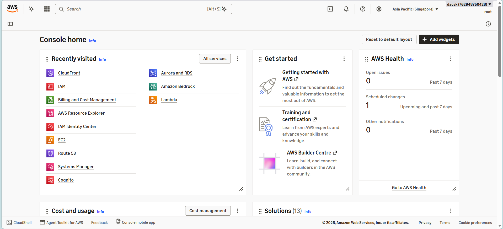

#### Chuẩn bị công cụ

- Tài khoản AWS của bạn, có quyền tạo VPC, EC2, RDS, IAM, S3 và các dịch vụ trong bài. Bật MFA và sử dụng IAM role hoặc IAM user có quyền phù hợp, không dùng root access key.
- Cài [AWS CLI v2](https://docs.aws.amazon.com/cli/latest/userguide/getting-started-install.html), Git, Docker, Python 3.11 và Node.js phù hợp với `frontend/package.json`.
- Tải mã nguồn CoupleLife AI về máy, mở terminal tại thư mục gốc chứa `backend/`, `ai-service/` và `frontend/`. Chuẩn bị dataset và file index theo mã nguồn. Kiểm tra các file dependency và Dockerfile trước khi build.
- Tạo API key Groq và Cloudflare Workers AI token trong dashboard của từng dịch vụ. Lưu riêng các giá trị này để nhập vào Secrets Manager ở mục 5.3.2; không đưa vào Git.

Cần có mã nguồn và dataset của CoupleLife AI trước khi bắt đầu mục 5.4. Nếu nhận mã nguồn dưới dạng ZIP, giải nén vào một thư mục riêng; nếu có quyền truy cập repository, clone repository rồi mở thư mục đó trong terminal.

#### Bước 1: Chọn Region

1. Đăng nhập [AWS Management Console](https://ap-southeast-1.console.aws.amazon.com/console/home?region=ap-southeast-1).
2. Tại góc trên bên phải, chọn **Asia Pacific (Singapore)** (`ap-southeast-1`).



#### Bước 2: Kết nối AWS CLI

Mở Bash hoặc Git Bash trên máy tính. Kiểm tra công cụ:

```bash
aws --version
docker --version
git --version
node --version
python --version
```

Nếu tài khoản sử dụng IAM Identity Center, cấu hình profile `couplelife-lab` bằng `aws configure sso --profile couplelife-lab`, nhập thông tin SSO của bạn và đăng nhập bằng `aws sso login --profile couplelife-lab`. Nếu sử dụng IAM user có access key, chạy `aws configure --profile couplelife-lab`, nhập credentials trong terminal, chọn region `ap-southeast-1` và output `json`. Ưu tiên credentials tạm thời; không tạo access key cho root.

```bash
aws sts get-caller-identity --profile couplelife-lab
aws configure get region --profile couplelife-lab
```

Kiểm tra Account ID trả về khớp tài khoản bạn đang dùng trên Console. Các lệnh trên máy cá nhân trong bài sử dụng `--profile couplelife-lab`. Nếu mở terminal mới, khai báo lại các biến shell trong bước tương ứng. Trên EC2, dùng IAM instance role (không cấu hình access key). CloudFront và IAM là global; WAF cho CloudFront dùng scope CLOUDFRONT tại `us-east-1`.

#### Bước 3: Đặt tên và lưu thông tin tài nguyên

Dùng các tên trong bài và tag `Project=CoupleLifeAI` cho tài nguyên hỗ trợ tag. Sau mỗi bước, lưu VPC ID, subnet IDs, security group IDs, RDS endpoint, ARN của master secret, image tag, tên bucket và CloudFront domain của bạn. Các ID hiển thị trong hình chỉ là ví dụ. Không sao chép credentials vào ghi chú.

#### Nội dung

1. [Dự toán trước khi triển khai](5.2.1-Cost-estimation/)
2. [Thiết lập AWS Budgets](5.2.2-AWS-Budgets/)
