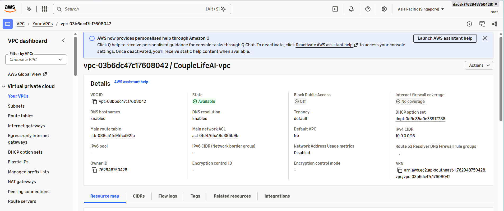
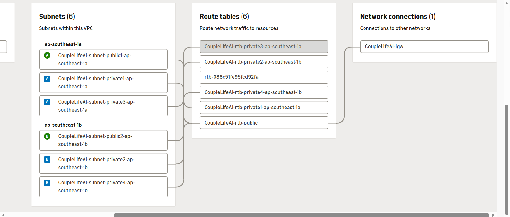
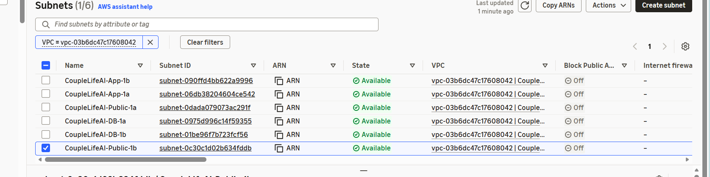
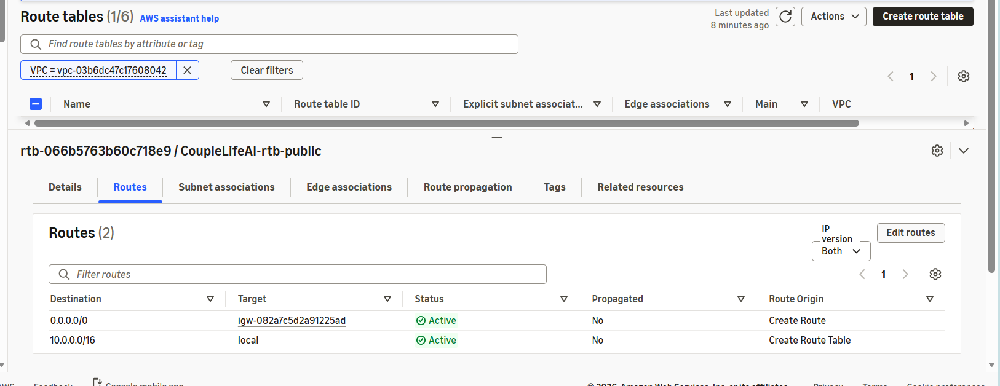
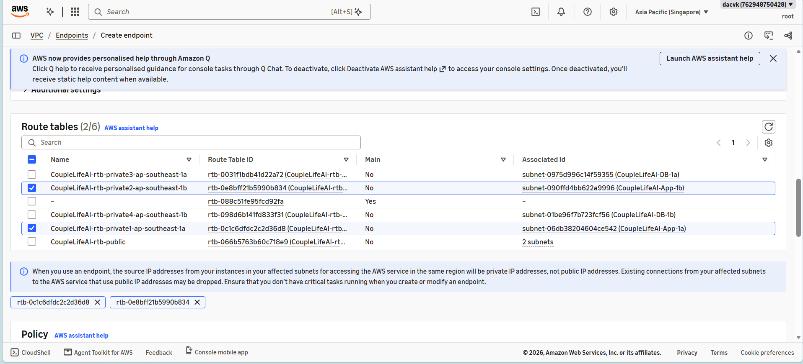
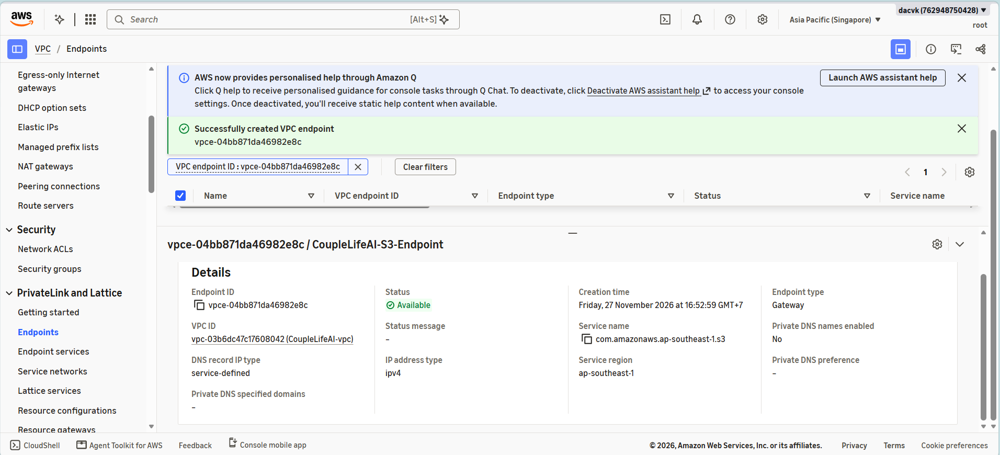
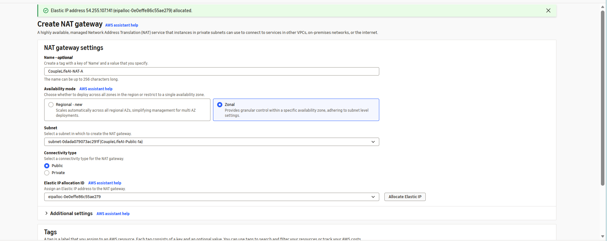
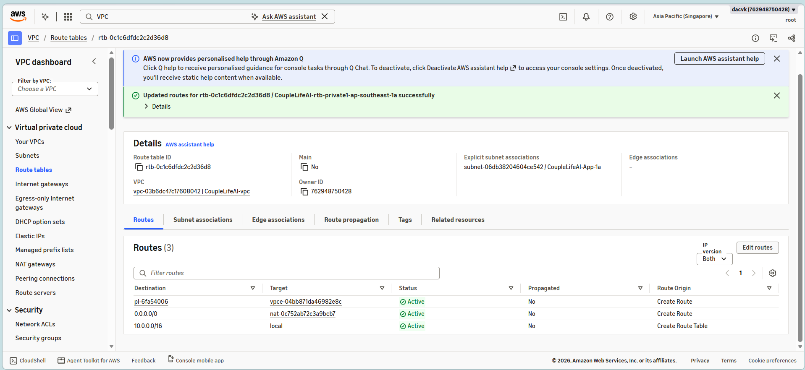
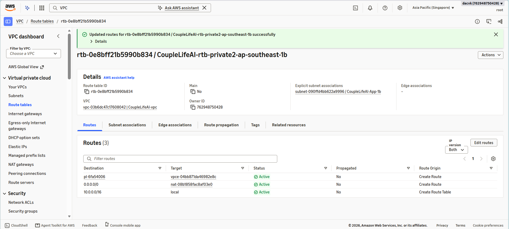

#### Create the VPC and subnets

1. Open the [Amazon VPC Console](https://ap-southeast-1.console.aws.amazon.com/vpcconsole/home?region=ap-southeast-1), then choose **Create VPC → VPC and more**.
2. Set the name tag to `CoupleLifeAI` and IPv4 CIDR to `10.0.0.0/16`. Choose two AZs, two public subnets and four private subnets. Enable DNS resolution and DNS hostnames. Set NAT gateways and VPC endpoints to None; create them in the following steps.
3. Create the VPC and check its details and Resource map.

4. In **Subnets**, rename the subnets to identify their purpose. Keep the CIDRs allocated by the VPC wizard and check that the subnets do not overlap.

| AZ | Public | Private application | Private database |
|---|---|---|---|
| ap-southeast-1a | CoupleLifeAI-Public-1a | CoupleLifeAI-App-1a | CoupleLifeAI-DB-1a |
| ap-southeast-1b | CoupleLifeAI-Public-1b | CoupleLifeAI-App-1b | CoupleLifeAI-DB-1b |

Under **Route tables**, check Subnet associations. If the wizard shares a table across private subnets, choose **Create route table** for each app and DB subnet. Select `CoupleLifeAI-vpc`, then use Edit subnet associations to associate one private subnet with each table. Name them `CoupleLifeAI-rtb-app-1a`, `CoupleLifeAI-rtb-app-1b`, `CoupleLifeAI-rtb-db-1a` and `CoupleLifeAI-rtb-db-1b`. Keep local routes on all four; only the two app tables receive NAT and S3 endpoint routes below.

#### Public routes and S3 Gateway Endpoint

1. Under **Route tables**, open `CoupleLifeAI-rtb-public`. Both public subnets must use this table, with `10.0.0.0/16 → local` and `0.0.0.0/0 → Internet Gateway`.

2. Choose **Endpoints → Create endpoint**. Name it `CoupleLifeAI-S3-Endpoint`, select AWS services and choose `com.amazonaws.ap-southeast-1.s3` of type Gateway. Select the project VPC and both app route tables. Select Full access for the endpoint policy; S3 access is still governed by IAM and bucket policies.

3. Create the endpoint and check that it is Available. The endpoint does not make a bucket public.

#### Create two NAT gateways

1. Open **NAT gateways → Create NAT gateway**. Set the name to `CoupleLifeAI-NAT-A`, Zonal availability, subnet `CoupleLifeAI-Public-1a`, Public connectivity, and choose **Allocate Elastic IP**.

2. Create `CoupleLifeAI-NAT-B` the same way in `CoupleLifeAI-Public-1b`, with its own Elastic IP. Wait for both to become Available.

3. In the app route table for AZ 1a, choose Routes → Edit routes → Add route and set `0.0.0.0/0` to NAT-A. Set the corresponding route in the app route table for AZ 1b to NAT-B. Preserve the local and S3 prefix-list routes. Do not add an Internet default route to the DB route tables.

The EC2 instances can now reach external services without public IPs. The database remains on the internal network. Two NAT gateways cost more but avoid an outbound dependency on a NAT gateway in the other AZ.
