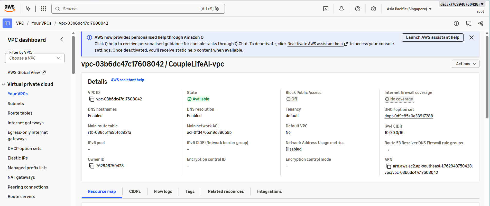
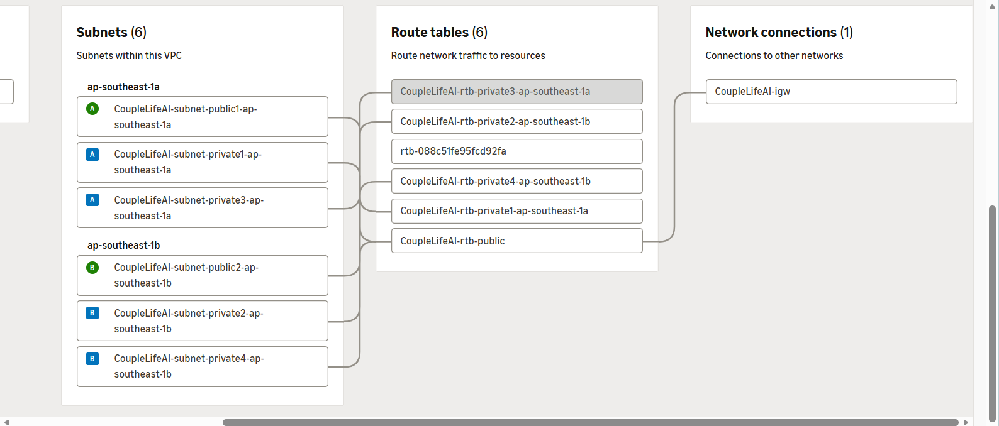
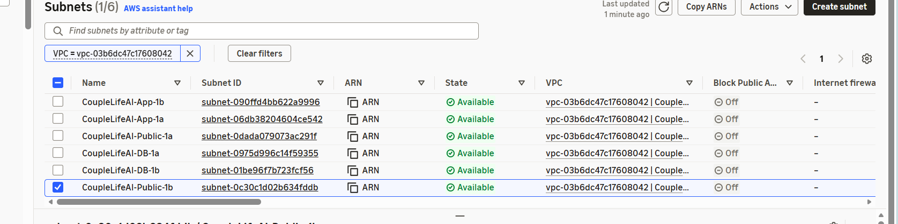
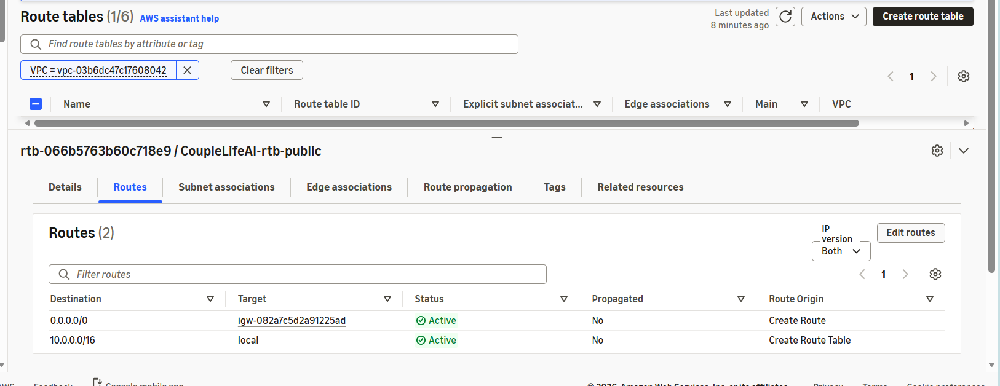
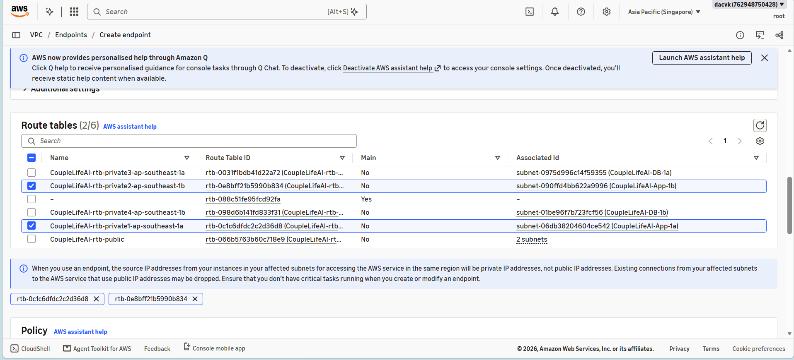
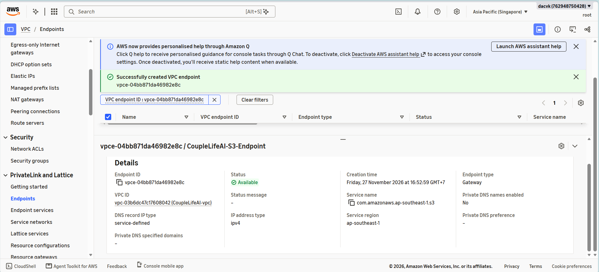
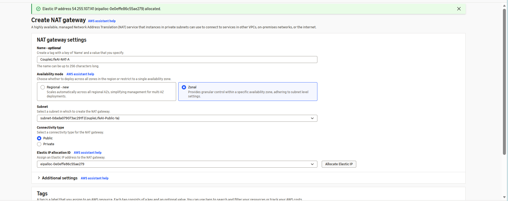
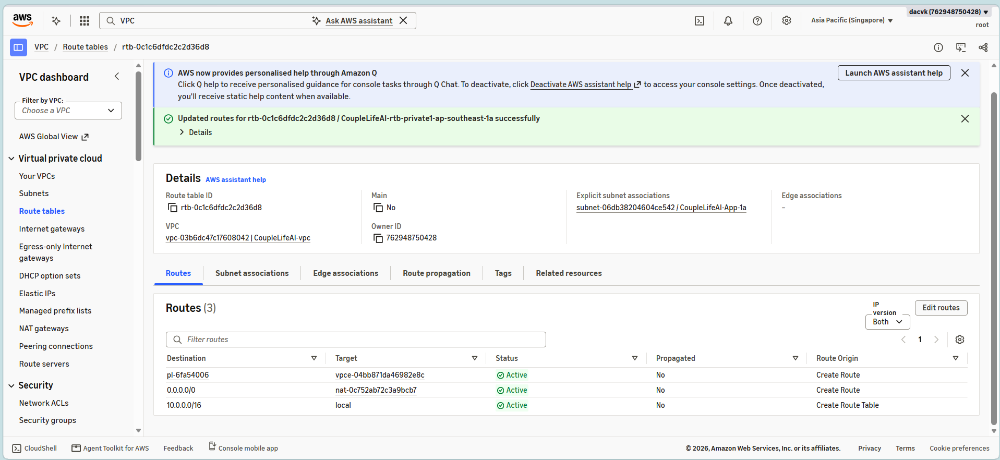
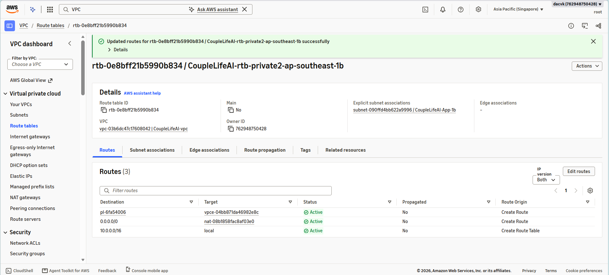

#### Tạo VPC và subnet

1. Mở [Amazon VPC Console](https://ap-southeast-1.console.aws.amazon.com/vpcconsole/home?region=ap-southeast-1), chọn **Create VPC → VPC and more**.
2. Đặt Name tag `CoupleLifeAI`, IPv4 CIDR `10.0.0.0/16`. Chọn 2 Availability Zones, 2 public subnets và 4 private subnets. Bật DNS resolution và DNS hostnames. Chọn NAT gateways = None và VPC endpoints = None để tạo riêng ở các bước tiếp theo.
3. Tạo VPC, kiểm tra VPC và Resource map.

4. Trong **Subnets**, đổi tên các subnet để dễ phân biệt. Bảng dưới thể hiện vai trò và AZ cần dùng; giữ CIDR do VPC wizard cấp và kiểm tra các subnet không chồng lấn.

| AZ | Public | Private application | Private database |
|---|---|---|---|
| ap-southeast-1a | CoupleLifeAI-Public-1a | CoupleLifeAI-App-1a | CoupleLifeAI-DB-1a |
| ap-southeast-1b | CoupleLifeAI-Public-1b | CoupleLifeAI-App-1b | CoupleLifeAI-DB-1b |

Trong **Route tables**, kiểm tra tab Subnet associations. Nếu wizard dùng chung route table cho nhiều private subnet, chọn **Create route table** để tạo một bảng riêng cho mỗi app subnet và mỗi DB subnet. Chọn `CoupleLifeAI-vpc`, sau đó Edit subnet associations để gắn đúng một private subnet vào mỗi bảng. Đặt tên `CoupleLifeAI-rtb-app-1a`, `CoupleLifeAI-rtb-app-1b`, `CoupleLifeAI-rtb-db-1a`, `CoupleLifeAI-rtb-db-1b`. Giữ route local trên cả bốn bảng; chỉ hai bảng app được thêm NAT và S3 endpoint ở các bước tiếp theo.

#### Route public và S3 Gateway Endpoint

1. Chọn **Route tables**, mở public route table `CoupleLifeAI-rtb-public`. Hai public subnets phải dùng route này, có `10.0.0.0/16 → local` và `0.0.0.0/0 → Internet Gateway`.

2. Chọn **Endpoints → Create endpoint**. Đặt tên `CoupleLifeAI-S3-Endpoint`, service category AWS services, chọn `com.amazonaws.ap-southeast-1.s3` loại Gateway. Chọn VPC của dự án và hai app route tables; chọn policy Full access, quyền S3 vẫn do IAM và bucket policy kiểm soát.

3. Tạo endpoint và kiểm tra trạng thái Available. Endpoint không cấp quyền đọc bucket công cộng.

#### Tạo hai NAT Gateway

1. Mở **NAT gateways → Create NAT gateway**. Đặt `CoupleLifeAI-NAT-A`, Availability mode Zonal, subnet `CoupleLifeAI-Public-1a`, connectivity Public; chọn **Allocate Elastic IP**.

2. Tạo `CoupleLifeAI-NAT-B` tương tự nhưng chọn `CoupleLifeAI-Public-1b` và một Elastic IP riêng. Đợi cả hai ở trạng thái Available.

3. Trong route table app của AZ 1a, chọn Routes → Edit routes → Add route, đặt `0.0.0.0/0` tới NAT-A. Với route table app của AZ 1b, đặt route tương ứng tới NAT-B. Giữ route local và route prefix list của S3. Không thêm default Internet route vào hai DB route tables.

Kết quả: EC2 có đường outbound ra Internet mà không cần public IP. Database chỉ có mạng nội bộ. Hai NAT tăng chi phí, nhưng tránh phụ thuộc vào một NAT thuộc AZ khác cho lưu lượng outbound của app.
