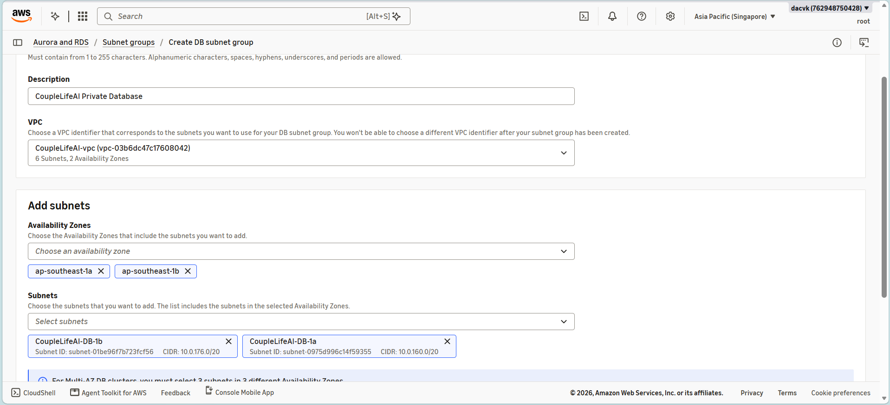
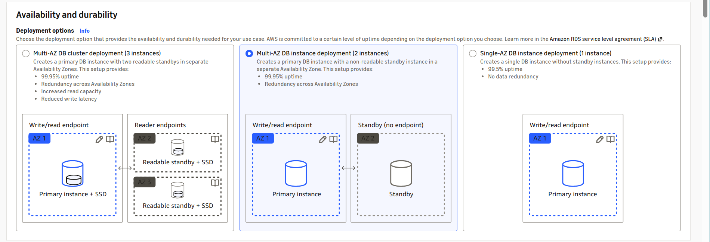
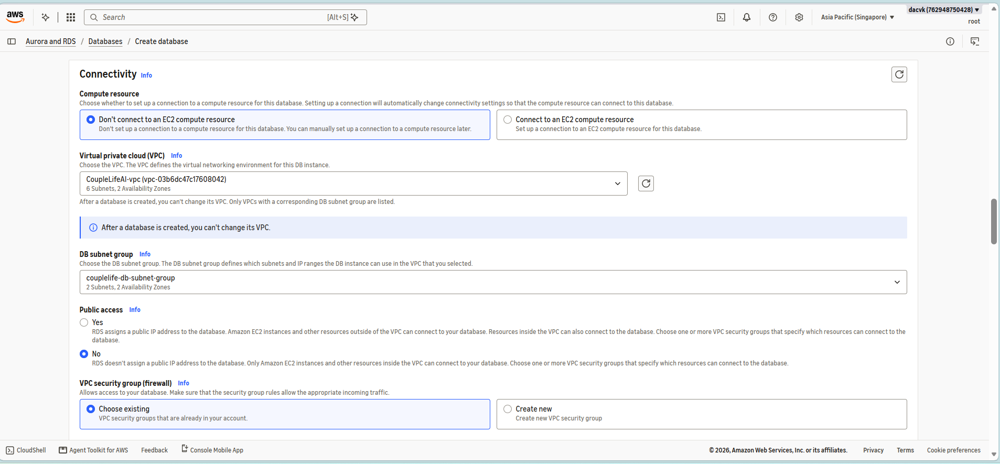
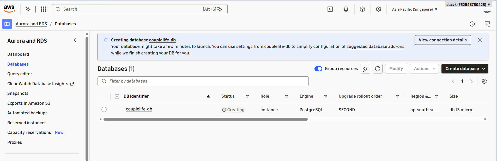

#### Create a DB subnet group

1. Open the [Amazon RDS Console](https://ap-southeast-1.console.aws.amazon.com/rds/home?region=ap-southeast-1), then choose **Subnet groups → Create DB subnet group**.
2. Name it `couplelife-db-subnet-group`, select the CoupleLifeAI VPC and choose `ap-southeast-1a`, `ap-southeast-1b` with the two `CoupleLifeAI-DB-1a` and `CoupleLifeAI-DB-1b` subnets. Do not select public subnets.

#### Create Multi-AZ PostgreSQL

1. Choose **Databases → Create database**, Standard create and PostgreSQL (not Aurora). Select PostgreSQL 18.3 if available in the Region and compatible with the application dependencies; choose a template that supports a Multi-AZ DB instance.
2. Under Availability and durability, choose **Multi-AZ DB instance deployment (2 instances)**. This is a primary and standby sharing an endpoint, not a Multi-AZ DB cluster.

3. Enter the settings below. Leave Initial database name blank; create the application database during bootstrap in section 5.4.2.

| Field | Value |
|---|---|
| DB instance identifier | `couplelife-db` |
| Instance class | `db.t3.micro` |
| Master username | `postgres` |
| Credentials | Managed in AWS Secrets Manager |
| Storage | General Purpose SSD (gp3), 20 GiB |
| Connectivity | CoupleLifeAI VPC and dedicated DB subnet group |
| Public access | No |
| VPC security group | CoupleLifeAI-SG-RDS |
| Database port | 5432 |

4. Enable storage encryption, review backup retention and disable unnecessary paid options. For the demo, decide on deletion protection and backups in accordance with the cleanup plan; do not disable production safeguards simply to make deletion easier.

5. Review Estimated monthly costs before creation. Compare your estimate with the example of USD 46.40/month before continuing.

6. Choose **Create database**. Wait for Available and retrieve the endpoint from Connectivity & security. Do not display the master secret.

#### Initialize data

Once EC2 is online in section 5.4.2, use temporary master-secret access to create `couplelife_db`, the `couplelife_app` role and the required schema privileges. Run Alembic migrations and seed data once using the matching backend image. Revoke RDS bootstrap access from the IAM role afterwards. Section 5.4.2 includes migration commands; section 5.5.1 checks the place count.

Check that the database is Available, Multi-AZ is enabled and the backend can connect. After seeding, verify the place count through the Health API in section 5.5.1; test RDS failover separately when evaluating recovery.
