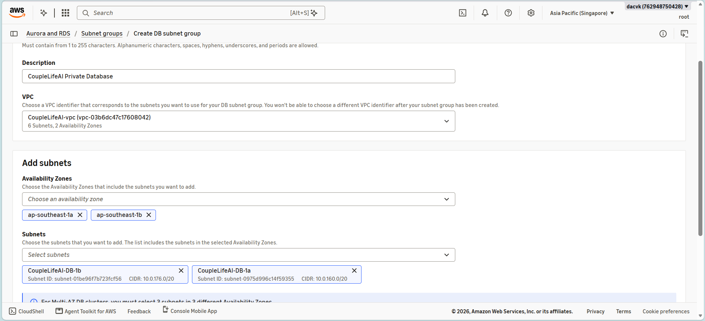
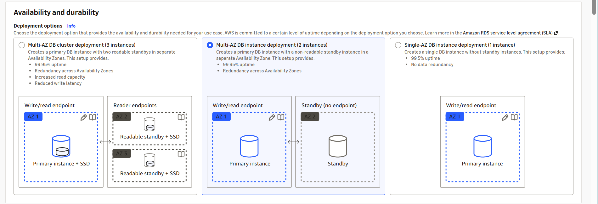
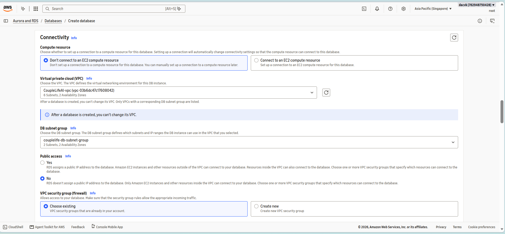
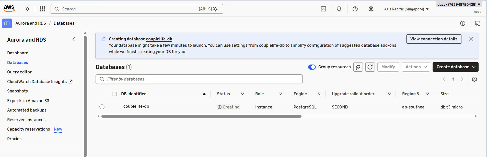

#### Tạo DB subnet group

1. Mở [Amazon RDS Console](https://ap-southeast-1.console.aws.amazon.com/rds/home?region=ap-southeast-1), chọn **Subnet groups → Create DB subnet group**.
2. Nhập tên `couplelife-db-subnet-group`, chọn VPC CoupleLifeAI. Chọn hai AZ `ap-southeast-1a`, `ap-southeast-1b` và hai subnet `CoupleLifeAI-DB-1a`, `CoupleLifeAI-DB-1b`. Không chọn public subnets.

#### Tạo PostgreSQL Multi-AZ

1. Chọn **Databases → Create database**, Standard create, engine PostgreSQL (không chọn Aurora). Chọn PostgreSQL 18.3 nếu có sẵn trong Region và phù hợp dependency ứng dụng; chọn template hỗ trợ Multi-AZ DB instance.
2. Trong Availability and durability, chọn **Multi-AZ DB instance deployment (2 instances)**. Đây là primary và standby dùng chung endpoint, không phải Multi-AZ DB cluster.

3. Nhập các thông số dưới đây. Để trống Initial database name; tạo database ứng dụng ở bước bootstrap (mục 5.4.2).

| Trường | Giá trị |
|---|---|
| DB instance identifier | `couplelife-db` |
| Instance class | `db.t3.micro` |
| Master username | `postgres` |
| Credentials | Managed in AWS Secrets Manager |
| Storage | General Purpose SSD (gp3), 20 GiB |
| Connectivity | CoupleLifeAI-vpc, DB subnet group riêng |
| Public access | No |
| VPC security group | CoupleLifeAI-SG-RDS |
| Database port | 5432 |

4. Bật mã hóa lưu trữ, kiểm tra backup retention và tắt các tùy chọn trả phí không cần thiết. Trong môi trường thực hành, quyết định deletion protection và backup phải phù hợp kế hoạch dọn dẹp; không tắt bảo vệ ở môi trường sản xuất thực tế chỉ để thuận tiện xóa.

5. Xem Estimated monthly costs trước khi Create. Tham khảo mức 46,40 USD/tháng trong hình và kiểm tra dự toán của bạn trước khi tiếp tục.

6. Bấm **Create database**. Đợi database Available rồi lấy endpoint tại Connectivity & security. Không hiển thị master secret.

#### Khởi tạo dữ liệu

Khi EC2 đã online ở mục 5.4.2, sử dụng master secret tạm thời để tạo database `couplelife_db`, role `couplelife_app` và quyền schema cần thiết. Chạy Alembic migration và seed trong container Backend đúng version, một lần duy nhất. Sau đó thu hồi quyền bootstrap RDS khỏi IAM role. Xem mục 5.4.2 để biết lệnh migration và mục 5.5.1 để kiểm tra số địa điểm.

Kiểm tra trạng thái Available, Multi-AZ = Yes và kết nối từ Backend. Sau khi seed, kiểm tra số địa điểm qua Health API tại mục 5.5.1; kiểm tra failover RDS riêng nếu cần đánh giá khả năng phục hồi.
