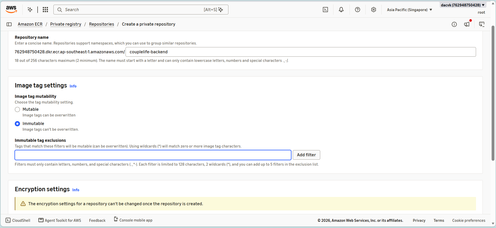
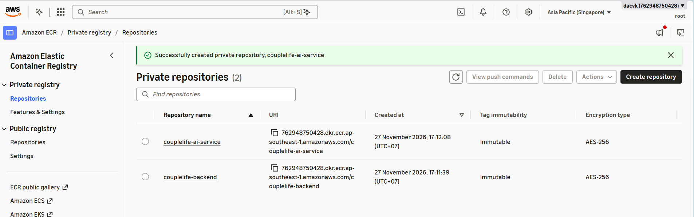
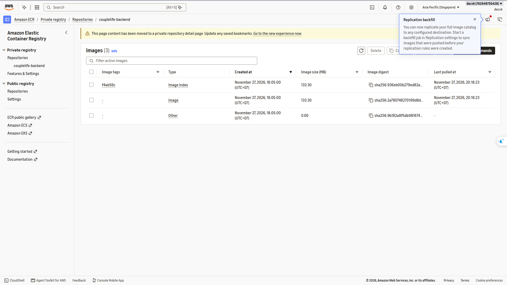

#### Create ECR repositories

1. Open [Amazon ECR](https://ap-southeast-1.console.aws.amazon.com/ecr/repositories?region=ap-southeast-1), then choose **Private repositories → Create repository**.
2. Enter `couplelife-backend`. Select Immutable image tags and AES-256 encryption. Do not create a public repository.



3. Repeat for `couplelife-ai-service`. Check both repositories in the list.



#### Build and push Docker images

Run the CLI on your development machine. Tag images with the SHA of the commit being built, for example `f4ab56c`. Do not use `latest` or include `.env`, API keys or passwords in images.

The following Bash/Git Bash commands illustrate the build/push process. Run them from the repository root, confirm each Dockerfile and build context, and use the `couplelife-lab` profile from section 5.2 with Docker support for linux/amd64.

```bash
REGION=ap-southeast-1
PROFILE=couplelife-lab
ACCOUNT_ID=$(aws sts get-caller-identity --profile "$PROFILE" --query Account --output text)
REGISTRY="$ACCOUNT_ID.dkr.ecr.$REGION.amazonaws.com"
TAG=$(git rev-parse --short HEAD)
aws ecr get-login-password --region "$REGION" --profile "$PROFILE" \
  | docker login --username AWS --password-stdin "$REGISTRY"
docker build --platform linux/amd64 -t "$REGISTRY/couplelife-backend:$TAG" ./backend
docker build --platform linux/amd64 -t "$REGISTRY/couplelife-ai-service:$TAG" ./ai-service
docker push "$REGISTRY/couplelife-backend:$TAG"
docker push "$REGISTRY/couplelife-ai-service:$TAG"
```

After pushing, open each repository's **Images** tab and check their digests and confirm that both have the same commit tag; the example uses `f4ab56c`. Immutable tags prevent accidental overwrites; build with a new SHA when the source changes.


**Result:** EC2 can pull both images using its IAM role without AWS access keys inside application containers. The Dockerfiles are linked below.

#### Attached Dockerfiles

Both images use Python 3.11 slim, install `requirements-prod.txt` and run Uvicorn. The backend listens on 8080 and the AI service on 8000. Use the corresponding Dockerfile as `Dockerfile` in each build context with matching source and dependency files. Check `.dockerignore` for `.env`, local databases and credentials before building.

- [Backend Dockerfile](./attachments/Dockerfile.backend)
- [AI service Dockerfile](./attachments/Dockerfile.ai-service)
