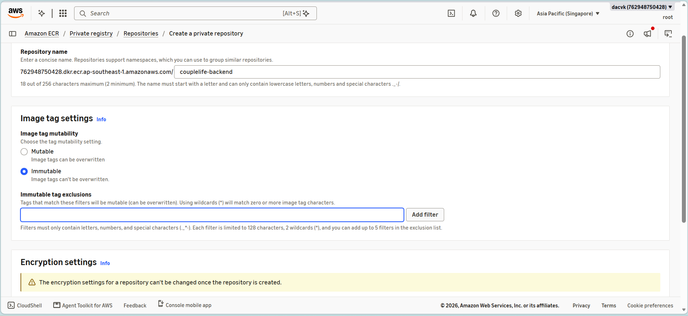
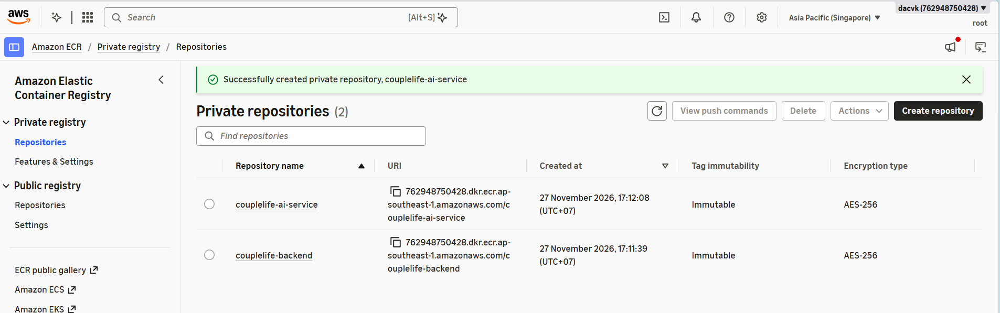
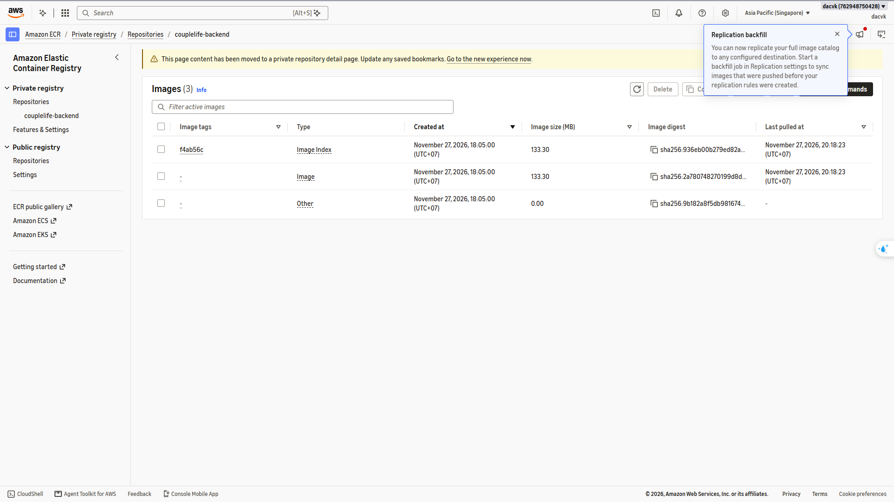

#### Tạo ECR repositories

1. Mở [Amazon ECR](https://ap-southeast-1.console.aws.amazon.com/ecr/repositories?region=ap-southeast-1), chọn **Private repositories → Create repository**.
2. Nhập `couplelife-backend`. Chọn Image tag immutability = Immutable và Encryption = AES-256. Không tạo public repository.



3. Lặp lại cho `couplelife-ai-service`. Kiểm tra hai repository trong danh sách.



#### Build và push Docker images

Chạy lệnh CLI trên máy phát triển. Dùng SHA của commit đang build làm image tag; ví dụ `f4ab56c`. Không sử dụng `latest` hoặc đưa `.env`, API keys, mật khẩu vào image.

Ví dụ dưới đây là lệnh Bash/Git Bash tương đương quy trình build/push. Chạy từ root repository, xác minh build context và Dockerfile của từng thư mục trước khi chạy. Dùng profile `couplelife-lab` đã cấu hình ở mục 5.2 và đảm bảo Docker hỗ trợ linux/amd64.

```bash
REGION=ap-southeast-1
PROFILE=couplelife-lab
ACCOUNT_ID=$(aws sts get-caller-identity --profile "$PROFILE" --query Account --output text)
REGISTRY="$ACCOUNT_ID.dkr.ecr.$REGION.amazonaws.com"
TAG=$(git rev-parse --short HEAD)
aws ecr get-login-password --region "$REGION" --profile "$PROFILE" \
  | docker login --username AWS --password-stdin "$REGISTRY"
docker build --platform linux/amd64 -t "$REGISTRY/couplelife-backend:$TAG" ./backend
docker build --platform linux/amd64 -t "$REGISTRY/couplelife-ai-service:$TAG" ./ai-service
docker push "$REGISTRY/couplelife-backend:$TAG"
docker push "$REGISTRY/couplelife-ai-service:$TAG"
```

Sau khi push, mở từng repository → **Images**. Kiểm tra digest và xác nhận cả hai image có cùng tag commit; ví dụ trong hình là `f4ab56c`. Immutable tag giúp tránh ghi đè ngoài ý muốn; nếu source thay đổi, build với SHA mới.


**Kết quả:** EC2 có thể pull hai image bằng IAM role, không cần AWS access key trong container. Hai Dockerfile được đính kèm bên dưới.

#### Dockerfile đính kèm

Hai image dùng Python 3.11 slim, cài `requirements-prod.txt` và chạy Uvicorn. Backend lắng nghe 8080, AI Service lắng nghe 8000. Đặt Dockerfile đúng tên `Dockerfile` trong build context tương ứng, dùng mã nguồn và dependency files cùng phiên bản; kiểm tra `.dockerignore` loại `.env`, database local và credentials trước khi build.

- [Dockerfile Backend](./attachments/Dockerfile.backend)
- [Dockerfile AI Service](./attachments/Dockerfile.ai-service)
