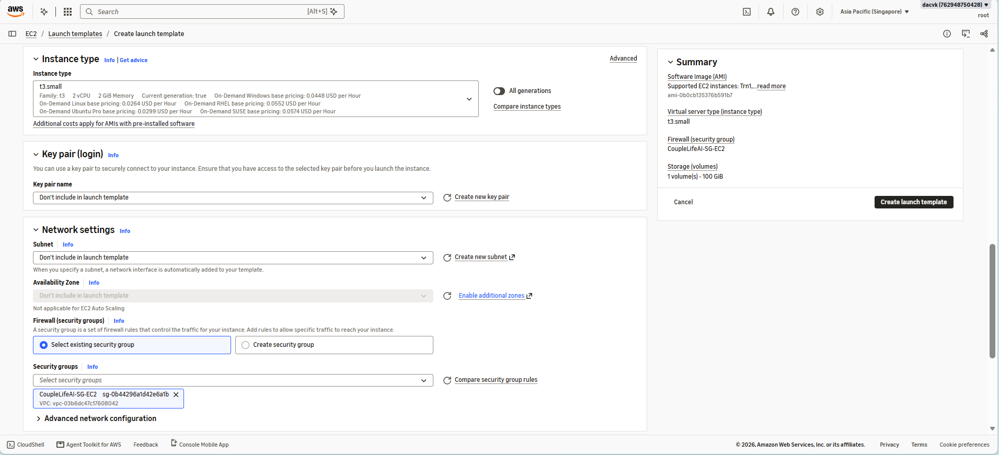
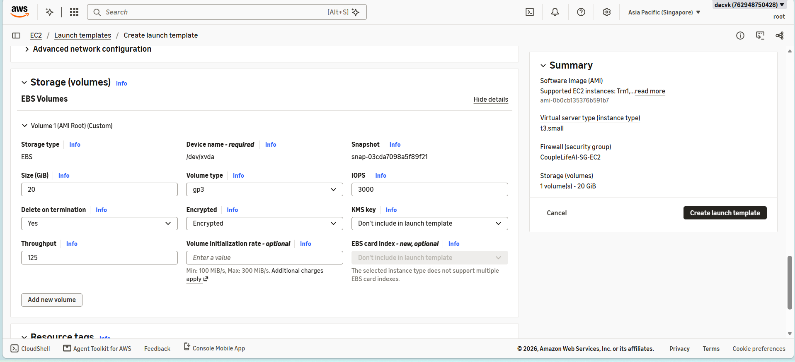
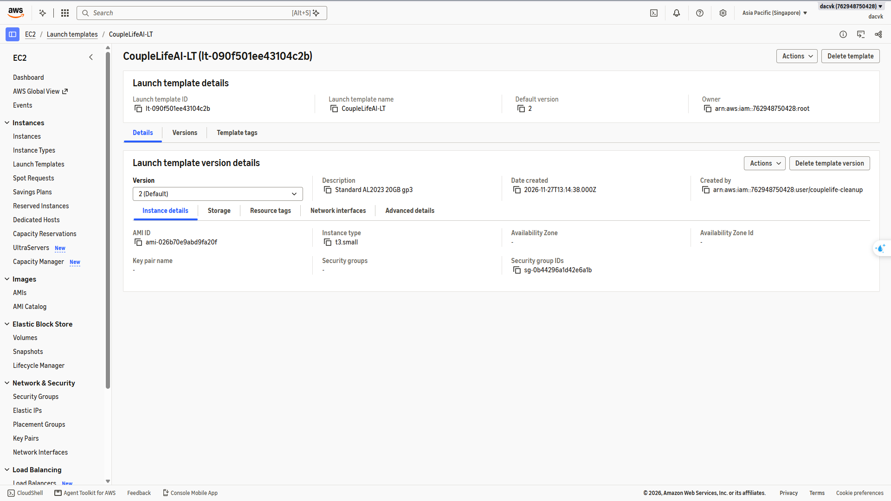
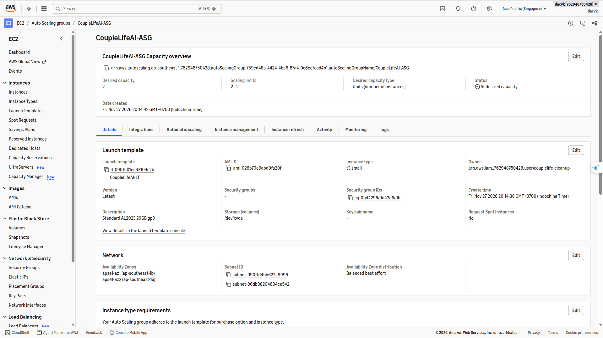
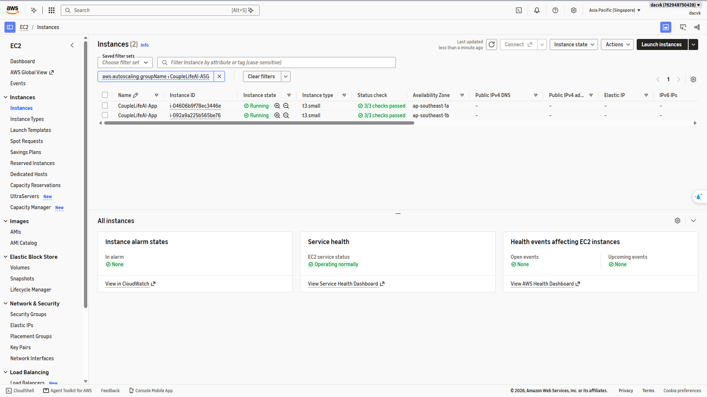

#### Create a launch template

1. Open the [EC2 Console](https://ap-southeast-1.console.aws.amazon.com/ec2/home?region=ap-southeast-1#LaunchTemplates:) and choose **Launch Templates → Create launch template**.
2. Name it `CoupleLifeAI-LT` and enable Auto Scaling guidance. Select a standard Amazon Linux 2023 x86_64 AMI and `t3.small`. Do not select a fixed subnet or key pair; the ASG chooses subnets. Select `CoupleLifeAI-SG-EC2`.



3. Configure a 20 GiB gp3 root volume with 3,000 IOPS, 125 MiB/s, encryption and Delete on termination. Tag instances and volumes with Project = CoupleLifeAI.



4. In Advanced details, set the IAM instance profile to `CoupleLifeAI-EC2-Role`. Use Standard CPU credits to avoid unexpected surplus-credit charges. Require IMDSv2 and use hop limit 1 if only the host needs metadata. Do not assign public IPs or expose SSH.
5. Download [User Data](./attachments/user-data-unified.sh.txt), open it in an editor and replace `REPLACE_WITH_ECR_IMAGE_TAG` with the tag from section 5.4.1. The script obtains the Account ID through the EC2 IAM role. In Advanced details → User data, paste the edited script (leave the base64 option off for plain text). It installs Docker, retrieves secrets, creates the Docker network and starts systemd services. Do not add migrations to User Data because both EC2 instances run it.

6. Create the template. Check its AMI, instance type, network and IAM instance profile before selecting the version for the ASG. Record the template version you just created for the ASG step.



#### Auto Scaling group and database bootstrap

Create the ASG in the EC2 console using the following steps.

1. Open **Auto Scaling Groups → Create Auto Scaling group**.
2. Name it `CoupleLifeAI-ASG`, select `CoupleLifeAI-LT` and the version you just created, then select the project VPC and both private app subnets. Do not choose public or database subnets.
3. Set Min = 2, Desired = 2, Max = 2 and a 300-second health check grace period. During bootstrap, EC2-only health checks can be used until the application and database are ready; then enable ELB health checks. With min/max equal, the ASG maintains and replaces two instances rather than scaling past two under load.
4. Open Systems Manager → Fleet Manager and check that both EC2 nodes have Online ping status. Open **Session Manager → Start session**, choose one EC2 node and start the session. Download [Bootstrap database](./attachments/bootstrap-database.sh.txt), open it in an editor and replace `REPLACE_WITH_RDS_ENDPOINT`, `REPLACE_WITH_RDS_MASTER_SECRET_ARN` and `REPLACE_WITH_ECR_IMAGE_TAG` with the values from sections 5.3.3 and 5.4.1. Run on only one EC2 node.

In Session Manager, enter a root shell and create the script file:

```bash
sudo -i
dnf install -y nano
nano /root/bootstrap-database.sh
```

Paste the configured script into nano, save with Ctrl+O, Enter and exit with Ctrl+X. Then run:

```bash
chmod 700 /root/bootstrap-database.sh
bash /root/bootstrap-database.sh
```

The script creates the database and user, runs Alembic and seeds data; do not repeat on the second EC2 node. Check for errors before continuing. In IAM → Roles → CoupleLifeAI-EC2-Role, remove the `CoupleLifeBootstrapRDSPolicy` inline policy. Keep access to the application secrets. Continue to section 5.4.3 to attach the target group and enable ELB health checks.




5. Open Session Manager for each EC2 instance and run the following commands:

```bash
sudo docker ps
sudo systemctl status couplelife-backend --no-pager
sudo systemctl status couplelife-ai-service --no-pager
curl -fsS http://localhost:8080/api/v1/health/live
```

In Systems Manager → Fleet Manager or Managed nodes, confirm both EC2 instances are Online, then open Session Manager to run the commands above.

#### Deployment scripts

- [EC2 User Data](./attachments/user-data-unified.sh.txt): installs Docker, creates `couplelife-net`, retrieves secrets, pulls tagged images and creates systemd units.
- [Database bootstrap](./attachments/bootstrap-database.sh.txt): retrieves the master secret, creates the database and app role, runs Alembic and seeds places.

The attachments use a `.txt` extension for review. Fill in the marked values in the Launch Template and database bootstrap steps. The account ID is obtained automatically through the IAM role. User Data uses Docker `json-file` with log rotation; see section 5.5.2 for application logs.
