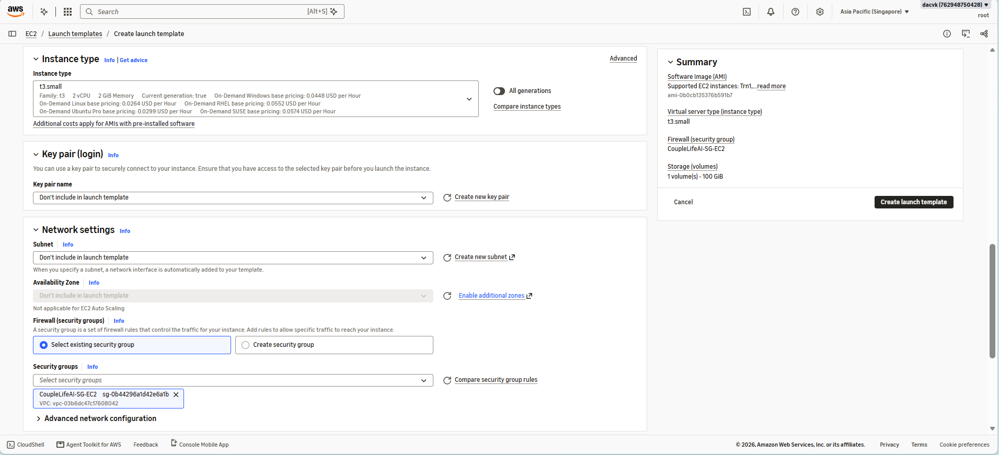
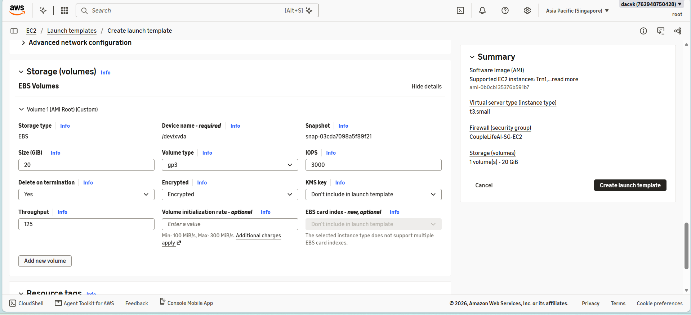
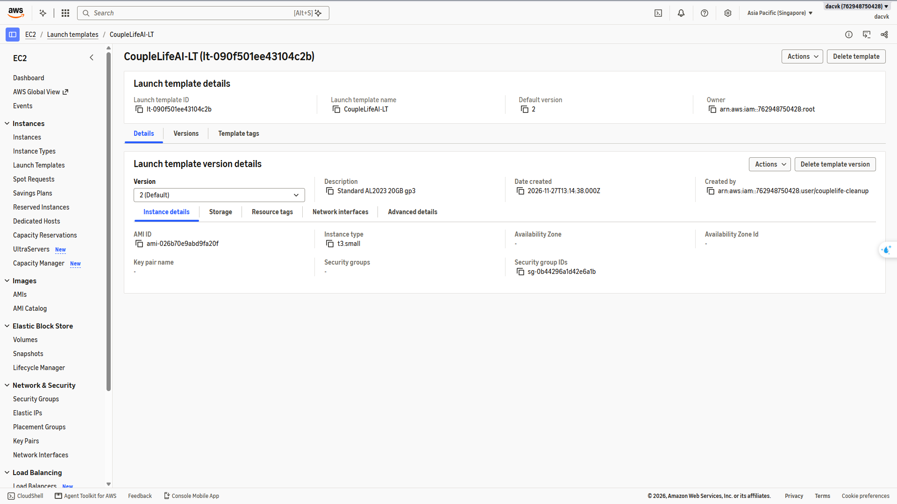
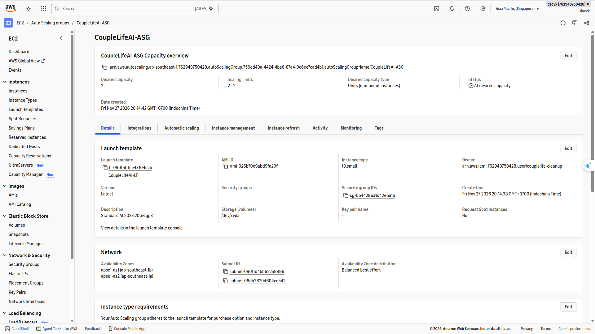
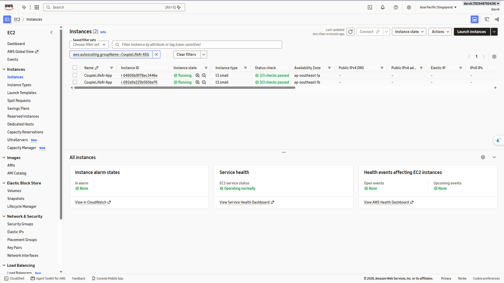

#### Tạo Launch Template

1. Mở [EC2 Console](https://ap-southeast-1.console.aws.amazon.com/ec2/home?region=ap-southeast-1#LaunchTemplates:), chọn **Launch Templates → Create launch template**.
2. Đặt tên `CoupleLifeAI-LT`, bật Auto Scaling guidance. Chọn Amazon Linux 2023 x86_64 thông thường và instance type `t3.small`. Không chọn key pair hoặc subnet cố định; ASG sẽ chọn subnet. Chọn security group `CoupleLifeAI-SG-EC2`.



3. Configure storage: root volume 20 GiB gp3, 3.000 IOPS, 125 MiB/s, Encrypted = Yes, Delete on termination = Yes. Thêm tag Project = CoupleLifeAI cho instance và volume.



4. Advanced details: IAM instance profile `CoupleLifeAI-EC2-Role`, credit specification Standard để tránh phí CPU surplus ngoài dự kiến; bật IMDSv2 required, hop limit 1 nếu chỉ host truy cập metadata. Không cấp public IP và không mở SSH.
5. Tải [User Data](./attachments/user-data-unified.sh.txt), mở bằng trình soạn thảo và thay `REPLACE_WITH_ECR_IMAGE_TAG` bằng tag ở mục 5.4.1. Script tự lấy Account ID từ IAM role của EC2. Trong Advanced details → User data, dán toàn bộ nội dung đã sửa (không bật base64 nếu dán plain text). Script cài Docker, lấy secrets, tạo Docker network và khởi động systemd services. Không thêm migration vào User Data vì hai EC2 sẽ chạy song song.

6. Bấm Create launch template. Kiểm tra AMI, instance type, network và IAM instance profile trước khi chọn version cho ASG. Ghi lại version của template vừa tạo để dùng ở bước ASG.



#### Auto Scaling Group và bootstrap database

Tạo ASG trong EC2 Console theo các bước dưới đây. Target Group sẽ được gắn ở mục 5.4.3.

1. Mở **Auto Scaling Groups → Create Auto Scaling group**.
2. Nhập tên `CoupleLifeAI-ASG`, chọn `CoupleLifeAI-LT` và version vừa tạo. Chọn VPC dự án và hai private app subnets, không chọn public/database subnets.
3. Đặt Min = 2, Desired = 2, Max = 2. Cấu hình health check grace period 300 giây. Trong giai đoạn bootstrap có thể chỉ dùng EC2 health check; chuyển sang ELB health check sau khi services và DB sẵn sàng. Với min/max bằng nhau, ASG duy trì hai máy và thay máy lỗi, không mở rộng theo tải vượt hai máy.
4. Mở Systems Manager → Fleet Manager, kiểm tra hai EC2 có Ping status Online. Mở **Session Manager → Start session**, chọn một trong hai EC2 rồi bấm Start session. Tải [Bootstrap database](./attachments/bootstrap-database.sh.txt) về máy, mở bằng trình soạn thảo, thay ba giá trị `REPLACE_WITH_RDS_ENDPOINT`, `REPLACE_WITH_RDS_MASTER_SECRET_ARN` và `REPLACE_WITH_ECR_IMAGE_TAG` bằng thông tin đã lưu ở các mục 5.3.3 và 5.4.1. Chỉ chạy trên một EC2.

Trong cửa sổ Session Manager, chuyển sang root shell, tạo file script và chạy:

```bash
sudo -i
dnf install -y nano
nano /root/bootstrap-database.sh
```

Dán nội dung script đã điền vào nano, lưu bằng Ctrl+O, Enter, thoát bằng Ctrl+X. Sau đó chạy:

```bash
chmod 700 /root/bootstrap-database.sh
bash /root/bootstrap-database.sh
```

Script tạo database, user, chạy Alembic và seed; không chạy lại trên EC2 thứ hai. Kiểm tra không có lỗi trước khi tiếp tục. Trong IAM → Roles → CoupleLifeAI-EC2-Role, xóa inline policy `CoupleLifeBootstrapRDSPolicy`. Giữ quyền đọc hai application secrets. Chuyển sang mục 5.4.3 để gắn target group và bật ELB health checks.




5. Kiểm tra cả hai node qua SSM. Mở Session Manager lần lượt cho từng EC2 và chạy các lệnh sau:

```bash
sudo docker ps
sudo systemctl status couplelife-backend --no-pager
sudo systemctl status couplelife-ai-service --no-pager
curl -fsS http://localhost:8080/api/v1/health/live
```

Trong Systems Manager → Fleet Manager hoặc Managed nodes, kiểm tra cả hai EC2 Online, sau đó mở Session Manager để chạy các lệnh trên.

#### Script triển khai

- [User Data cho EC2](./attachments/user-data-unified.sh.txt): cài Docker, tạo `couplelife-net`, lấy secrets, pull hai image theo tag và tạo systemd units.
- [Bootstrap database](./attachments/bootstrap-database.sh.txt): lấy master secret, tạo DB và app role, chạy Alembic và seed.

Các file đính kèm có đuôi `.txt` để đọc trước khi sử dụng. Điền các giá trị theo phần tạo Launch Template và bootstrap database. Account ID được lấy tự động từ IAM role. User Data dùng Docker `json-file` với log rotation; xem mục 5.5.2 để đọc application logs.
