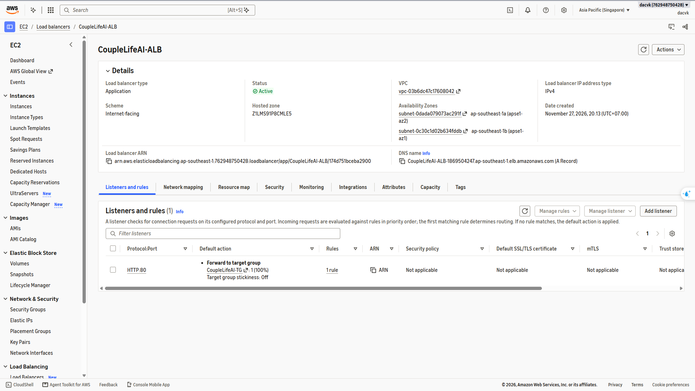
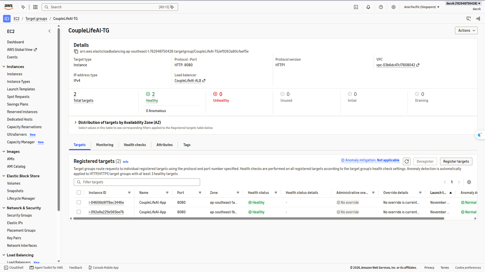

#### Target group

1. In EC2 → Load Balancing, choose **Target Groups → Create target group** and enter:

| Field | Value |
|---|---|
| Target type | Instances |
| Name | `CoupleLifeAI-TG` |
| Protocol / port | HTTP / 8080 |
| VPC | CoupleLifeAI-vpc |
| IP address type | IPv4 |
| Health check path | `/api/v1/health/live` |
| Interval | 15 seconds |
| Healthy / unhealthy threshold | 2 / 2 |

2. If EC2 does not exist yet, skip Register targets. The ASG manages target registration and deregistration.

#### Create the ALB

1. Choose **Load Balancers → Create load balancer → Application Load Balancer**. Name it `CoupleLifeAI-ALB`, with the Internet-facing scheme and IPv4.
2. In Network mapping, select the project VPC and `CoupleLifeAI-Public-1a`, `CoupleLifeAI-Public-1b`. Attach `CoupleLifeAI-SG-ALB`.
3. The listener uses HTTP 80; valid requests are forwarded to `CoupleLifeAI-TG`. Do not expose port 8000 directly through the ALB.
4. Open **Auto Scaling Groups**, select `CoupleLifeAI-ASG` → **Integrations**, edit Load balancing and select `CoupleLifeAI-TG`. Wait for instances to register, then open **Target Groups → Targets** to check their status.

#### Restrict access to the ALB

1. In EC2 → **Security Groups**, select `CoupleLifeAI-SG-ALB` → **Edit inbound rules**. Add HTTP 80 with source prefix list `com.amazonaws.global.cloudfront.origin-facing` and save. Do not allow `0.0.0.0/0`.
2. Generate a random value using `python -c "import secrets; print(secrets.token_hex(32))"`. Keep it privately for section 5.4.4; do not commit or screenshot it.
3. In EC2 → **Load Balancers**, select the ALB → **Listeners and rules** → HTTP:80. Add priority 1 rule with HTTP header `X-CoupleLife-Origin` matching the generated value and Forward to `CoupleLifeAI-TG`. Set the default rule to Return fixed response, HTTP 403. Save the changes.
4. Open ASG → **Integrations** and attach `CoupleLifeAI-TG` if not already attached. Once both targets are Healthy, open **Details → Health checks** and enable Elastic Load Balancing health checks.

CloudFront-to-ALB HTTP is unencrypted in this lab. Use test data only; configure an HTTPS origin with a valid certificate before handling sensitive data.

The `/api/v1/health/live` check covers application and AI liveness, not all Groq, Cloudflare, OSRM or business-function calls. Test the actual frontend in section 5.5.1.
