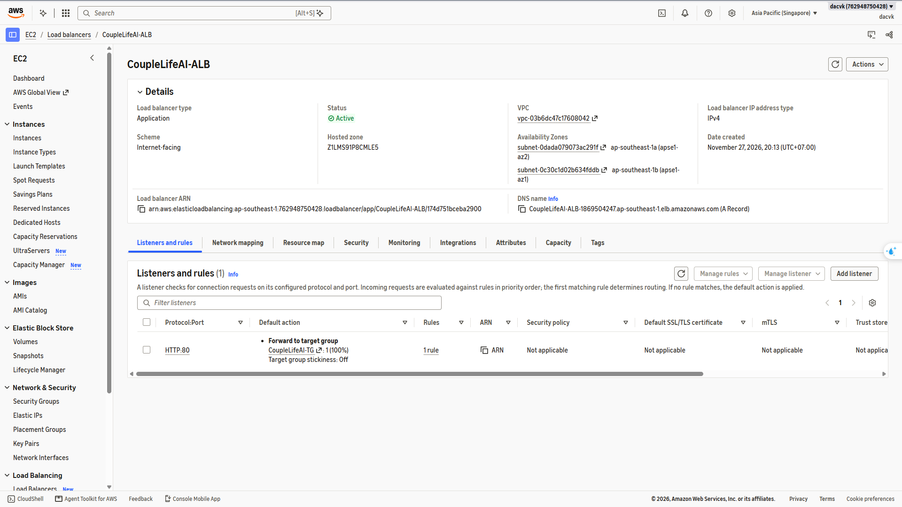
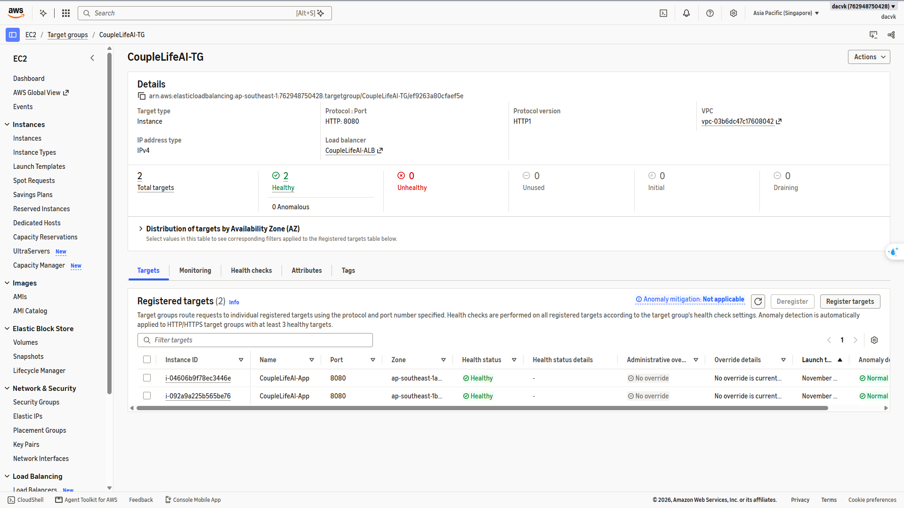

#### Target Group

1. Trong EC2 → Load Balancing, chọn **Target Groups → Create target group**. Cấu hình:

| Trường | Giá trị |
|---|---|
| Target type | Instances |
| Name | `CoupleLifeAI-TG` |
| Protocol / Port | HTTP / 8080 |
| VPC | CoupleLifeAI-vpc |
| IP address type | IPv4 |
| Health check path | `/api/v1/health/live` |
| Interval | 15 giây |
| Healthy / Unhealthy threshold | 2 / 2 |

2. Nếu chưa tạo EC2, bỏ qua Register targets. ASG sẽ quản lý đăng ký và hủy đăng ký target.

#### Tạo ALB

1. Chọn **Load Balancers → Create load balancer → Application Load Balancer**. Đặt tên `CoupleLifeAI-ALB`, scheme Internet-facing, IPv4.
2. Network mapping: chọn VPC dự án và `CoupleLifeAI-Public-1a`, `CoupleLifeAI-Public-1b`. Gắn `CoupleLifeAI-SG-ALB`.
3. Chọn listener HTTP 80 và forward request hợp lệ đến `CoupleLifeAI-TG`. Không dùng cổng 8000 trực tiếp từ ALB.
4. Mở **Auto Scaling Groups**, chọn `CoupleLifeAI-ASG` → **Integrations**, chỉnh Load balancing và chọn `CoupleLifeAI-TG`. Đợi các instances đăng ký rồi mở **Target Groups → Targets** để kiểm tra trạng thái.

#### Giới hạn truy cập ALB

1. Trong EC2 → **Security Groups**, chọn `CoupleLifeAI-SG-ALB` → **Edit inbound rules**. Thêm HTTP 80, Source = prefix list `com.amazonaws.global.cloudfront.origin-facing`, lưu lại. Không mở `0.0.0.0/0`.
2. Tạo một chuỗi ngẫu nhiên bằng `python -c "import secrets; print(secrets.token_hex(32))"`. Lưu riêng để dùng ở mục 5.4.4; không đưa vào Git hoặc ảnh.
3. Trong EC2 → **Load Balancers**, chọn ALB → **Listeners and rules** → HTTP:80. Thêm rule ưu tiên 1: điều kiện HTTP header `X-CoupleLife-Origin` khớp chuỗi vừa tạo, action Forward to `CoupleLifeAI-TG`. Sửa default rule thành Return fixed response, HTTP 403. Lưu thay đổi.
4. Mở ASG → **Integrations** và gắn Target Group `CoupleLifeAI-TG` nếu chưa gắn. Khi cả hai target Healthy, vào **Details → Health checks** để bật Elastic Load Balancing health checks.

Kết nối CloudFront → ALB dùng HTTP trong bài thực hành, không mã hóa đoạn origin. Chỉ dùng dữ liệu thử nghiệm; cấu hình HTTPS origin với chứng chỉ hợp lệ trước khi xử lý dữ liệu nhạy cảm.

Health check `/api/v1/health/live` nhằm kiểm tra tiến trình ứng dụng và AI liveness; không chứng minh Groq, Cloudflare, OSRM hay mọi chức năng nghiệp vụ đều thành công. Vì vậy cần kiểm thử từ frontend ở 5.5.1.
