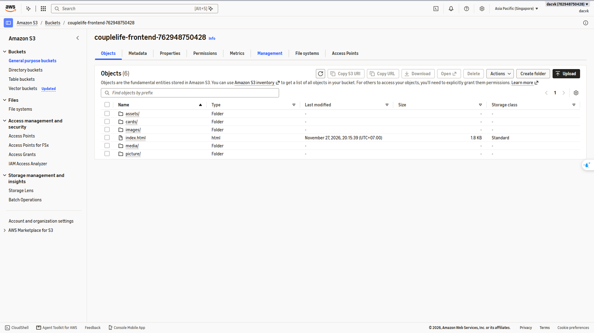
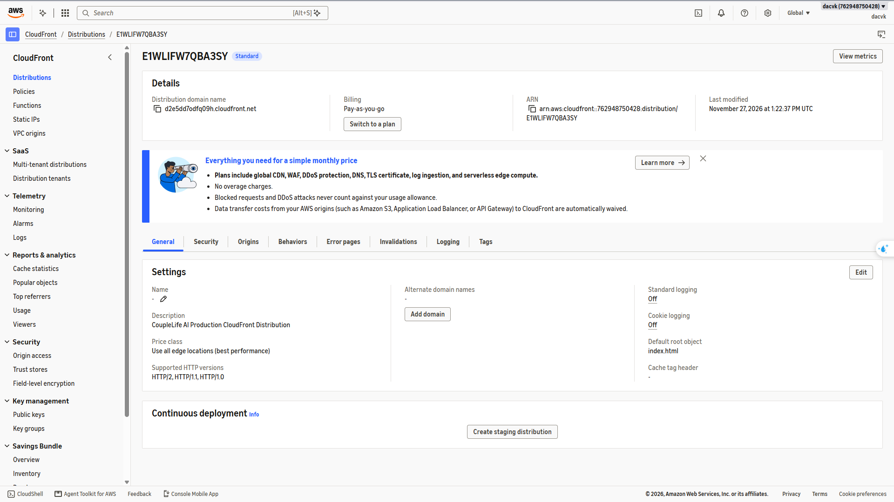
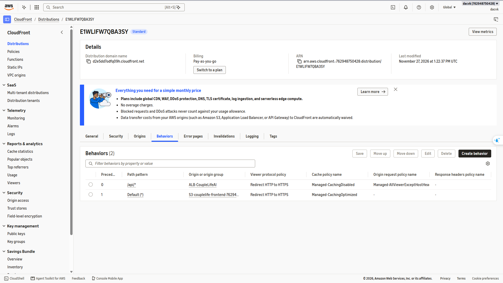
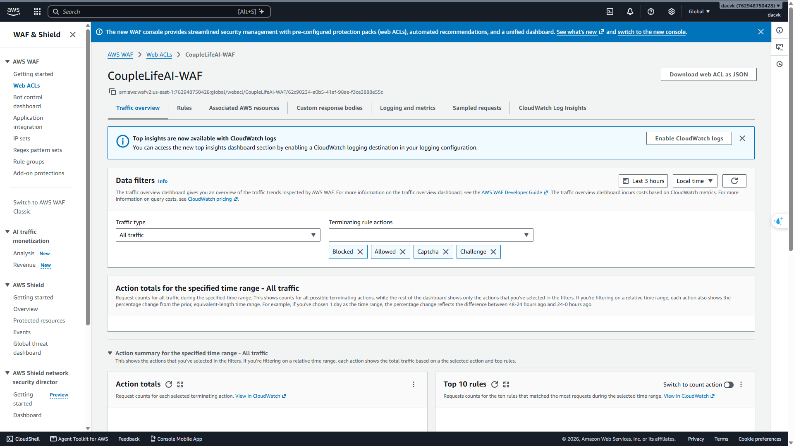

#### Build the frontend and create an S3 bucket

1. From the frontend directory, build the React/Vite application. Verify that the API base URL uses `/api` or the correct same-origin path for the source. Do not hardcode `localhost` or the ALB DNS name into the production bundle.

```bash
npm ci
npm run build
```

2. In the [Amazon S3 Console](https://s3.console.aws.amazon.com/s3/home?region=ap-southeast-1), create a general purpose bucket in Singapore. Name it `couplelife-frontend-<account-id>` using your account ID or another globally unique name. Record the bucket name. Keep Block all public access and SSE-S3 (AES-256). Do not use a public website endpoint.
3. Upload the contents of `dist/`, not the entire source directory. Example CLI command after verifying the project bucket and build path:

```bash
BUCKET=your-unique-frontend-bucket
aws s3 sync dist/ "s3://$BUCKET/" --region ap-southeast-1 --profile couplelife-lab
```



#### CloudFront

1. Open the [CloudFront Console](https://console.aws.amazon.com/cloudfront/v4/home). Create a distribution with an S3 REST origin and Origin Access Control (OAC); enable request signing. Update the bucket policy to allow `cloudfront.amazonaws.com` to read objects only when SourceArn matches the project distribution. Do not enable public access to fix a 403 error.
2. Set Default root object = `index.html`. Use the default CloudFront domain without Route 53 or a custom ACM certificate. After creation, open General and copy your Distribution domain name and Distribution ID. Select **Pay-as-you-go** to match the estimate in section 5.5.3.



After creating the distribution, open **S3 → Buckets → frontend bucket → Permissions → Bucket policy → Edit**. Paste the policy below, replacing `BUCKET_NAME`, `ACCOUNT_ID` and `DISTRIBUTION_ID` with your own values (keep Block public access enabled). If CloudFront already created the correct policy, simply review it.

```json
{
  "Version": "2012-10-17",
  "Statement": [{
    "Effect": "Allow",
    "Principal": {"Service": "cloudfront.amazonaws.com"},
    "Action": "s3:GetObject",
    "Resource": "arn:aws:s3:::BUCKET_NAME/*",
    "Condition": {"StringEquals": {"AWS:SourceArn": "arn:aws:cloudfront::ACCOUNT_ID:distribution/DISTRIBUTION_ID"}}
  }]
}
```

3. Add the ALB origin and create `/api/*` ahead of Default (*). Allow API POST/PUT/PATCH/DELETE methods as required by the source. Configure caching and forwarding as below, then verify with real requests.

| Behavior | Origin | Viewer protocol | Cache policy | Origin request policy |
|---|---|---|---|---|
| `/api/*` | ALB-CoupleLifeAI | Redirect HTTP to HTTPS | Managed-CachingDisabled | Managed-AllViewerExceptHostHeader |
| Default (*) | S3 | Redirect HTTP to HTTPS | Managed-CachingOptimized | As required by the static origin |



Managed-CachingDisabled avoids caching personalized or authenticated responses. Forward Authorization, query strings and required cookies according to the API contract. For the lab ALB HTTP 80 listener, set the origin protocol policy to HTTP only. Restrict inbound access and headers as in section 5.4.3; use HTTPS origins for sensitive workloads.

In the distribution → **Origins**, select the ALB origin → **Edit**. Set Origin protocol policy to HTTP only and add the custom header `X-CoupleLife-Origin` with the value generated in section 5.4.3. Save. Do not include the header value in screenshots.

4. SPA routing: attach a CloudFront Function (viewer request) to the default behavior to rewrite extensionless frontend routes to `/index.html`; do not rewrite `/api/*` or static assets. Avoid distribution-wide 403/404 → 200 custom errors because they can change API responses. Test deep links and API errors after configuration.

In CloudFront → Functions, choose Create function, name it `couplelife-spa-rewrite`, paste the code below and choose Save changes → Publish. In the distribution → Behaviors → Default (*) → Edit → Function associations, choose Viewer request and the published function. Do not attach it to `/api/*`.

```javascript
function handler(event) {
    var request = event.request;
    var uri = request.uri;
    if (uri !== '/api' && !uri.startsWith('/api/') && !uri.split('/').pop().includes('.')) {
        request.uri = '/index.html';
    }
    return request;
}
```

#### AWS WAF

1. Open [AWS WAF](https://us-east-1.console.aws.amazon.com/wafv2/homev2?region=global), create `CoupleLifeAI-WAF` for CloudFront (Global scope in us-east-1).
2. Add an AWS Common Rule Set group and a rate-based rule of 1,000 requests per five minutes. Associate the ACL with the distribution. Check rule actions and avoid blocking legitimate itinerary payloads; adjust using logs/metrics rather than disabling all protection.



Under Associated AWS resources, check that the distribution is associated with the Web ACL; use Rules and metrics to monitor requests.

#### Check access

Wait for the distribution to deploy. Open the CloudFront domain, check the homepage and `/api/v1/health`. After frontend updates, check the cache for `index.html` and invalidate when necessary rather than overusing invalidations. Functional results are in section 5.5.1.
