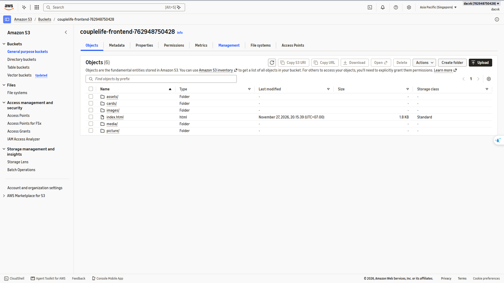
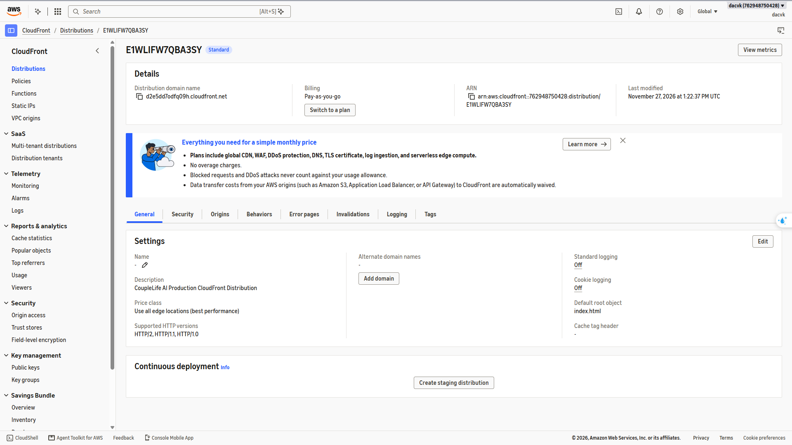
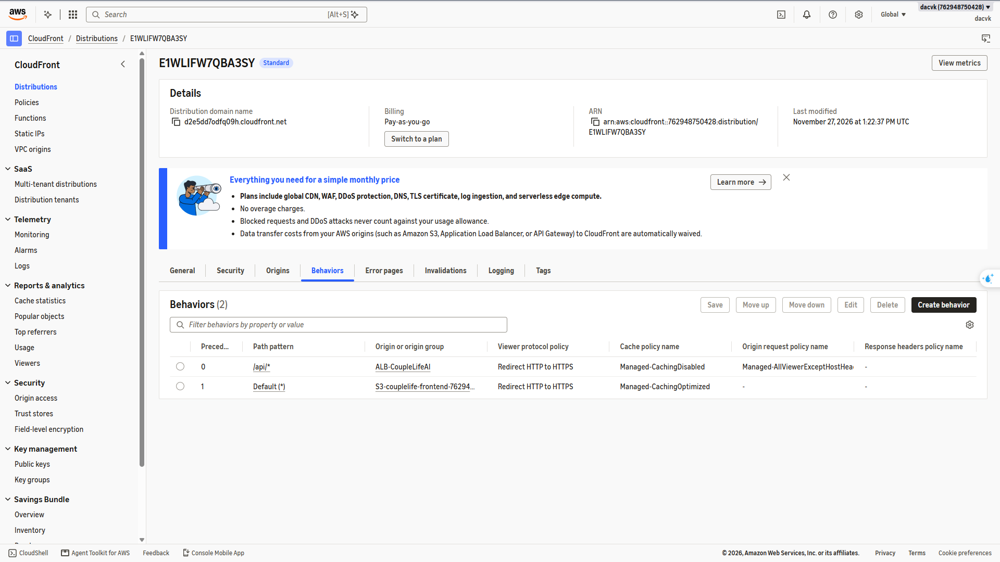
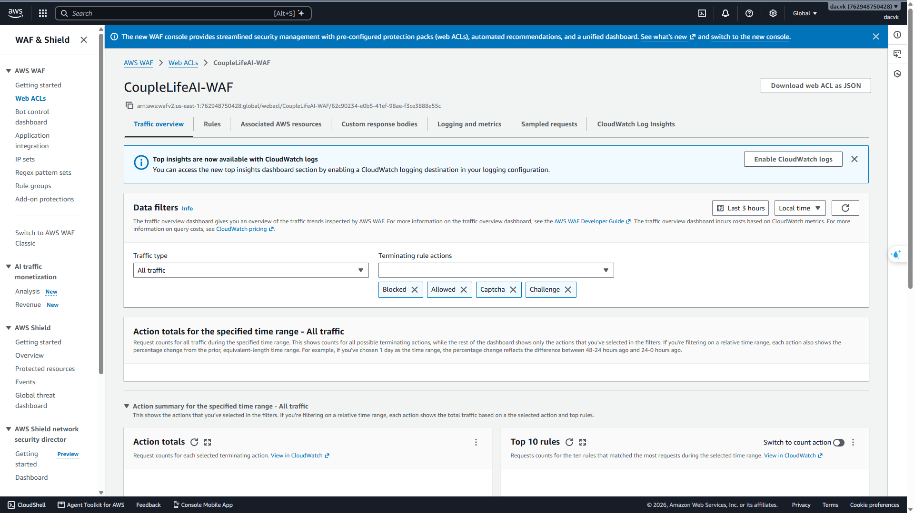

#### Build Frontend và tạo S3 bucket

1. Từ thư mục frontend của repository, build React/Vite. Kiểm tra cấu hình API base URL dùng đường dẫn tương đối `/api` hoặc đường dẫn same-origin đúng theo source, không hardcode `localhost` hoặc ALB DNS vào production bundle.

```bash
npm ci
npm run build
```

2. Trong [Amazon S3 Console](https://s3.console.aws.amazon.com/s3/home?region=ap-southeast-1), tạo general purpose bucket tại Singapore. Đặt tên `couplelife-frontend-<account-id>` với Account ID của bạn hoặc tên duy nhất toàn cầu. Ghi lại tên bucket. Giữ Block all public access và SSE-S3 (AES-256), không dùng public static website endpoint.
3. Upload nội dung thư mục `dist/` (không upload cả thư mục source). Ví dụ lệnh dùng CLI sau khi kiểm tra đường dẫn và tên bucket của dự án:

```bash
BUCKET=your-unique-frontend-bucket
aws s3 sync dist/ "s3://$BUCKET/" --region ap-southeast-1 --profile couplelife-lab
```



#### CloudFront

1. Mở [CloudFront Console](https://console.aws.amazon.com/cloudfront/v4/home). Tạo distribution với S3 bucket REST origin và Origin Access Control (OAC); bật ký request. Cập nhật bucket policy chỉ cho phép service principal `cloudfront.amazonaws.com` đọc object khi SourceArn là distribution của dự án. Không bật public access để xử lý lỗi 403.
2. Đặt Default root object = `index.html`. Sử dụng domain mặc định CloudFront, không cần Route 53 hay ACM custom certificate. Sau khi tạo, mở tab General, sao chép Distribution domain name và Distribution ID của bạn. Chọn mô hình **Pay-as-you-go** cho cấu hình dự toán ở mục 5.5.3.



Sau khi tạo distribution, mở **S3 → Buckets → bucket frontend → Permissions → Bucket policy → Edit**. Dán policy dưới đây, thay `BUCKET_NAME`, `ACCOUNT_ID` và `DISTRIBUTION_ID` bằng thông tin của bạn (giữ Block public access). Nếu CloudFront đã tạo policy đúng, chỉ cần kiểm tra lại.

```json
{
  "Version": "2012-10-17",
  "Statement": [{
    "Effect": "Allow",
    "Principal": {"Service": "cloudfront.amazonaws.com"},
    "Action": "s3:GetObject",
    "Resource": "arn:aws:s3:::BUCKET_NAME/*",
    "Condition": {"StringEquals": {"AWS:SourceArn": "arn:aws:cloudfront::ACCOUNT_ID:distribution/DISTRIBUTION_ID"}}
  }]
}
```

3. Thêm origin cho ALB và tạo behavior `/api/*` đứng trước Default (*). Đảm bảo allowed methods hỗ trợ API POST/PUT/PATCH/DELETE khi source yêu cầu. Cấu hình cache và forwarding như bảng sau, rồi kiểm tra bằng request thật.

| Behavior | Origin | Viewer protocol | Cache policy | Origin request policy |
|---|---|---|---|---|
| `/api/*` | ALB-CoupleLifeAI | Redirect HTTP to HTTPS | Managed-CachingDisabled | Managed-AllViewerExceptHostHeader |
| Default (*) | S3 | Redirect HTTP to HTTPS | Managed-CachingOptimized | Theo static origin |



Managed-CachingDisabled tránh cache response cá nhân và xác thực. Forward Authorization, query strings và cookies cần thiết theo API contract. Với ALB listener HTTP 80, đặt origin protocol policy HTTP only cho môi trường lab. Giới hạn inbound và header như mục 5.4.3; dùng HTTPS origin khi xử lý dữ liệu nhạy cảm.

Trong distribution → **Origins**, chọn ALB origin → **Edit**. Đặt Origin protocol policy = HTTP only, thêm custom header `X-CoupleLife-Origin` với giá trị đã tạo ở mục 5.4.3, sau đó lưu. Không đưa giá trị header vào ảnh.

4. SPA routing: gắn CloudFront Function (viewer request) vào default behavior để rewrite route frontend không có phần mở rộng về `/index.html`; không rewrite `/api/*` hoặc static assets. Không dùng custom error response 403/404 → 200 toàn distribution vì có thể làm sai response API. Kiểm tra deep link và API lỗi sau cấu hình.

Trong CloudFront → Functions, chọn Create function, đặt tên `couplelife-spa-rewrite`, dán code dưới đây, chọn Save changes → Publish. Trong distribution → Behaviors → Default (*) → Edit → Function associations, chọn Viewer request và function vừa publish. Không gắn function vào `/api/*`.

```javascript
function handler(event) {
    var request = event.request;
    var uri = request.uri;
    if (uri !== '/api' && !uri.startsWith('/api/') && !uri.split('/').pop().includes('.')) {
        request.uri = '/index.html';
    }
    return request;
}
```

#### AWS WAF

1. Mở [AWS WAF](https://us-east-1.console.aws.amazon.com/wafv2/homev2?region=global), tạo Web ACL `CoupleLifeAI-WAF` cho CloudFront (Global scope tại us-east-1).
2. Thêm AWS Common Rule Set và rate-based rule với giới hạn 1.000 requests/5 phút. Gắn Web ACL với distribution. Kiểm tra rule actions và tránh chặn payload itinerary hợp lệ; dùng log/metrics để điều chỉnh có kiểm soát, không bỏ toàn bộ bảo vệ.



Trong tab Associated AWS resources, kiểm tra distribution đã được gắn Web ACL; xem Rules và metrics để theo dõi request.

#### Kiểm tra truy cập

Đợi distribution deploy xong. Mở domain CloudFront, kiểm tra trang chủ và `/api/v1/health`. Khi cập nhật frontend, kiểm tra cache của `index.html` và invalidation nếu cần; tránh invalidation quá mức. Kết quả chức năng ở 5.5.1.
