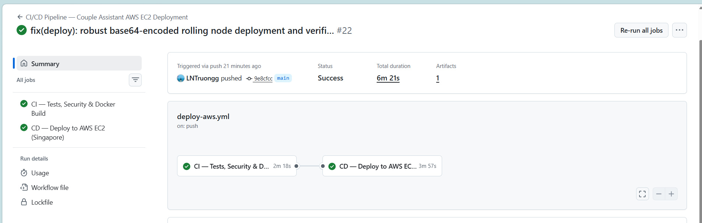

---
title: "CI/CD with GitHub Actions"
date: 2026-11-28
weight: 5
chapter: false
pre: " <b> 5.4.5. </b> "
---

#### 1. Configure GitHub Actions

GitHub Actions automates the process of testing, building, and deploying the application to AWS whenever the source code is updated.

The pipeline consists of two main stages:

- **Continuous Integration (CI):** Runs Backend tests, builds the Frontend, and validates Docker images.
- **Continuous Deployment (CD):** Pushes Docker images to Amazon ECR, updates the Frontend on Amazon S3, and deploys new application versions to Amazon EC2.

#### 2. Configure AWS Authentication with OIDC

1. Open the AWS Management Console and navigate to **IAM**.
2. Select **Identity providers**, then choose **Add provider**.
3. Select OpenID Connect and enter:
   - Provider URL: `https://token.actions.githubusercontent.com`
   - Audience: `sts.amazonaws.com`
4. Create an IAM Role for GitHub Actions.
5. Configure the Trust Policy to restrict access to the specific repository and deployment branch or production environment.
6. Grant the required permissions for Amazon ECR, Amazon S3, CloudFront, Systems Manager, and other related resources.

OIDC allows GitHub Actions to use temporary AWS credentials instead of storing long-term AWS Access Keys in the repository.

#### 3. Create the CI/CD Workflow

1. Download the [CI/CD workflow](./attachments/deploy-aws.yml.txt).
2. Create the `.github/workflows/` directory in your repository and save the workflow as `deploy-aws.yml`.
3. Update the AWS configuration values in the workflow to match your account and deployed resources:
   - AWS Region.
   - IAM Role ARN.
   - ECR repositories.
   - S3 bucket.
   - CloudFront Distribution ID.
   - EC2, Auto Scaling Group, and Target Group.
   - Health Check URL.
4. Verify that the branch specified in `on.push.branches` matches your deployment branch.
5. Commit and push the source code to GitHub.
6. Open the **Actions** tab and select the CI/CD workflow to monitor its execution.

#### 4. Automated Deployment Process

After the source code is pushed, GitHub Actions performs the following tasks:

1. Run Backend automated tests.
2. Build the Frontend SPA.
3. Validate Docker image builds.
4. Authenticate with AWS through OIDC.
5. Build and push Docker images to Amazon ECR.
6. Synchronize Frontend assets to Amazon S3 and invalidate the CloudFront cache.
7. Perform PostgreSQL database migrations using Alembic.
8. Update the Backend and AI Service sequentially across EC2 instances through AWS Systems Manager.
9. Verify ALB target health and the API Health Check endpoint.

Rolling Deployment helps minimize service interruptions by updating EC2 instances individually instead of updating the entire system simultaneously.

If the updated application fails its health checks, the rollback mechanism restores the previous Docker image version.

#### 5. Verify CI/CD Results

In GitHub Actions, open the workflow run and verify that both jobs have completed successfully:

- **CI — Tests, Security & Docker Build:** Success.
- **CD — Deploy to AWS EC2 (Singapore):** Success.

The following results were recorded during the demonstrated deployment:

| Item | Result |
|---|---|
| Backend automated tests | 156/156 Passed |
| Continuous Integration | Success |
| Continuous Deployment | Success |
| CI duration | 2 minutes 18 seconds |
| CD duration | 3 minutes 57 seconds |
| Total duration | 6 minutes 21 seconds |

#### 6. Verify the Application After Deployment

1. Open Amazon EC2 and select **Target Groups**.
2. Select the application's Target Group and verify that all instances have a **Healthy** status.
3. Access the CloudFront Distribution Domain Name to verify the website.
4. Check the Backend API using the `/api/v1/health` endpoint.
5. Test the application features to ensure that the newly deployed version works correctly.

After completing these steps, the system can automatically test and deploy new application versions through GitHub Actions without requiring manual updates to individual EC2 instances.
