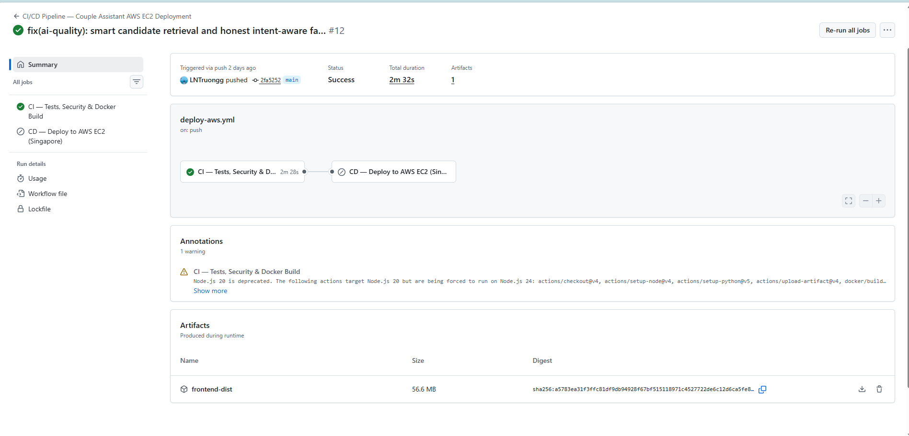

#### 1. Tạo workflow kiểm thử

GitHub Actions giúp chạy test Backend, build frontend và kiểm tra khả năng build Docker image trước khi triển khai.

1. Tải [workflow CI](./attachments/deploy-aws.yml.txt). Trong repository của bạn, tạo thư mục `.github/workflows/`, lưu nội dung thành `deploy-aws.yml`.
2. Kiểm tra branch trong `on.push.branches` khớp branch bạn sử dụng. Kiểm tra `backend/requirements.txt`, `backend/tests/`, `frontend/package-lock.json` và hai Dockerfile tồn tại trong repository.
3. Commit và push workflow vào repository của bạn. Mở tab **Actions**, chọn workflow CoupleLife AI — CI. Có thể chọn Run workflow để chạy thủ công.

4. Mở run, chọn job CI để xem kết quả pytest, frontend build và Docker build. Trong Artifacts, tải `frontend-dist` nếu cần kiểm tra bundle.

Kiểm tra job CI hoàn tất và artifact được tạo. Workflow trong bài chỉ kiểm thử và build; thực hiện triển khai AWS theo bước tiếp theo.

#### 2. Triển khai phiên bản mới

Sau khi CI thành công, dùng quy trình build/push image ở mục 5.4.1 và triển khai EC2 ở mục 5.4.2. Để cập nhật image, tạo Launch Template version mới với tag mới, chọn version mới cho ASG. Kiểm tra tương thích migration và sao lưu dữ liệu trước khi cập nhật. Mở ASG → Instance refresh → Start instance refresh, cấu hình thay thế lần lượt và kiểm tra target health ở mục 5.4.3; tránh giảm cả hai target cùng lúc. Khi cần, khôi phục version trước đã kiểm tra tương thích schema. Cập nhật frontend theo mục 5.4.4 sau khi API sẵn sàng.

Nếu mở rộng thành CD tự động, cấu hình GitHub OIDC role giới hạn repository/environment và quyền ECR, S3, CloudFront, SSM cần thiết. Dùng environment protection và kiểm tra kết quả từng lệnh SSM, image tag, health check trước khi phát hành. Phần thực hành này sử dụng CI kết hợp triển khai thủ công để người đọc kiểm soát từng bước.
