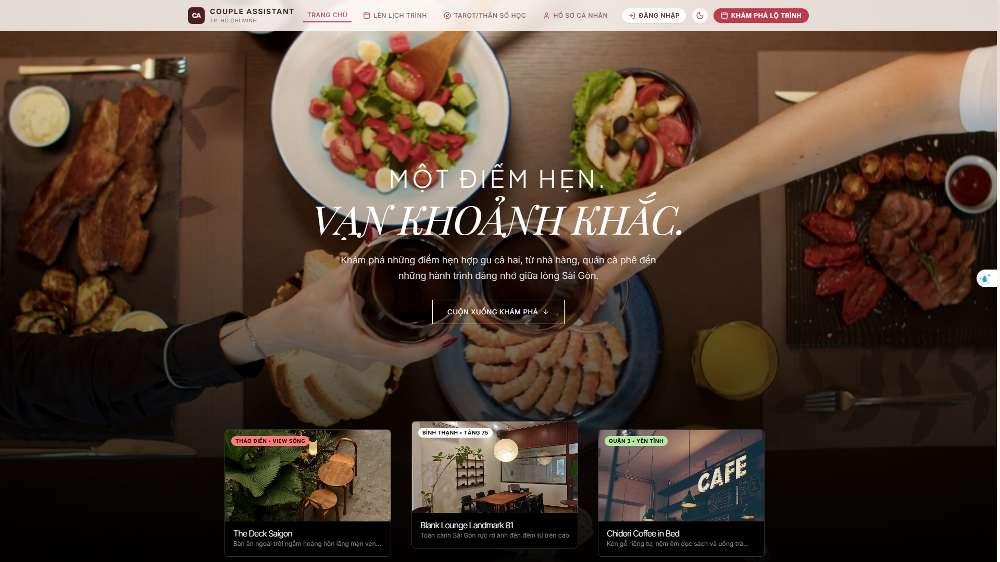
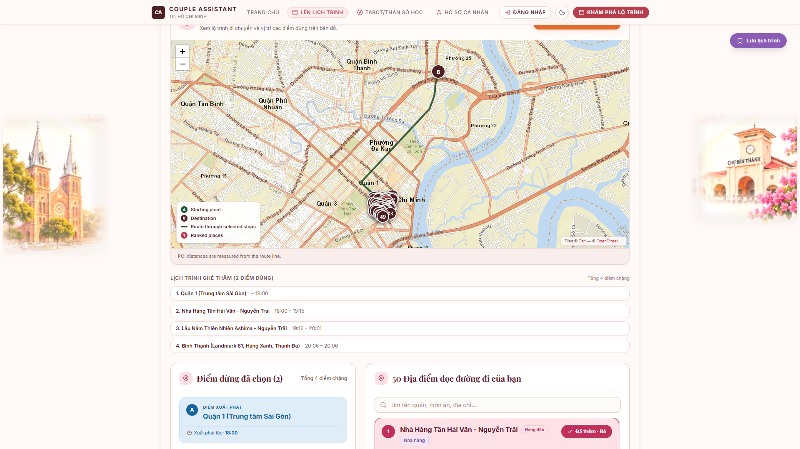
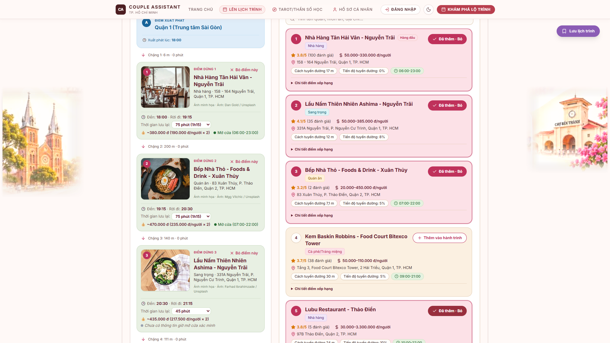
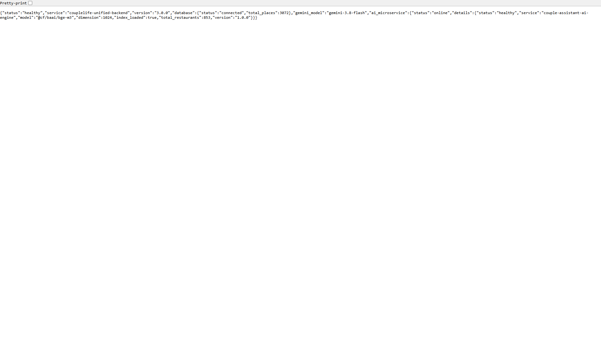

#### Test the application through CloudFront

1. Open CloudFront → Distributions → your distribution, copy the Distribution domain name and visit it over HTTPS. Check the homepage, images, CSS and JavaScript. After a release, use a hard refresh if older assets are cached.



2. Open the itinerary page, select a starting point in District 1 and a destination in Binh Thanh (example). Enter suitable constraints and choose **KHÁM PHÁ ĐỊA ĐIỂM** (Explore places). The result should include a route and real places, not just a success message.

3. Check the candidates along the route and the AI assistance area. Select places, add them to the itinerary and inspect the map/legs. Compare the selected count, time and budget with the displayed result.



Also test registration/login, JWT, profile updates and consistency across both nodes using a test account. Use the Network tab or API logs to confirm HTTP status and inspect AI responses.

#### Troubleshoot AI Service errors

If the Explore button displays `AI Service route request failed`, open Systems Manager → Session Manager and connect to an EC2 instance. Run `sudo docker logs --tail 100 couplelife-backend` and `sudo docker logs --tail 100 couplelife-ai-service`. If the backend returns 502 and AI Service returns 500, inspect the error before changing configuration.

- For a non-ASCII `secrets.compare_digest` error, open Secrets Manager and make the backend `INTERNAL_TOKEN` match the AI `INTERNAL_API_SECRET`, using a random ASCII token.
- If embedding initialization fails, check `CLOUDFLARE_ACCOUNT_ID`, `CLOUDFLARE_API_TOKEN` and the Workers AI quota. Check the Groq API key if the LLM returns an authentication error.
- After updating secrets, refresh the environment files on both EC2 instances using the secret retrieval procedure in section 5.4.2 and restart the affected services. Do not print secrets. Retest the health API and place exploration.

#### Check APIs and data

The following read-only requests can be run from the test machine:

```bash
read -r -p "CloudFront distribution domain (without https://): " CF_DOMAIN
BASE="https://$CF_DOMAIN"
curl -fsS "$BASE/api/v1/health"
curl -fsS "$BASE/api/v1/places?limit=2"
```

With the lab dataset, check that the Health API returns `status: healthy`, `database.status: connected`, `total_places: 3072`, `index_loaded: true`, `total_restaurants: 853` and the `@cf/baai/bge-m3` embedding model (1,024 dimensions). The counts differ because PostgreSQL contains the full place dataset, while AI uses 853 prepared restaurants for ranking. Check the configured Groq model `openai/gpt-oss-20b` and provider logs to identify the active model; do not rely on legacy metadata.



#### Routing measurements

Open Chrome DevTools → Network, filter for `routes` and perform five route searches with different start/end points. Select each `POST /api/v1/routes` request, check Status and Duration/Timing, record its time and calculate the average. Compare requests for the same operation only.

An example measurement covers five `POST /api/v1/routes` calls through CloudFront, all HTTP 200:

| Request | Latency (ms) |
|---|---:|
| 1 | 651.5 |
| 2 | 729.8 |
| 3 | 560.8 |
| 4 | 611.3 |
| 5 | 583.0 |
| Mean | 627.3 |

These example measurements cover routing rather than LLM latency or the complete itinerary workflow. Five requests do not constitute a stress test or an SLA guarantee.

#### Check high availability

1. Open EC2 → Auto Scaling Groups → `CoupleLifeAI-ASG` and check two InService instances in separate AZs.
2. Open Target Groups → `CoupleLifeAI-TG` and confirm 2/2 Healthy. Check both nodes through SSM for matching image versions and running containers.

See sections 5.4.2 and 5.4.3 for ASG and target group configuration.

3. To test failover in a test environment, prepare backups, request monitoring and a recovery plan. Replace one instance through ASG, verify that the other continues to serve traffic and that the new instance becomes Healthy. Test RDS failover separately and measure recovery time. This is an additional test; two healthy targets alone do not establish failover results.

**Expected result:** The Health API is healthy, routing returns HTTP 200, both targets are Healthy and the main frontend features work.

#### Source-level testing

Run the backend test suite using the CI workflow in section 5.4.5 and `npm ci` / `npm run build` in the frontend. Check test results and artifacts before building images or deploying a new version.
