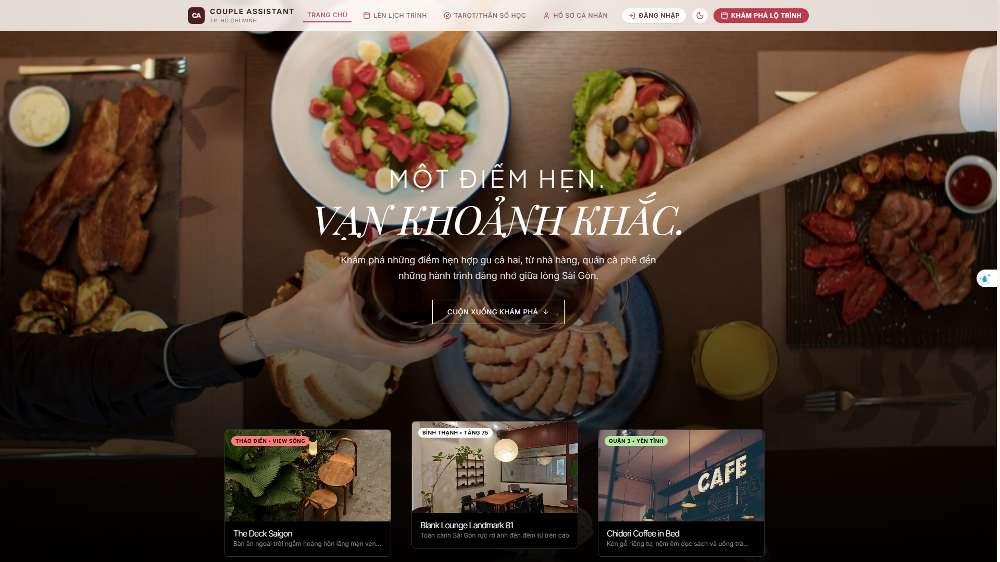
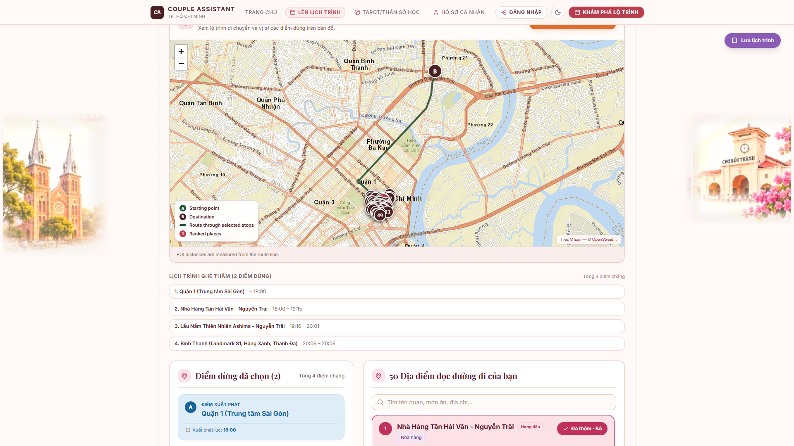
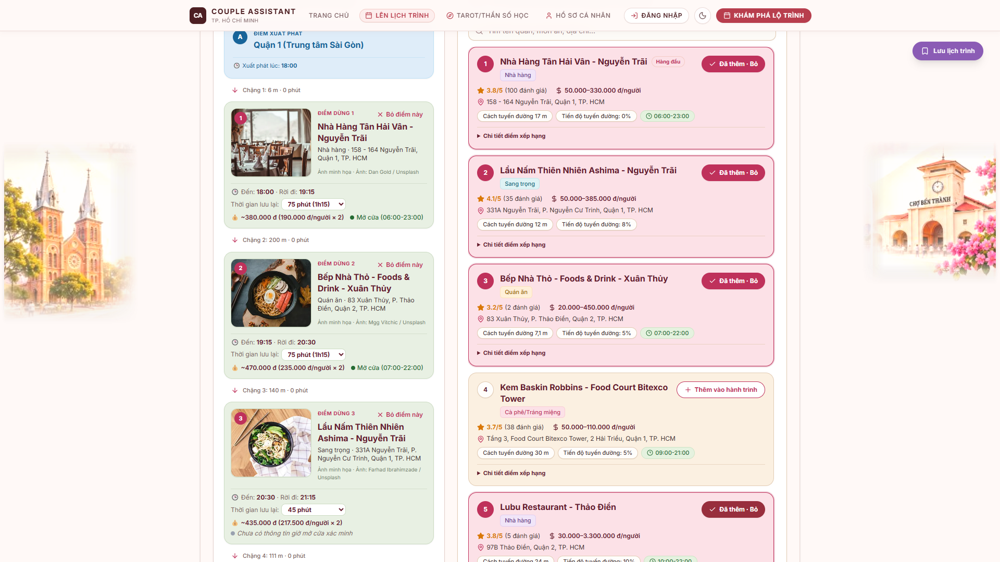
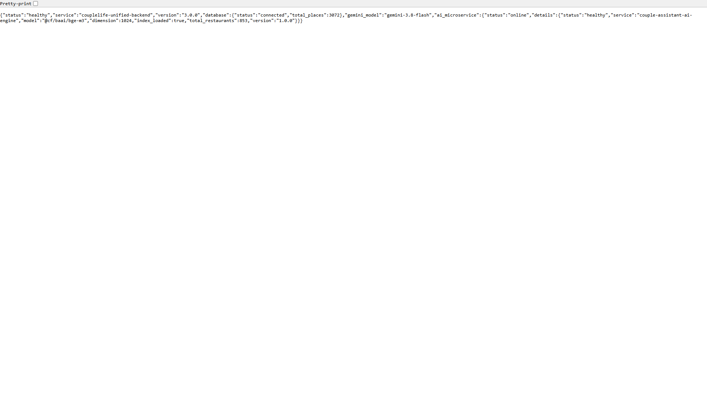

#### Kiểm tra ứng dụng qua CloudFront

1. Mở CloudFront → Distributions → distribution vừa tạo, sao chép Distribution domain name và truy cập bằng HTTPS. Kiểm tra trang chủ, ảnh, CSS và JavaScript. Nếu vừa cập nhật phiên bản, dùng hard refresh để tránh asset cũ trong cache.



2. Vào mục lên lịch trình, chọn điểm A ở Quận 1 và điểm B ở Bình Thạnh (ví dụ). Nhập các ràng buộc phù hợp rồi bấm **KHÁM PHÁ ĐỊA ĐIỂM**. Kết quả cần có tuyến đường và các địa điểm thật, không chỉ thông báo thành công.

3. Kiểm tra danh sách ứng viên dọc tuyến đường và phần hỗ trợ AI. Chọn địa điểm, thêm vào lịch trình và xem bản đồ/các chặng. Đối chiếu số điểm đã chọn, thời gian và chi phí với thông tin đang hiển thị.



Kiểm tra thêm đăng ký/đăng nhập, JWT, cập nhật hồ sơ và dữ liệu nhất quán giữa hai node bằng tài khoản thử nghiệm. Dùng Network tab hoặc log API để xác nhận HTTP status và kiểm tra phản hồi của AI.

#### Xử lý lỗi AI Service

Nếu nút khám phá hiển thị `AI Service route request failed`, mở Systems Manager → Session Manager và kết nối EC2. Chạy `sudo docker logs --tail 100 couplelife-backend` và `sudo docker logs --tail 100 couplelife-ai-service`. Nếu Backend trả 502 và AI trả 500, kiểm tra thông báo lỗi trước khi sửa cấu hình.

- Với lỗi `secrets.compare_digest` liên quan non-ASCII, mở Secrets Manager và đặt `INTERNAL_TOKEN` của Backend trùng `INTERNAL_API_SECRET` của AI Service, dùng token ASCII ngẫu nhiên.
- Nếu embedding không khởi tạo, kiểm tra `CLOUDFLARE_ACCOUNT_ID`, `CLOUDFLARE_API_TOKEN` và quota Workers AI. Kiểm tra thêm Groq API key nếu LLM trả lỗi xác thực.
- Sau khi cập nhật secrets, cập nhật file môi trường trên cả hai EC2 bằng quy trình lấy secret ở mục 5.4.2 và restart các service tương ứng. Không in secret ra màn hình. Kiểm tra lại Health API và chức năng khám phá địa điểm.

#### Kiểm tra API và dữ liệu

Có thể dùng các lệnh chỉ đọc sau từ máy kiểm thử:

```bash
read -r -p "CloudFront distribution domain (without https://): " CF_DOMAIN
BASE="https://$CF_DOMAIN"
curl -fsS "$BASE/api/v1/health"
curl -fsS "$BASE/api/v1/places?limit=2"
```

Với dataset của bài, kiểm tra Health API có `status: healthy`, `database.status: connected`, `total_places: 3072`, `index_loaded: true`, `total_restaurants: 853` và embedding model `@cf/baai/bge-m3` (1024 chiều). Hai số lượng khác nhau vì PostgreSQL chứa toàn bộ địa điểm, còn AI sử dụng tập 853 quán đã được chuẩn bị cho ranking. Kiểm tra model Groq `openai/gpt-oss-20b` trong cấu hình AI và log provider; không dùng trường metadata cũ để xác định model đang chạy.



#### Kết quả đo Routing

Mở Chrome DevTools → Network, lọc `routes`, thực hiện năm lần tìm tuyến trên giao diện với các điểm khác nhau. Chọn từng request `POST /api/v1/routes`, xem Status và Duration/Timing, ghi lại thời gian và tính trung bình. Chỉ so sánh các request cùng chức năng.

Ví dụ đo năm request `POST /api/v1/routes` qua CloudFront, tất cả HTTP 200:

| Lần thử | Latency (ms) |
|---|---:|
| 1 | 651,5 |
| 2 | 729,8 |
| 3 | 560,8 |
| 4 | 611,3 |
| 5 | 583,0 |
| Trung bình | 627,3 |

Đây là số liệu đo tham chiếu cho routing, không phải latency LLM hoặc toàn bộ quy trình tạo lịch trình; mẫu năm request không phải stress test hoặc cam kết SLA.

#### Kiểm tra High Availability

1. Mở EC2 → Auto Scaling Groups → `CoupleLifeAI-ASG`, kiểm tra hai instances InService ở hai AZ khác nhau.
2. Mở Target Groups → `CoupleLifeAI-TG`, xác nhận 2/2 Healthy. Kiểm tra cả hai node qua SSM để xác nhận version image và container hoạt động đồng nhất.

3. Để kiểm tra failover trong môi trường thử nghiệm, chuẩn bị backup, theo dõi request và phương án khôi phục. Thử thay thế một instance bằng ASG, xác nhận node còn lại tiếp tục phục vụ và node mới trở lại Healthy. Thử RDS failover riêng và đo thời gian phục hồi. Đây là bài kiểm tra bổ sung, không suy ra kết quả chỉ từ 2/2 Healthy.

**Kết quả cần đạt:** Health API trả về trạng thái healthy, routing trả HTTP 200, hai target Healthy và chức năng chính hoạt động trên frontend.

Xem cấu hình ASG và Target Group tại mục 5.4.2 và 5.4.3.

#### Kiểm thử mã nguồn

Chạy bộ kiểm thử Backend theo workflow CI ở mục 5.4.5 và `npm ci` / `npm run build` trong frontend. Kiểm tra kết quả test và artifact trước khi build image hoặc triển khai phiên bản mới.
