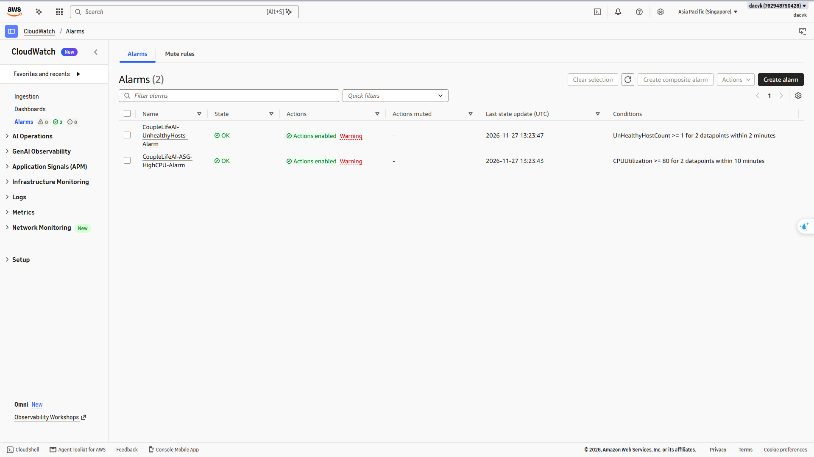

#### CloudWatch alarms

1. Open [Amazon CloudWatch](https://ap-southeast-1.console.aws.amazon.com/cloudwatch/home?region=ap-southeast-1#alarmsV2:) and choose **Alarms → Create alarm → Select metric**. Select the appropriate ALB or EC2 ASG namespace/dimension.
2. Configure two alarms using the settings below. Select the SNS topic as notification action if the subscription is ready.

| Alarm | Metric | Alarm condition |
|---|---|---|
| CoupleLifeAI-UnhealthyHosts-Alarm | UnHealthyHostCount | ≥ 1, 2 datapoints within 2 minutes |
| CoupleLifeAI-ASG-HighCPU-Alarm | CPUUtilization | ≥ 80%, 2 datapoints within 10 minutes |



If Actions shows Warning, open alarm details and check the SNS action, publish permissions and subscription. Additional useful metrics include ALB TargetResponseTime, HTTPCode_Target_5XX_Count, RDS CPU/connections/free storage and CPU credit balance.

#### SNS

1. Open [Amazon SNS](https://ap-southeast-1.console.aws.amazon.com/sns/v3/home?region=ap-southeast-1) → Topics → Create topic. Choose Standard and name it `CoupleLifeAI-Alerts`.
2. Choose Create subscription, Email protocol and the notification address. Confirm the subscription by email and check for Confirmed status.
3. In CloudWatch, open the alarm → Edit → Notification and attach the topic for the In alarm state. Check the action and send a test notification to verify delivery.

#### CloudTrail and logs

1. Open [AWS CloudTrail](https://ap-southeast-1.console.aws.amazon.com/cloudtrail/home?region=ap-southeast-1) → Event history. Filter by event source or CoupleLifeAI resource to inspect management events from the last 90 days. A separate S3 trail is not required for Event History.
2. Use SSM Session Manager and `sudo docker logs --tail 100 couplelife-backend` or `sudo docker logs --tail 100 couplelife-ai-service` to inspect HTTP, database and AI provider errors. Never print credentials.
3. For centralized logs, configure the CloudWatch agent or Docker log driver, scope write permissions to the log group and set an appropriate retention period (for example 14 days). Verify log events and estimate ingestion/storage costs before use.

#### Read-only CLI checks

```bash
PROFILE=couplelife-lab
ACCOUNT_ID=$(aws sts get-caller-identity --profile "$PROFILE" --query Account --output text)
aws sns list-subscriptions-by-topic --topic-arn "arn:aws:sns:ap-southeast-1:$ACCOUNT_ID:CoupleLifeAI-Alerts" --region ap-southeast-1 --profile "$PROFILE"
aws cloudtrail lookup-events --max-results 10 --region ap-southeast-1 --profile "$PROFILE"
aws logs describe-log-groups --log-group-name-prefix RDSOSMetrics --region ap-southeast-1 --profile "$PROFILE"
```

The commands use the Account ID from the profile configured in section 5.2. Use CloudWatch → Log groups to inspect available log groups; RDS logs and application logs are separate.
