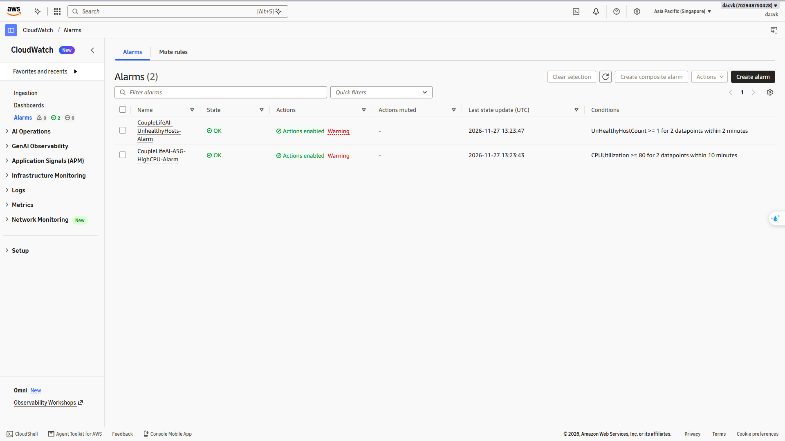

#### CloudWatch alarms

1. Mở [Amazon CloudWatch](https://ap-southeast-1.console.aws.amazon.com/cloudwatch/home?region=ap-southeast-1#alarmsV2:), chọn **Alarms → Create alarm → Select metric**. Chọn namespace/dimension đúng của ALB hoặc EC2 ASG.
2. Tạo hai alarms với cấu hình trong bảng. Chọn SNS topic làm notification action nếu subscription đã sẵn sàng.

| Alarm | Metric | Điều kiện cảnh báo |
|---|---|---|
| CoupleLifeAI-UnhealthyHosts-Alarm | UnHealthyHostCount | ≥ 1, 2 datapoints trong 2 phút |
| CoupleLifeAI-ASG-HighCPU-Alarm | CPUUtilization | ≥ 80%, 2 datapoints trong 10 phút |



Nếu Actions hiển thị Warning, mở chi tiết alarm và kiểm tra SNS action, quyền publish và subscription. Theo dõi thêm ALB TargetResponseTime, HTTPCode_Target_5XX_Count, RDS CPU/connections/free storage và CPU credit balance nếu cần.

#### SNS

1. Mở [Amazon SNS](https://ap-southeast-1.console.aws.amazon.com/sns/v3/home?region=ap-southeast-1) → Topics → Create topic. Chọn Standard, tên `CoupleLifeAI-Alerts`.
2. Chọn Create subscription, protocol Email và địa chỉ nhận cảnh báo. Xác nhận subscription qua email; kiểm tra trạng thái Confirmed.
3. Trong CloudWatch, chọn alarm → Edit → Notification, gắn topic vào trạng thái In alarm. Kiểm tra action và thử gửi thông báo để xác nhận việc nhận email.

#### CloudTrail và logs

1. Mở [AWS CloudTrail](https://ap-southeast-1.console.aws.amazon.com/cloudtrail/home?region=ap-southeast-1) → Event history. Lọc theo event source hoặc resource của CoupleLifeAI để tra cứu thao tác quản trị trong 90 ngày. Không cần tạo trail lưu S3 nếu chỉ tra cứu Event History.
2. Dùng SSM Session Manager để đọc log container bằng `sudo docker logs --tail 100 couplelife-backend` hoặc `sudo docker logs --tail 100 couplelife-ai-service`. Kiểm tra lỗi HTTP, kết nối database và AI provider; không in credentials.
3. Nếu cần log tập trung, cấu hình CloudWatch agent hoặc Docker log driver, cấp quyền ghi đúng log group và đặt retention phù hợp (ví dụ 14 ngày). Kiểm tra log events và dự toán ingestion/storage trước khi sử dụng.

#### Kiểm tra bằng CLI (chỉ đọc)

```bash
PROFILE=couplelife-lab
ACCOUNT_ID=$(aws sts get-caller-identity --profile "$PROFILE" --query Account --output text)
aws sns list-subscriptions-by-topic --topic-arn "arn:aws:sns:ap-southeast-1:$ACCOUNT_ID:CoupleLifeAI-Alerts" --region ap-southeast-1 --profile "$PROFILE"
aws cloudtrail lookup-events --max-results 10 --region ap-southeast-1 --profile "$PROFILE"
aws logs describe-log-groups --log-group-name-prefix RDSOSMetrics --region ap-southeast-1 --profile "$PROFILE"
```

Lệnh trên tự lấy Account ID từ profile đã thiết lập ở mục 5.2. Dùng CloudWatch → Log groups để xem các nhóm log đang có; không nhầm log RDS với log ứng dụng.
