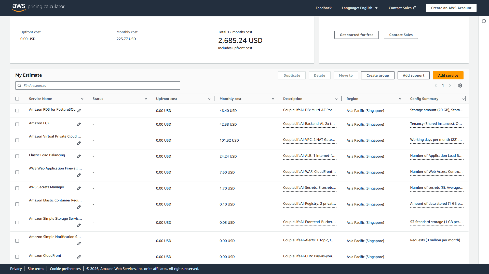
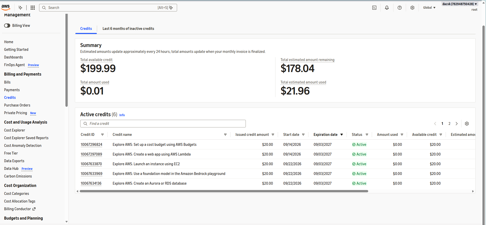

---
title: "Cost Estimation and Optimization"
date: 2026-11-28
weight: 3
chapter: false
pre: " <b> 5.5.3. </b> "
---

Cost estimation and management are essential when deploying applications on AWS. In this workshop, CoupleLife AI is designed to balance performance, high availability, and operational costs.

#### 1. Configuration and Cost Assumptions

Use AWS Pricing Calculator to estimate costs before deploying resources in the Singapore Region (ap-southeast-1).

The main configuration parameters are:

- 2 t3.small EC2 instances running continuously, each with 20 GiB of gp3 storage.
- Amazon RDS PostgreSQL db.t3.micro Multi-AZ with 20 GiB of gp3 storage.
- 2 NAT Gateways with an estimated total data processing volume of 10 GB per month.
- 4 estimated public IPv4 addresses for NAT Gateways and the Application Load Balancer.
- 1 Application Load Balancer with an assumed average utilization of 1 LCU.
- CloudFront with 10 GB of outbound data transfer and 100,000 HTTPS requests per month.
- AWS WAF with 1 Web ACL, 2 rules, and an estimated allowance of 1 million requests per month.
- S3 and ECR with an estimated storage capacity of 1 GB each.
- Secrets Manager with 3 secrets and 100,000 API calls per month.

Monthly operating time is calculated based on 730 hours. Traffic and usage parameters are planning assumptions rather than actual load testing results.

#### 2. AWS Pricing Calculator Results

After entering the configuration into AWS Pricing Calculator, review the estimated cost breakdown for each service.

| Service | Estimated Monthly Cost (USD) |
|---|---:|
| Amazon VPC, NAT Gateways and Public IPv4 | 101.32 |
| Amazon RDS PostgreSQL | 46.40 |
| Amazon EC2 and EBS | 42.38 |
| Application Load Balancer | 24.24 |
| AWS WAF | 7.60 |
| AWS Secrets Manager | 1.70 |
| Amazon ECR | 0.10 |
| Amazon S3 | 0.03 |
| Amazon SNS | 0.00 |
| Amazon CloudFront | 0.00 |
| **Total** | **223.77** |

CloudWatch, CloudTrail Event History, and other supporting services are expected to incur no additional charges under the assumed usage conditions.

CloudFront uses pay-as-you-go pricing. Actual costs depend on traffic volume, applicable free usage allowances, and service configuration.

NAT Gateways account for the largest portion of the estimated costs. However, the architecture retains two NAT Gateways and RDS Multi-AZ to support High Availability requirements.

References:

- [AWS Pricing Calculator](https://calculator.aws/)
- [CoupleLife AI Cost Estimate](https://calculator.aws/#/estimate?id=01ec0aee30504f4a008d08d0db765ffb13d06485)

#### 3. Budget Estimation for 14 Days

The workshop uses an internal budget of 120 USD for a 14-day deployment period, supported by up to 200 USD in AWS Promotional Credits, subject to account eligibility.

The estimated cost for 14 days is:

223.77 × 336 / 730 ≈ 103.00 USD

| Item | Cost |
|---|---:|
| Estimated monthly cost | 223.77 USD |
| Estimated cost for 14 days | 103.00 USD |
| Internal budget | 120.00 USD |
| Contingency budget | 17.00 USD |

The contingency budget is allocated to potential additional expenses related to network traffic, CloudWatch Logs, API requests, and actual resource utilization.

This calculation is a planning estimate rather than an actual AWS invoice. Costs should be monitored regularly throughout the deployment period.

#### 4. Monitor AWS Credits and Actual Costs

1. Sign in to the AWS Management Console.
2. Open Billing and Cost Management.
3. Select Credits to review the available balance, expiration dates, and eligibility conditions.

4. Open Cost Explorer, select the required date range, and choose Group by Service to review individual service costs.
5. Open Bills to review incurred charges and applied AWS Credits.
6. Monitor AWS Budgets using the 50%, 80%, and 100% alert thresholds configured in Section 5.2.2.

Costs should be reviewed daily to identify unexpected resource usage. If the deployment period spans two billing months, review the combined costs of both months.

AWS Budgets provides spending alerts but does not enforce a hard spending limit. AWS Credits can only be applied to eligible charges.

#### 5. Cost Optimization Strategies

The CoupleLife AI architecture applies the following cost optimization strategies:

**Amazon CloudFront**

Cache static content at Edge Locations to reduce origin requests and improve website loading performance. Disable caching for APIs containing personal data.

**S3 Gateway Endpoint**

Allow EC2 instances in Private Subnets to access Amazon S3 through a Gateway Endpoint, reducing unnecessary traffic through NAT Gateways.

**EC2 Resource Optimization**

Deploy the Backend and AI Service as Docker containers on the same EC2 instance to improve resource utilization without provisioning separate servers for each service.

**External AI Services**

Use Groq API and Cloudflare Workers AI within applicable free usage limits instead of hosting AI models on expensive GPU-enabled EC2 instances.

**Resource and Data Management**

Monitor Docker image storage in ECR, data stored in S3, and CloudWatch Logs retention periods. Remove resources and data that are no longer required.

**Maintain High Availability**

Retain two Availability Zones, two NAT Gateways, and RDS Multi-AZ to balance operational costs with service availability during infrastructure failures.

#### 6. Resource Cleanup

After completing the workshop, follow the Cleanup instructions in Section 5.6 to prevent unexpected charges.

Review Billing and Cost Management to verify that billable resources have been properly removed and monitor any remaining charges.

#### Conclusion

Based on the selected configuration and assumed usage, the estimated cost of running CoupleLife AI for 14 days is approximately 103 USD, which remains within the internal budget of 120 USD.

Cost estimation, AWS Budgets monitoring, resource optimization, and timely cleanup align with the Cost Optimization pillar of the AWS Well-Architected Framework.
