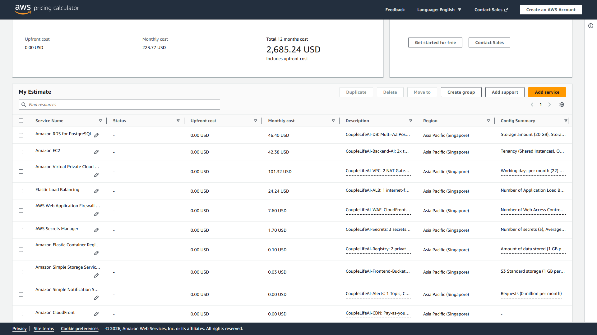
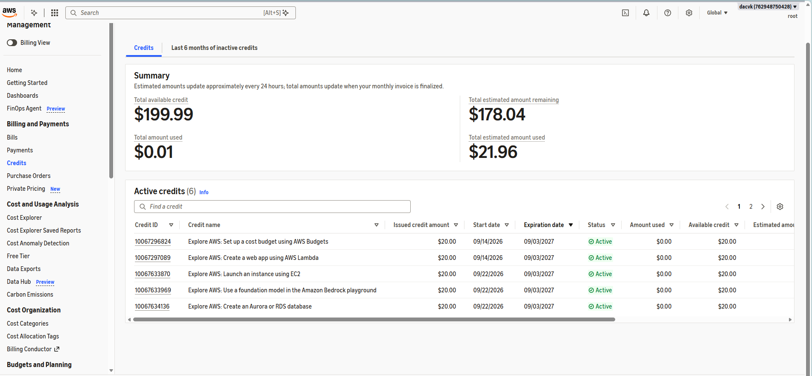

---
title: "Dự toán và tối ưu chi phí"
date: 2026-11-28
weight: 3
chapter: false
pre: " <b> 5.5.3. </b> "
---

Dự toán và quản lý chi phí là một phần quan trọng khi triển khai ứng dụng trên AWS. Trong Workshop này, hệ thống CoupleLife AI được thiết kế để cân bằng giữa hiệu suất, tính sẵn sàng cao và chi phí vận hành.

#### 1. Cấu hình và giả định dự toán

Sử dụng AWS Pricing Calculator để lập dự toán trước khi triển khai tài nguyên tại Region Singapore (ap-southeast-1).

Các thông số chính được sử dụng:

- 2 EC2 t3.small hoạt động liên tục, mỗi máy sử dụng 20 GiB gp3.
- Amazon RDS PostgreSQL db.t3.micro Multi-AZ, sử dụng 20 GiB gp3.
- 2 NAT Gateways, tổng lưu lượng dự kiến 10 GB/tháng.
- 4 public IPv4 dự kiến cho NAT Gateway và ALB.
- 1 Application Load Balancer với mức sử dụng trung bình giả định 1 LCU.
- CloudFront với 10 GB dữ liệu truyền ra và 100.000 HTTPS requests/tháng.
- AWS WAF với 1 Web ACL, 2 rules và dự trù 1 triệu requests/tháng.
- S3 và ECR dự trù 1 GB lưu trữ cho mỗi dịch vụ.
- Secrets Manager sử dụng 3 secrets và 100.000 API calls/tháng.

Thời gian hoạt động được quy đổi theo 730 giờ/tháng. Các thông số lưu lượng là giả định để lập dự toán, không phải kết quả đo tải thực tế.

#### 2. Kết quả AWS Pricing Calculator

Sau khi nhập cấu hình vào AWS Pricing Calculator, kiểm tra bảng tổng hợp chi phí của từng dịch vụ.

| Dịch vụ | Chi phí dự kiến (USD/tháng) |
|---|---:|
| Amazon VPC, NAT Gateways và Public IPv4 | 101,32 |
| Amazon RDS PostgreSQL | 46,40 |
| Amazon EC2 và EBS | 42,38 |
| Application Load Balancer | 24,24 |
| AWS WAF | 7,60 |
| AWS Secrets Manager | 1,70 |
| Amazon ECR | 0,10 |
| Amazon S3 | 0,03 |
| Amazon SNS | 0,00 |
| Amazon CloudFront | 0,00 |
| **Tổng cộng** | **223,77** |

CloudWatch, CloudTrail Event History và các dịch vụ hỗ trợ khác được dự kiến không phát sinh thêm chi phí trong phạm vi sử dụng giả định.

CloudFront sử dụng hình thức Pay-as-you-go. Chi phí thực tế phụ thuộc vào lưu lượng, hạn mức miễn phí và cấu hình sử dụng.

NAT Gateway là thành phần chiếm tỷ trọng chi phí lớn nhất. Tuy nhiên, hệ thống vẫn duy trì hai NAT Gateways và RDS Multi-AZ để đáp ứng yêu cầu High Availability.

Tham khảo:

- [AWS Pricing Calculator](https://calculator.aws/)
- [Dự toán chi phí CoupleLife AI](https://calculator.aws/#/estimate?id=01ec0aee30504f4a008d08d0db765ffb13d06485)

#### 3. Dự toán ngân sách trong 14 ngày

Kịch bản thực hành sử dụng ngân sách nội bộ 120 USD trong 14 ngày, với nguồn AWS Promotional Credits tối đa 200 USD nếu tài khoản đủ điều kiện.

Chi phí dự kiến trong 14 ngày:

223,77 × 336 / 730 ≈ 103,00 USD

| Hạng mục | Chi phí |
|---|---:|
| Dự toán mỗi tháng | 223,77 USD |
| Dự toán trong 14 ngày | 103,00 USD |
| Ngân sách nội bộ | 120,00 USD |
| Ngân sách dự phòng | 17,00 USD |

Mức dự phòng được sử dụng để xử lý các chi phí có thể phát sinh từ lưu lượng mạng, CloudWatch Logs, API requests và mức sử dụng tài nguyên thực tế.

Đây là kết quả quy đổi để lập kế hoạch, không phải hóa đơn AWS. Cần kiểm tra chi phí thường xuyên trong quá trình vận hành.

#### 4. Theo dõi AWS Credits và chi phí thực tế

1. Truy cập AWS Management Console.
2. Mở Billing and Cost Management.
3. Chọn Credits để kiểm tra số dư, thời hạn và điều kiện sử dụng AWS Credits.

4. Mở Cost Explorer, chọn khoảng thời gian cần theo dõi và Group by Service để xem chi phí của từng dịch vụ.
5. Mở Bills để kiểm tra các khoản phí và khoản Credits được khấu trừ.
6. Theo dõi AWS Budgets với các ngưỡng cảnh báo 50%, 80% và 100% đã cấu hình tại mục 5.2.2.

Nên theo dõi chi phí mỗi ngày để phát hiện mức sử dụng bất thường. Nếu thời gian triển khai đi qua hai tháng, cần kiểm tra tổng chi phí của cả hai tháng.

AWS Budgets hỗ trợ cảnh báo nhưng không phải giới hạn chi tiêu cứng. AWS Credits chỉ được áp dụng cho các khoản phí đủ điều kiện.

#### 5. Các phương pháp tối ưu chi phí

Kiến trúc CoupleLife AI áp dụng các phương pháp sau:

**Amazon CloudFront**

Cache nội dung tĩnh tại các Edge Locations, giúp giảm số lượng request đến origin và cải thiện tốc độ tải website. Không cache các API chứa dữ liệu cá nhân.

**S3 Gateway Endpoint**

Cho phép EC2 trong Private Subnets truy cập Amazon S3 thông qua Gateway Endpoint, giảm lưu lượng không cần thiết qua NAT Gateway.

**Tối ưu tài nguyên EC2**

Backend và AI Service được triển khai dưới dạng Docker containers trên cùng mỗi EC2, giúp tận dụng tài nguyên mà không cần tạo máy chủ riêng cho từng service.

**Sử dụng dịch vụ AI bên ngoài**

Sử dụng Groq API và Cloudflare Workers AI trong hạn mức miễn phí phù hợp, thay vì triển khai mô hình AI trên các EC2 GPU có chi phí cao.

**Quản lý tài nguyên và dữ liệu**

Theo dõi dung lượng Docker images trong ECR, dữ liệu trong S3 và thời gian lưu trữ CloudWatch Logs. Dọn dẹp những tài nguyên không còn cần thiết.

**Duy trì High Availability**

Giữ nguyên hai Availability Zones, hai NAT Gateways và RDS Multi-AZ để cân bằng giữa chi phí và khả năng duy trì dịch vụ khi xảy ra sự cố.

#### 6. Dọn dẹp tài nguyên sau khi hoàn thành

Sau khi hoàn thành Workshop, thực hiện Cleanup theo hướng dẫn tại mục 5.6 để tránh phát sinh chi phí ngoài dự kiến.

Kiểm tra lại Billing and Cost Management để xác nhận các tài nguyên tính phí đã được xử lý.

#### Kết luận

Với cấu hình và mức sử dụng giả định, chi phí triển khai CoupleLife AI trong 14 ngày khoảng 103 USD, nằm trong ngân sách nội bộ 120 USD.

Việc lập dự toán, theo dõi AWS Budgets, tối ưu mức sử dụng và dọn dẹp tài nguyên phù hợp với trụ cột Cost Optimization của AWS Well-Architected Framework.
