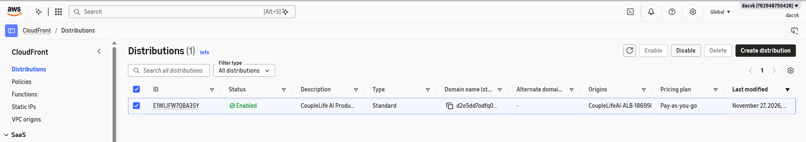
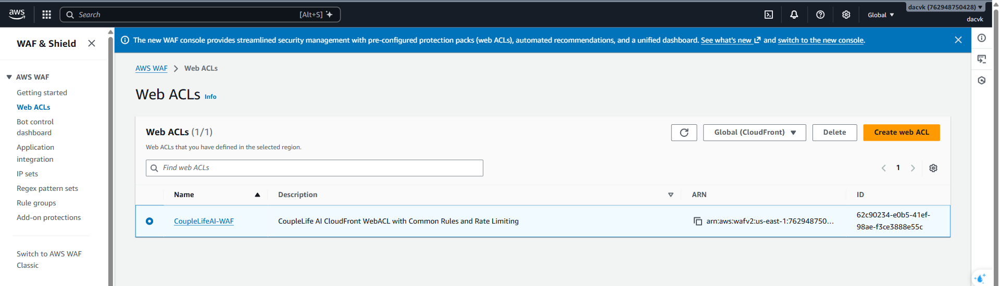
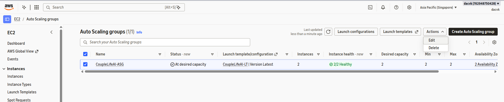
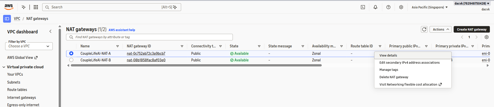
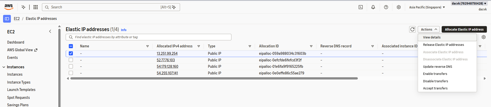
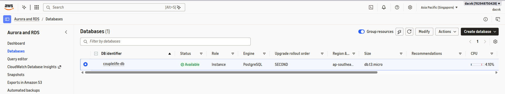
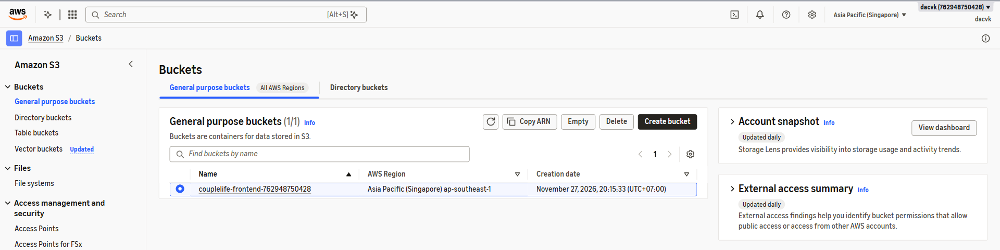
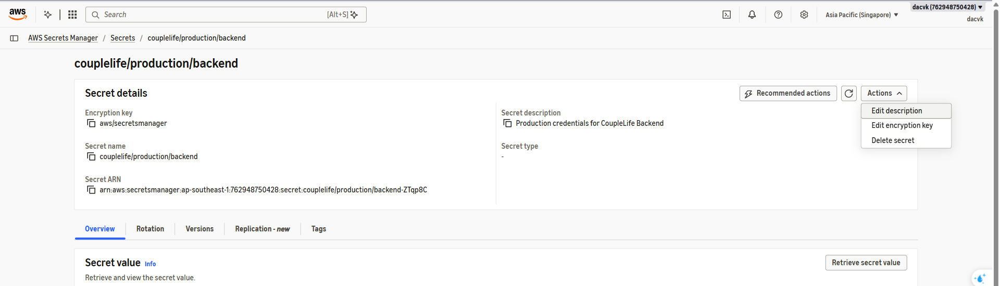
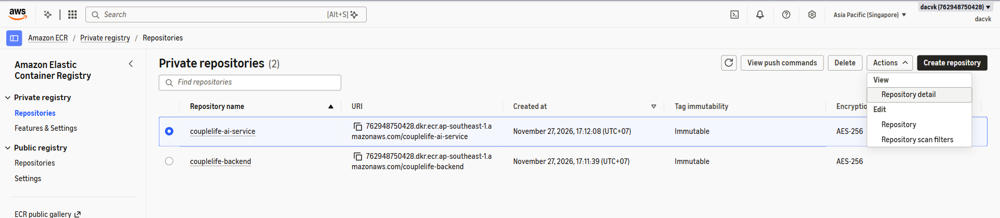
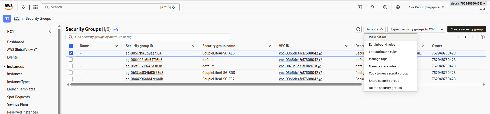

Congratulations on completing the CoupleLife AI Workshop on AWS. In this lab, you deployed an application across two Availability Zones using EC2, RDS PostgreSQL, S3 and CloudFront.

When you no longer need the application, remove the resources created during the lab to avoid further charges. Back up any data you want to keep. If automatic deployment is enabled, open GitHub → **Actions**, select the workflow and choose **Disable workflow** from the `...` menu.

{}
Delete only resources created in this lab. Check their names and VPC IDs before confirming. Do not delete the default VPC or resources used by other applications. Retained snapshots and backups may continue to incur charges.
{}

#### 1. Delete the CloudFront distribution and AWS WAF

1. Open the [CloudFront console](https://console.aws.amazon.com/cloudfront/v4/home) → **Distributions**.
2. Select the distribution created in section 5.4.4. Choose **Disable**, confirm and wait for the update to finish.
3. Select the distribution again, choose **Delete** and confirm.



4. Open AWS WAF → **Web ACLs**, select **Global (CloudFront)**, and select `CoupleLifeAI-WAF`. Remove any remaining distribution associations, then choose **Delete**. Skip this step if the ACL was removed with the distribution.



5. Return to CloudFront → **Origin access**, select the OAC created for the lab bucket and delete it. If you created a CloudFront Function for SPA routing, open **Functions** and delete it once it has no associations.

#### 2. Delete the Auto Scaling group and EC2 instances

1. Select the **Asia Pacific (Singapore)** Region. Open the [EC2 console](https://ap-southeast-1.console.aws.amazon.com/ec2/home?region=ap-southeast-1) → **Auto Scaling Groups**.
2. Select `CoupleLifeAI-ASG` → **Actions → Edit**. Set Desired, Minimum and Maximum capacity to `0`, then save.
3. Wait until all EC2 instances belonging to the group are terminated. Choose **Actions → Delete** and confirm.



4. In EC2 → **Launch Templates**, select `CoupleLifeAI-LT` → **Actions → Delete template**.
5. Open **Volumes** and **Snapshots**, then remove any unattached lab volumes and snapshots that you no longer need.

#### 3. Delete the Application Load Balancer

1. In EC2 → **Load Balancers**, select `CoupleLifeAI-ALB`. If deletion protection is enabled, open **Attributes → Edit** to turn it off.
2. Choose **Actions → Delete load balancer** and confirm.
3. Once the ALB has been deleted, open **Target Groups**, select `CoupleLifeAI-TG` → **Actions → Delete**.

#### 4. Delete NAT gateways and release Elastic IPs

1. Open the [VPC console](https://ap-southeast-1.console.aws.amazon.com/vpcconsole/home?region=ap-southeast-1) → **NAT gateways**. Select `CoupleLifeAI-NAT-A` and record the Elastic IP allocation ID from its details. Repeat for NAT-B.
2. Select `CoupleLifeAI-NAT-A` → **Actions → Delete NAT gateway** and confirm. Repeat for `CoupleLifeAI-NAT-B`.



3. Wait for both NAT gateways to reach Deleted. Open **Elastic IPs**, select the address matching the recorded allocation ID, check that it is no longer associated, then choose **Actions → Release Elastic IP addresses**. Repeat for the second address.



Deleting a NAT gateway does not release its Elastic IP. Do not select unrelated addresses or addresses managed by the ALB.

#### 5. Delete RDS PostgreSQL

1. Open the [RDS console](https://ap-southeast-1.console.aws.amazon.com/rds/home?region=ap-southeast-1) → **Databases**, then select `couplelife-db`.
2. If deletion protection is enabled, choose **Modify**, turn it off and apply the change. Choose **Actions → Delete**.



3. Create a final snapshot if you need to retain data. Otherwise, deselect the final snapshot option and choose to delete automated backups. Enter the confirmation text requested by the console and choose **Delete**.
4. After the DB is deleted, open **Subnet groups**, select `couplelife-db-subnet-group` and choose **Delete**. Check **Snapshots** and **Automated backups** and delete copies you no longer need.

#### 6. Delete the S3 bucket

1. Open the [Amazon S3 console](https://s3.console.aws.amazon.com/s3/home?region=ap-southeast-1) → **Buckets**.
2. Select the frontend bucket created in section 5.4.4, choose **Empty**, enter the requested confirmation and wait for completion. If versioning is enabled, check versions and delete markers; abort incomplete multipart uploads if any remain.
3. Return to the list, select the bucket → **Delete**, enter the bucket name and confirm.



#### 7. Delete Secrets Manager secrets and ECR repositories

1. Open **Secrets Manager → Secrets**, select `couplelife/production/backend` → **Actions → Delete secret**. Choose a suitable recovery window and confirm. Repeat for `couplelife/production/ai-service`. Check the RDS-managed secret after deleting the database.



2. Open **Amazon ECR → Private registry → Repositories**. Select `couplelife-backend` → **Delete**. Confirm deletion of the repository and its images if they are no longer needed. Repeat for `couplelife-ai-service`.



3. Revoke any Groq and Cloudflare API keys dedicated to the application in their respective dashboards when no longer needed.

#### 8. Delete CloudWatch alarms and the SNS topic

1. Open **CloudWatch → Alarms → All alarms**, select `CoupleLifeAI-UnhealthyHosts-Alarm` and `CoupleLifeAI-ASG-HighCPU-Alarm` → **Actions → Delete**.
2. In **Log groups** and **Dashboards**, remove lab-specific log groups or dashboards if created and no longer needed. Do not delete shared logs.
3. Open **Amazon SNS → Topics**, select `CoupleLifeAI-Alerts` → **Delete** and confirm. The default CloudTrail Event History does not need to be deleted. If you created a separate trail, remove the trail and its dedicated log bucket when no longer needed.

#### 9. Delete the VPC endpoint and security groups

1. Open VPC → **Endpoints**, select `CoupleLifeAI-S3-Endpoint` → **Actions → Delete VPC endpoints** and confirm.
2. Open **Security groups** and filter by the lab VPC. Select `CoupleLifeAI-SG-RDS`, `CoupleLifeAI-SG-EC2` and `CoupleLifeAI-SG-ALB` in that order → **Actions → Delete security groups**.



If deletion is blocked by a dependency, check that EC2, ALB and RDS have been removed. Remove rules referencing the group from the remaining lab security groups, then retry.

#### 10. Delete the IAM role and VPC

1. Open IAM → **Roles**, select `CoupleLifeAI-EC2-Role` → **Delete** and confirm. If an instance profile is still attached, remove the role from it and delete the lab-specific profile. If you created a separate GitHub deployment role, delete it when no longer required; keep the OIDC provider if other repositories use it.
If an instance profile needs to be removed using the CLI, open the terminal configured in section 5.2. The first command lists profiles attached to the role; run the next two only for a profile created in this lab. Replace `PROFILE_NAME` with its name, then return to IAM Roles to delete the role.

```bash
aws iam list-instance-profiles-for-role --role-name CoupleLifeAI-EC2-Role --profile couplelife-lab
aws iam remove-role-from-instance-profile --instance-profile-name PROFILE_NAME --role-name CoupleLifeAI-EC2-Role --profile couplelife-lab
aws iam delete-instance-profile --instance-profile-name PROFILE_NAME --profile couplelife-lab
```

2. Open VPC → **Your VPCs**, select `CoupleLifeAI-vpc` → **Actions → Delete VPC**. Review the subnets, route tables, Internet Gateway and other components that will be removed with the VPC. Enter the requested confirmation and choose **Delete**. If a dependency blocks deletion, remove the dependent lab resource first and retry.

#### 11. Check costs after cleanup

1. Reopen EC2, NAT gateways, Elastic IPs, RDS, S3 and CloudFront to verify that the deleted resources are gone. Also check for remaining EBS volumes, snapshots, ECR repositories and log groups.
2. Open **Billing and Cost Management → Cost Explorer**, select the usage period and **Group by → Service** to review charges. Billing data can be delayed; check again over the next few days.
3. After reviewing charges, open **AWS Budgets**, select `CoupleLifeAI-Budget` → **Delete** if you no longer need it.

Charges incurred before cleanup remain on your bill. Review the storage costs of any resources or backups you choose to retain.
