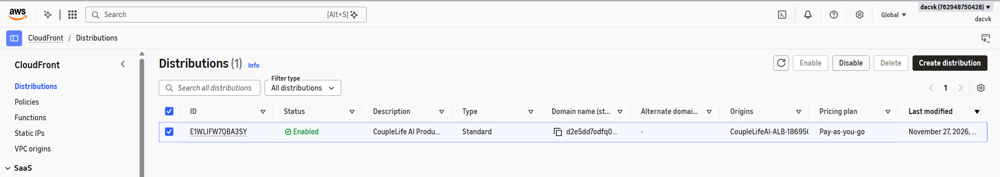
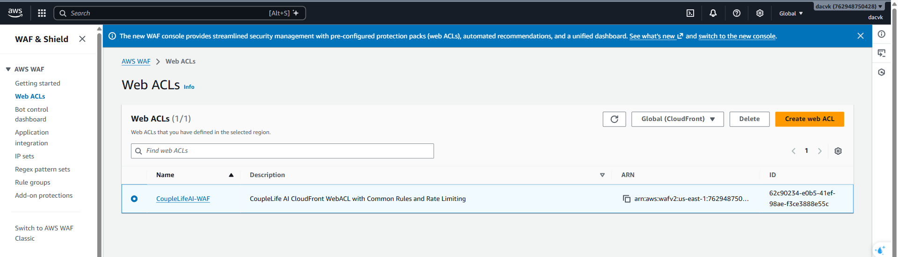
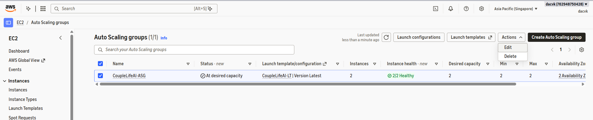
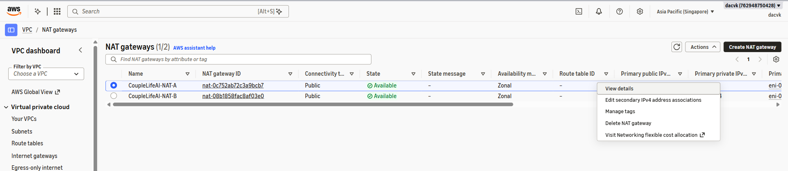
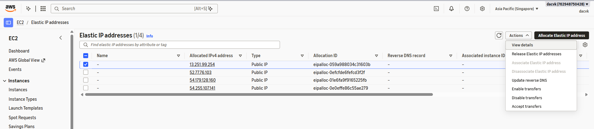
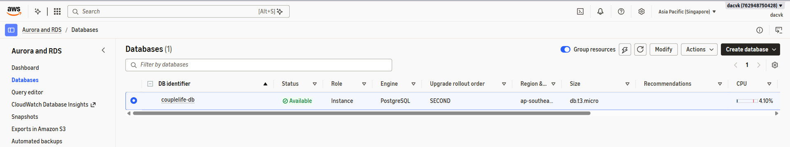
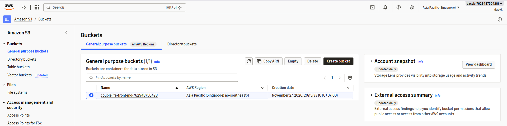
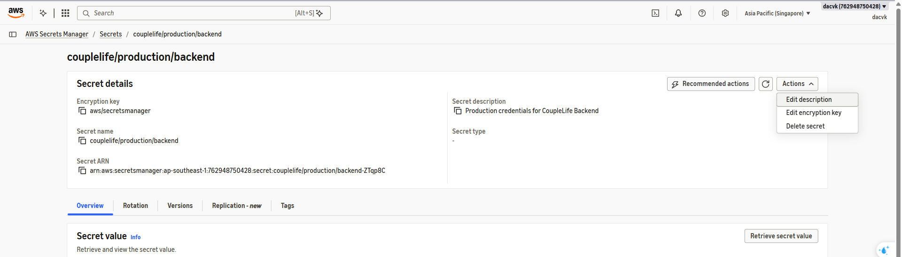
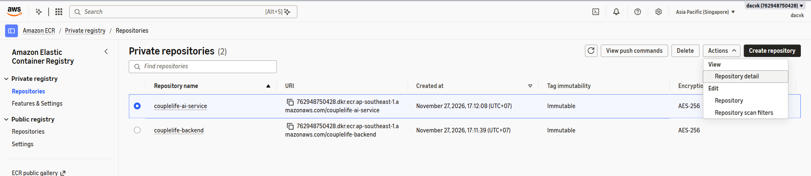
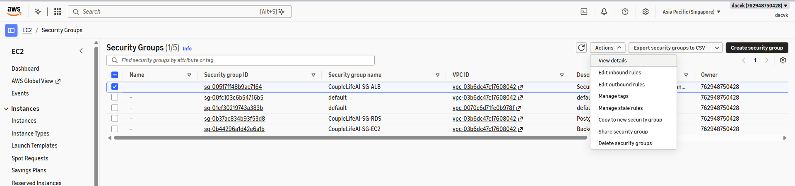

Chúc mừng bạn đã hoàn thành Workshop triển khai CoupleLife AI trên AWS. Bạn đã đưa ứng dụng lên hai Availability Zones, sử dụng EC2, RDS PostgreSQL, S3 và CloudFront.

Khi không còn sử dụng ứng dụng, hãy dọn dẹp các tài nguyên đã tạo để tránh phát sinh chi phí. Trước khi bắt đầu, sao lưu dữ liệu cần giữ. Nếu đã bật workflow tự động triển khai, vào GitHub → **Actions**, chọn workflow và chọn **Disable workflow** trong menu `...`.

{}
Chỉ xóa tài nguyên đã tạo trong bài thực hành. Kiểm tra tên và VPC ID trước khi xác nhận. Không xóa Default VPC hoặc tài nguyên của ứng dụng khác. Snapshot và backup giữ lại có thể tiếp tục tính phí.
{}

#### 1. Xóa CloudFront Distribution và AWS WAF

1. Mở [CloudFront Console](https://console.aws.amazon.com/cloudfront/v4/home) → **Distributions**.
2. Chọn distribution đã tạo ở mục 5.4.4. Nhấn **Disable**, xác nhận và chờ cập nhật hoàn tất.
3. Chọn lại distribution, nhấn **Delete** và xác nhận.



4. Mở AWS WAF → **Web ACLs**, chọn phạm vi **Global (CloudFront)**. Chọn `CoupleLifeAI-WAF`, gỡ các liên kết của distribution nếu còn, sau đó nhấn **Delete**. Bỏ qua nếu ACL đã được xóa cùng distribution.



5. Quay lại CloudFront → **Origin access**, chọn OAC đã tạo cho bucket của bài và xóa. Nếu đã tạo CloudFront Function cho SPA routing, mở **Functions** và xóa function sau khi không còn association.

#### 2. Xóa Auto Scaling Group và EC2

1. Chọn Region **Asia Pacific (Singapore)**. Mở [EC2 Console](https://ap-southeast-1.console.aws.amazon.com/ec2/home?region=ap-southeast-1) → **Auto Scaling Groups**.
2. Chọn `CoupleLifeAI-ASG` → **Actions → Edit**. Đặt Desired capacity, Minimum capacity và Maximum capacity bằng `0`, lưu thay đổi.
3. Chờ tất cả EC2 thuộc group chuyển sang Terminated. Chọn **Actions → Delete** và xác nhận xóa ASG.



4. Trong EC2 → **Launch Templates**, chọn `CoupleLifeAI-LT` → **Actions → Delete template**.
5. Mở **Volumes** và **Snapshots**, xóa các volume không còn gắn và snapshot của bài mà bạn không cần giữ.

#### 3. Xóa Application Load Balancer

1. Trong EC2 → **Load Balancers**, chọn `CoupleLifeAI-ALB`. Nếu bật deletion protection, vào **Attributes → Edit** để tắt.
2. Chọn **Actions → Delete load balancer** và xác nhận.
3. Khi ALB đã được xóa, mở **Target Groups**, chọn `CoupleLifeAI-TG` → **Actions → Delete**.

#### 4. Xóa NAT Gateway và giải phóng Elastic IP

1. Mở [VPC Console](https://ap-southeast-1.console.aws.amazon.com/vpcconsole/home?region=ap-southeast-1) → **NAT gateways**. Chọn `CoupleLifeAI-NAT-A`. Ghi lại Allocation ID của Elastic IP trong thông tin gateway; thực hiện tương tự với NAT-B.
2. Chọn `CoupleLifeAI-NAT-A` → **Actions → Delete NAT gateway**, xác nhận. Lặp lại với `CoupleLifeAI-NAT-B`.



3. Chờ hai NAT Gateway chuyển sang Deleted. Mở **Elastic IPs**, chọn đúng địa chỉ có Allocation ID vừa ghi lại, kiểm tra không còn association, rồi chọn **Actions → Release Elastic IP addresses**. Lặp lại cho địa chỉ thứ hai.



Xóa NAT Gateway không tự giải phóng Elastic IP. Không chọn các địa chỉ khác trong danh sách hoặc địa chỉ do ALB quản lý.

#### 5. Xóa RDS PostgreSQL

1. Mở [RDS Console](https://ap-southeast-1.console.aws.amazon.com/rds/home?region=ap-southeast-1) → **Databases**, chọn `couplelife-db`.
2. Nếu bật deletion protection, chọn **Modify**, tắt tùy chọn này và áp dụng thay đổi. Sau đó chọn **Actions → Delete**.



3. Nếu cần giữ dữ liệu, tạo final snapshot. Nếu không cần giữ dữ liệu, bỏ chọn final snapshot và chọn xóa automated backups. Nhập nội dung xác nhận theo yêu cầu của Console và nhấn **Delete**.
4. Sau khi DB đã được xóa, mở **Subnet groups**, chọn `couplelife-db-subnet-group` và nhấn **Delete**. Kiểm tra **Snapshots** và **Automated backups**, xóa các bản không cần giữ.

#### 6. Xóa S3 bucket

1. Mở [Amazon S3 Console](https://s3.console.aws.amazon.com/s3/home?region=ap-southeast-1) → **Buckets**.
2. Chọn bucket frontend đã tạo ở mục 5.4.4, nhấn **Empty**, nhập nội dung xác nhận theo yêu cầu và đợi quá trình hoàn tất. Nếu bật versioning, kiểm tra cả versions và delete markers; hủy multipart upload chưa hoàn tất nếu có.
3. Quay lại danh sách, chọn bucket → **Delete**, nhập tên bucket và xác nhận.



#### 7. Xóa Secrets Manager và ECR

1. Mở **Secrets Manager → Secrets**, chọn `couplelife/production/backend` → **Actions → Delete secret**. Chọn thời gian khôi phục phù hợp và xác nhận. Lặp lại với `couplelife/production/ai-service`. Kiểm tra secret do RDS quản lý sau khi DB đã bị xóa.



2. Mở **Amazon ECR → Private registry → Repositories**. Chọn `couplelife-backend` → **Delete**. Xác nhận xóa repository và images nếu không cần giữ. Lặp lại với `couplelife-ai-service`.



3. Thu hồi các API key Groq và Cloudflare dành riêng cho ứng dụng trong dashboard tương ứng nếu không còn sử dụng.

#### 8. Xóa CloudWatch alarms và SNS topic

1. Mở **CloudWatch → Alarms → All alarms**, chọn `CoupleLifeAI-UnhealthyHosts-Alarm` và `CoupleLifeAI-ASG-HighCPU-Alarm` → **Actions → Delete**.
2. Trong **Log groups** và **Dashboards**, xóa các nhóm log hoặc dashboard riêng của bài nếu đã tạo và không cần lưu. Không xóa log dùng chung.
3. Mở **Amazon SNS → Topics**, chọn `CoupleLifeAI-Alerts` → **Delete** và xác nhận. CloudTrail Event History mặc định không cần xóa; nếu đã tạo trail riêng thì xóa trail và log bucket riêng không cần giữ.

#### 9. Xóa VPC Endpoint và Security Groups

1. Mở VPC → **Endpoints**, chọn `CoupleLifeAI-S3-Endpoint` → **Actions → Delete VPC endpoints** và xác nhận.
2. Mở **Security groups**, lọc theo VPC của bài. Chọn lần lượt `CoupleLifeAI-SG-RDS`, `CoupleLifeAI-SG-EC2` và `CoupleLifeAI-SG-ALB` → **Actions → Delete security groups**.



Nếu không xóa được do dependency, kiểm tra EC2, ALB và RDS đã xóa xong chưa. Trong các security group còn lại, gỡ rule tham chiếu đến group cần xóa rồi thử lại.

#### 10. Xóa IAM Role và VPC

1. Mở IAM → **Roles**, chọn `CoupleLifeAI-EC2-Role` → **Delete** và xác nhận. Nếu Console báo còn instance profile, gỡ role khỏi profile rồi xóa profile riêng của bài. Nếu đã tạo role riêng cho GitHub Actions, xóa role đó khi không còn sử dụng; giữ OIDC provider nếu repository khác vẫn dùng.
Nếu cần gỡ instance profile bằng CLI, mở terminal đã cấu hình ở mục 5.2. Lệnh đầu tiên liệt kê đúng instance profile gắn với role; chỉ chạy hai lệnh sau nếu profile đó được tạo cho bài thực hành. Thay `PROFILE_NAME` bằng tên vừa tìm, rồi quay lại IAM Roles để xóa role.

```bash
aws iam list-instance-profiles-for-role --role-name CoupleLifeAI-EC2-Role --profile couplelife-lab
aws iam remove-role-from-instance-profile --instance-profile-name PROFILE_NAME --role-name CoupleLifeAI-EC2-Role --profile couplelife-lab
aws iam delete-instance-profile --instance-profile-name PROFILE_NAME --profile couplelife-lab
```

2. Mở VPC → **Your VPCs**, chọn `CoupleLifeAI-vpc` → **Actions → Delete VPC**. Kiểm tra danh sách subnet, route table, Internet Gateway và các thành phần sẽ bị xóa cùng VPC. Nhập nội dung xác nhận và chọn **Delete**. Nếu Console báo còn dependency, xóa tài nguyên phụ thuộc của bài trước rồi thử lại.

#### 11. Kiểm tra chi phí sau khi dọn dẹp

1. Mở lại EC2, NAT gateways, Elastic IPs, RDS, S3 và CloudFront để kiểm tra các tài nguyên đã xóa. Kiểm tra cả EBS, snapshots, ECR và log groups còn sót.
2. Mở **Billing and Cost Management → Cost Explorer**, chọn khoảng thời gian sử dụng và **Group by → Service** để kiểm tra chi phí. Dữ liệu hóa đơn có thể cập nhật chậm; kiểm tra lại trong vài ngày.
3. Sau khi đối soát chi phí xong, mở **AWS Budgets**, chọn `CoupleLifeAI-Budget` → **Delete** nếu không còn cần theo dõi.

Chi phí phát sinh trước khi dọn dẹp vẫn được ghi nhận trên hóa đơn. Với tài nguyên hoặc bản sao lưu còn giữ lại, kiểm tra và tính cả chi phí lưu trữ tương ứng.
